<h1 align="center">Hyper Fusion ALPHA</h1>

<p align="center"><strong>Your workspace. Your colors. Your kind of Linux desktop.</strong><br>A complete Xetal desktop for Hyprland, with native settings, custom menus, KVM tools and a little Compiz nostalgia.</p>

<p align="center">
  <a href="#three-ways-to-install-hyper-fusion">Install</a> ·
  <a href="#tested-on">Tested on</a> ·
  <a href="#four-looks-one-desktop">Themes</a> ·
  <a href="#compiz-spirit-hyprland-desktop">Effects</a> ·
  <a href="#kvm-settings">KVM</a> ·
  <a href="docs/GALLERY.md">Gallery</a> ·
  <a href="#documentation">Documentation</a>
</p>

[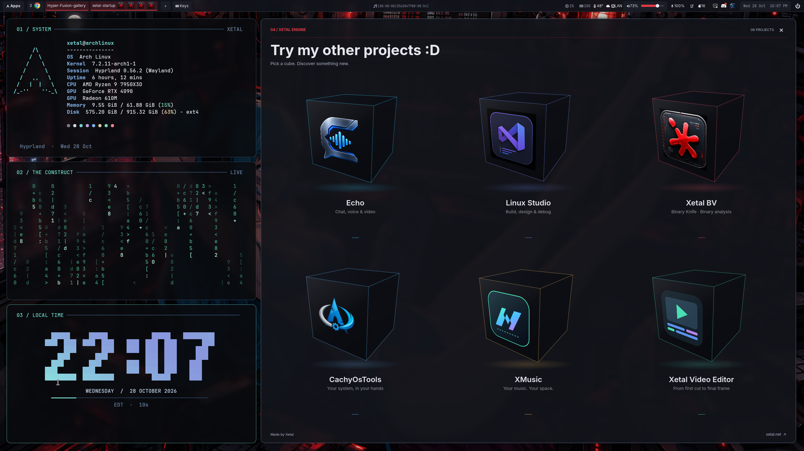](docs/GALLERY.md)

<!-- GitHub renders this attachment as an inline video player. -->
https://github.com/user-attachments/assets/8a20af5b-ec30-4bbb-ad7f-06d4e392a57d

<p align="center"><sub>48-second desktop tour · Original 1440p recording · <a href="docs/GALLERY.md">Explore the full gallery</a></sub></p>

## Three ways to install Hyper Fusion

**[Download the ONLINE and OFFLINE Arch Linux ISOs](https://drive.google.com/drive/folders/1bkAs8SiMqnbCihzMGPYzlOXB5mXGfs_Y?usp=sharing)** — both installers are in this shared Google Drive folder.

1. **Install it on your existing system**

   Download or clone the [GitHub repository](https://github.com/XetalEngine/x_hyperland), open a terminal in the repository folder, and run the installer as your regular desktop user. Make it executable first if needed:

   ```bash
   chmod +x x_hyperinstall.sh
   ./x_hyperinstall.sh
   ```

   See the [detailed installation instructions](#install) below.

2. **Install the custom Arch Linux OFFLINE ISO**

   This is the version installed in the video above. It includes Arch Linux, KDE, and the entire Hyper Fusion system.

3. **Install the custom Arch Linux ONLINE ISO**

   This includes the same setup as the offline version, but downloads the packages from the Arch Linux servers during installation. Since Arch is a rolling release, future package or library changes could cause compatibility issues.

[**GitHub repository**](https://github.com/XetalEngine/x_hyperland) — feel free to contribute ideas or submit pull requests!

---

Hyper Fusion brings the whole desktop together: a launcher you can arrange yourself, coordinated visual styles, a configurable taskbar, native settings, themed file tools, virtual-machine management and original Compiz effects adapted to Hyprland. The graphical installer builds the included desktop components for your system, and the updater keeps your personal choices between releases.

Fresh installations use **Use Other Icons → Papirus-Dark**. Desktop updates preserve your saved icon choices.

**Control Panel → Software & maintenance → Proton** includes our custom Windows application manager, with isolated prefixes, Proton downloads, dependencies and launch controls. [See it in action below.](#windows-apps-with-our-custom-proton-manager)

## Tested on

<table>
  <tr>
    <td align="center" width="20%"><a href="https://archlinux.org/"><br><strong>Arch Linux</strong></a></td>
    <td align="center" width="20%"><a href="https://cachyos.org/"><br><strong>CachyOS</strong></a></td>
    <td align="center" width="20%"><a href="https://manjaro.org/"><br><strong>Manjaro</strong></a></td>
    <td align="center" width="20%"><a href="https://fedoraproject.org/"><br><strong>Fedora</strong></a></td>
    <td align="center" width="20%"><a href="https://www.debian.org/"><br><strong>Debian</strong></a></td>
  </tr>
</table>

| Distribution | Current testing and installation scope |
| --- | --- |
| **Arch Linux** | Development desktop and fresh-install testing; automatic setup on x86-64. |
| **CachyOS** | Fresh-install testing; automatic x86-64 setup, with repository checks for v3/v4 packages. |
| **Manjaro** | Project-reported testing and stable-repository compatibility checks; uses the Arch-family setup path. |
| **Fedora 44** | Native x86-64 RPM setup, desktop build and recovery checks; graphical VM testing is ongoing. Targets mutable Workstation/KDE installations. |
| **Debian 13 (trixie)** | Native x86-64 DEB bundle, clean-container installation and complete desktop build; graphical VM login testing is pending. |

These notes describe project testing, not certification of every release or GPU. Setup checks the recipient's repositories and dependencies before changing the compositor. Fedora Atomic/OSTree editions, Ubuntu and other Debian releases are outside the current automatic setup paths. See [dependencies and compatibility](docs/DEPENDENCIES.md) for the exact scope.

> **Control Panel compatibility:** Some features currently work **only on Arch-based systems, until further notice**. These include Pacman/Paru/Yay, Arch package repair and kernel-management tools. Fedora and Debian desktop support do not provide distribution-specific equivalents for these features.

## Install

Open a terminal in your graphical Linux session and run as your **regular desktop user**:

```bash
git clone --depth 1 https://github.com/XetalEngine/x_hyperland.git
cd x_hyperland
./x_hyperinstall.sh
```

Prefer a ZIP? Choose **Code → Download ZIP**, extract the entire archive, open a terminal in `x_hyperland-main`, and run `bash ./x_hyperinstall.sh`. A Git checkout is not required. When testing a newer download, extract it into a new folder.

**Hyper Fusion Setup** guides you through Welcome → Your setup → Review → Install → Ready.

- Adapts monitor resolution, placement and scale to your computer.
- Lets you keep existing desktop/startup preferences or install the current defaults.
- Offers an **optional Fusion sign-in screen** with your theme, animated account photo, account selector and installed desktop sessions, including Hyprland, KDE Plasma and XFCE. It is off by default; selecting it reveals a warning with the changed files, backup location and console recovery command. Take a picture of that warning before continuing.
- Installs required packages with a separate administrator-password prompt and builds native components locally. The Control Panel uses all available CPU threads.
- Shows an expanded installation log that grows with the window; **Installing…** stays disabled until the operation finishes. Failed steps show their useful diagnostic and a **Retry** action.
- Backs up the existing profile and validates the complete configuration before replacement. Package recovery is prepared before changing the compositor.

When Setup finishes, **log out, select Hyprland and sign in again**. Your current session is not forcibly restarted. The desktop keeps its themes, Dolphin profile and startup helpers separate from KDE/Plasma and shared desktop preferences.

### One tested compositor version

This release uses **Hyprland 0.56.2** and its exact tested source commit so the desktop, **Cube**, **Burn** and **Minimize** stay compatible. Setup installs or downgrades to that version and applies the appropriate package holds.

| Included runtime | Download ZIP contains |
| --- | --- |
| **Arch family** | Signed official Hyprland **0.56.2-4** package — **51.3 MB**. |
| **Fedora 44** | Signed **0.56.2-6.fc44** runtime, matching libraries and headers — **55.9 MB**; corresponding LGPL source RPMs add **55.4 MB** separately. |
| **Debian 13** | Native **0.56.2** runtime, matching headers/libraries, Waybar, Kitty and SDL3 — **22.3 MB ZIP**; corresponding sources are included separately. |

Each bundled package is below 100 MB. Fedora packages come from the documented giperborey/Hyprland COPR publisher; Setup verifies them without enabling a COPR repository. Other desktop dependencies still download as needed. Future compositor changes go through foreground Setup together with matching desktop/effect builds. [Installer, signatures and recovery →](docs/INSTALLER.md)

<details>
<summary><strong>Terminal options and troubleshooting</strong></summary>

```bash
./x_hyperinstall.sh --cli                          # Use the terminal installer
./x_hyperinstall.sh --check                        # Check dependencies and versions
./x_hyperinstall.sh --dry-run                      # Preview the installation plan
./x_hyperinstall.sh --skip-packages                # Use dependencies already installed
./x_hyperinstall.sh --prepare /tmp/fusion-review   # Build/validate a new review directory
./x_hyperinstall.sh --fusion-login                 # Opt in to Fusion sign-in; back up system login settings
./x_hyperinstall.sh --no-fusion-login              # Restore the login settings saved before opting in
./x_hyperinstall.sh --restore /path/to/backup       # Use the backup path printed by Setup
```

The installation log is `~/.local/state/xetal-hyprland/setup.log`. Include the source revision and the first compiler/package error when reporting a failure. Setup keeps the existing desktop profile if preparation fails. If it changed the compositor, its recovery path restores the previous runtime; successfully installed ordinary dependencies remain available for a retry.

On 0.56.2, the brief `.conf` deprecation notice refers to a future Hyprland format change. The pinned release still supports this configuration. [Compatibility notes →](docs/DEPENDENCIES.md)

</details>

## Four looks. One desktop.

| Xetal Raw | Xetal Modern |
| :---: | :---: |
| [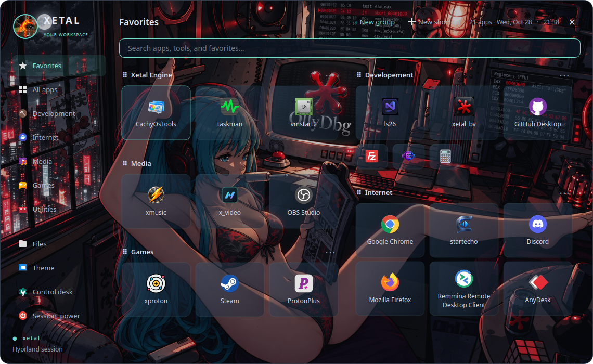](docs/screenshots/apps-raw.png) | [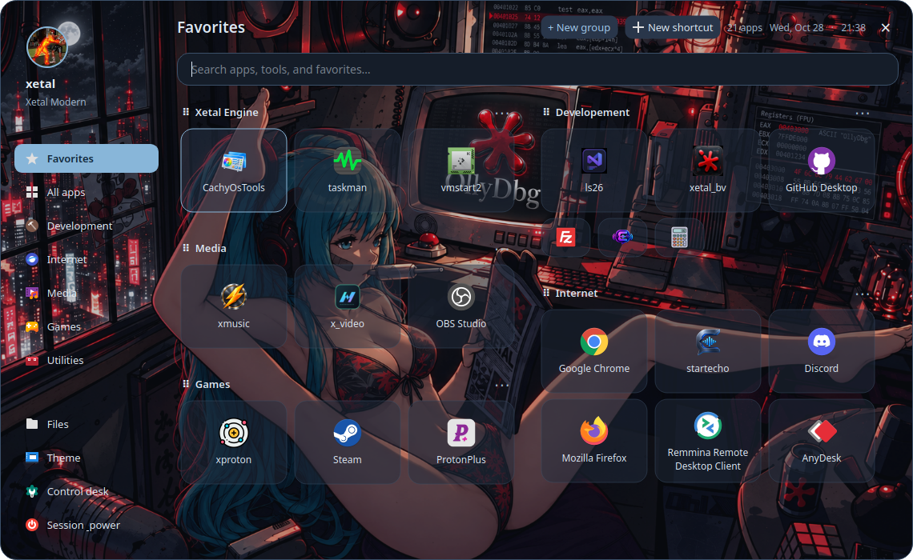](docs/screenshots/apps-modern.png) |
| Cyan accents and transparent surfaces | Soft blue cards and a Home overview |

| BreakPoint | Binary Knife |
| :---: | :---: |
| [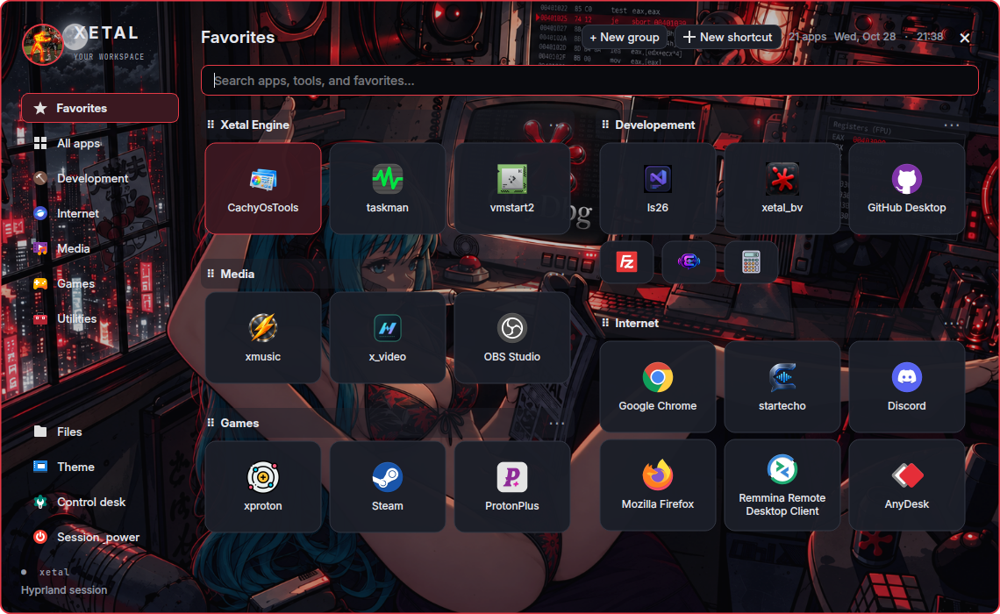](docs/screenshots/apps-breakpoint.png) | [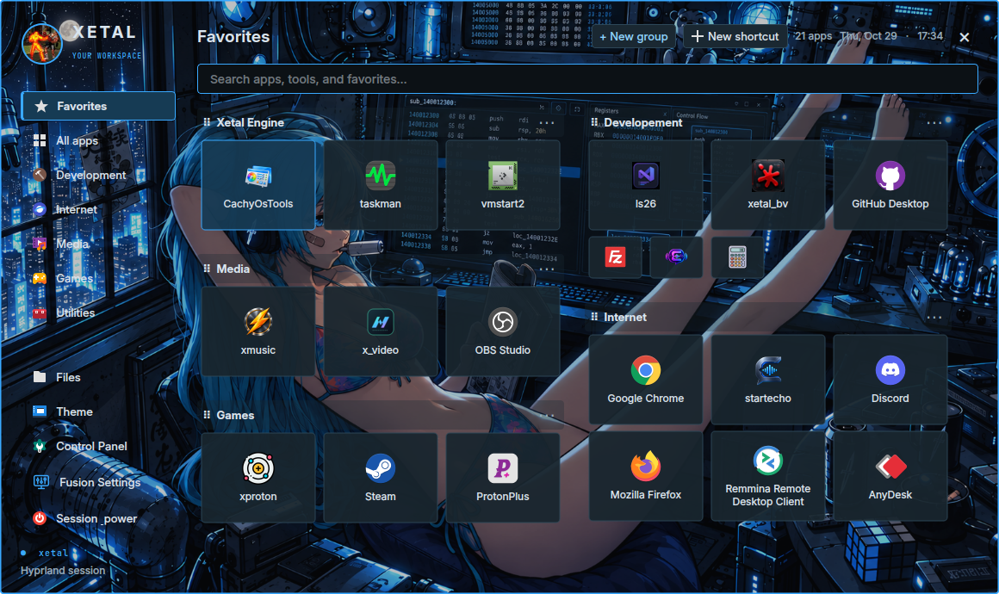](docs/screenshots/apps-binaryknife.png) |
| Charcoal glass and crimson highlights | Graphite panels and electric blue edges |

Colors follow you through Apps, the taskbar, Fusion Settings, Control Panel, KVM, file pickers, notifications, lock screen and session tools. Choose **Dark**, **Light** or **High contrast**, with a separate wallpaper for each monitor.

Fresh installations start with **Hollow Grove · Dark**. The cube includes Gilded Hollow's **Lantern Crossing** ceiling and **The Gilded Hollow** floor, a moving image sky, 65% wall opacity and raised windows. Cube, 3D-window and Wobbly defaults use the tuned desktop settings; upgrades retain existing preferences.

**Fusion Settings → Theme** lets you mix the pieces: any Start menu with any palette, Classic/Modern/Gallery/Studio navigation, an account picture or animated GIF, menu backgrounds and transparency, custom cursors, task switchers and transfer animations. **Apply theme** lets you choose which components change. Save your combination as a named **Custom** preset and restore it selectively later.

**Mix & match** brings the independent styles together in one quick editor. Its applied choices persist and stay synchronized with the detailed tabs, without creating another preset. Fusion Files' optional **Selection marker** starts **Off** in every theme; choose a Glass curve or Ink line in **Design** or **Mix & match**. Mouse effects include a separate **General effects** gallery and an **Enable mouse trail** switch.

The **Presets** gallery shows every theme in a full-width banner. Search by name, color or mood; hover or keyboard-focus the right side to reveal its wallpapers. Expanded collections use a grid of previews that widens on hover or focus when needed. The previews disappear when you move away. Choose the banner to select which parts of the theme to apply. **File Transfer** has an independently scrolling style column, with a responsive live preview and settings beside it. Each theme includes its own three-screen default wallpaper set, with extra artwork available individually where included. The [gallery](docs/GALLERY.md) shows the original Xetal World designs, their tools and artwork.

**[Midnight Transit](config/hypr/theme/MIDNIGHT_TRANSIT.md)** brings teal enamel, cream pinstripes and amber station lights to the whole desktop, with its own Platform Twelve minimize container, icons, cursor, transfer animation, sound pack and three rainy railway wallpapers.

**[Blackwood](config/hypr/theme/BLACKWOOD.md)** pairs walnut headers and aged-brass fittings with sage controls and serif text. Its Harbour Cabinet minimize dock, brass icons and cursor, document-boat transfers and Harbour bells accompany three original coastal wallpapers.

**[Atomic Afterglow](config/hypr/theme/ATOMIC_AFTERGLOW.md)** combines olive graphite, brass fittings and phosphor green. Its Containment Bay minimize dock, atomic icons, custom cursor, continuously orbiting file transfers and Phosphor signals sound pack accompany three original research-complex wallpapers.

**[Mycelium](config/hypr/theme/MYCELIUM.md)** brings plum velvet, lilac mushroom caps and ivory roots to the desktop. Its Spore Cradle minimize container, woodland icons, mushroom cursor, continuously drifting file transfers and Spore songs accompany three original enchanted-forest wallpapers.

**[Platform 95](config/hypr/theme/PLATFORM95.md)** brings classic ivory bevels, espresso headers and antique-gold selections to the desktop. Gold folders, a clock cursor, luggage-cart transfers, the Parcel Shelf minimize dock and Golden departure sounds accompany three original railway wallpapers. Light mode follows the concept, with dark and high-contrast alternatives.

**[Midnight Run](config/hypr/theme/MIDNIGHT_RUN.md)** brings rainy Tokyo nights to the desktop: graphite surfaces, cyan edges, magenta selections and neon outline icons. Its wheel cursor, courier-car file transfers, Neon Pit Lane minimize dock and After-hours signals sound pack accompany nine original wallpapers. The original sedan, expressway and sakura canal scenes remain, alongside three Audi Avant scenes and three slammed black **2014 Audi A4 sedan** wallpapers: Sakura Stance, Neon Profile and Midnight Return. The A4 trio follows the neon Tokyo concept from front, side and rear angles, with tucked silver wheels and a very low stance. Dark, light and high-contrast modes are included.

**[Infernal Encore](config/hypr/theme/INFERNAL_ENCORE.md)** turns the desktop into a gothic concert stage: blackened metal, brass bevels, crimson switches and riveted folder icons. The Infernal Blade cursor, speaker-to-speaker file transfers, Amplifier Rack minimize dock and Backstage signals sound pack accompany three original wallpapers: a fiery live performance, a cathedral venue and an ember-lit backstage guitar. Includes dark, light and high-contrast modes.

**[Polaris](config/hypr/theme/POLARIS.md)** pairs midnight navy glass with luminous cyan controls and violet depth. Sapphire folder icons, the Starlight cursor, orbital document transfers, the Orbital Glass minimize dock and Northern lights sounds accompany three original wallpapers: Tux Starlight, Northern Lights and Orbital Glass. Dark, light and high-contrast modes are included.

Tidal Glass, Porcelain Ink, Obsidian Forge, and **Candy Cloud** bring four distinct atmospheres to the gallery. Obsidian Forge pairs machined basalt panels and copper edges with three original volcanic wallpapers: Basalt Reach, The Forge, and Ashen Observatory. Its Cinder wake mouse trail lifts embers from a cooling fissure; its file-transfer animation carries glowing documents through basalt presses.

Candy Cloud adds sculpted satin controls, pill-shaped navigation, a pearlescent taskbar, and three floating-island wallpapers: Sugar Sky, Cloud Palace, and Moon Ribbon, assigned left to right. Its Cloud nine trail releases small clouds and four-point stars, while cloud couriers carry envelopes along a ribbon during file transfers. These styles, its Orchid cursor, and its Start menu can be mixed independently through their detailed tabs or Mix & match. Every preset starts dark; Candy Cloud also includes pastel light and high-contrast modes. Kitty stays dark in every mode, and the optional selection marker starts Off. Wallpaper generation prompts are kept beside each atmosphere's artwork.

**Shadow Edge** brings smoked glass, silver edges, and crimson rain to the same gallery. Its ribbon navigation and cut-corner launcher accompany three original wallpapers, assigned left to right: Silent Approach, Shadow Edge, and Moonlit Watch. The Blade wake mouse trail sheds silver crescents and crimson needles; sealed dispatches cross a cutting arc during file transfers, including the expanding question panel. The menu, trail, and transfer style are independently mixable. Dark is the preset default, with steel-light and high-contrast variants; Kitty remains dark and selection markers start Off. [Artwork and built-in imagegen prompts](config/hypr/wallpaper/shadowedge/prompts.json) are included in the repository.

## Make the desktop yours

### Apps, favorites and shortcuts

Press **Super+Space** and start typing. Arrange favorites into named groups, drag them into place, and mix medium tiles with compact icons. Resize the menu without losing your layout. Right-click an app to pin it to Favorites or the taskbar, assign a global hotkey, edit its command/icon, or choose terminal and floating behavior.

The refresh icon beside **Favorites** (or **F5**) reloads installed applications while keeping your search and pins. Apps also refreshes whenever you open the menu and watches for new application folders created by installers. Newly installed applications are not automatically pinned.

Fresh installs start with **My Computer**, **Kitty** and the bundled **Calculator** as the supplied favorites. My Computer opens Fusion Files at This PC. Your existing KDE favorites can also appear; the developer's pins and shortcut copies are never imported. While dragging a favorite, a small trash icon appears beside **Favorites**. Drop the tile there to unpin it; the application remains installed. Updates keep your own pins and layout.

**Calculator** includes exact integer arithmetic, DEC/HEX conversion, selectable word sizes, bit operations, optional live results and session history. It runs locally and saves its preferences inside the Hyprland profile.

**Ctrl+click** launches an app floating once. Floating windows remember their size, open centered, and support Maximize/Restore. **Super+F** brings the active window to the front; **Super+B** sends it behind overlapping windows. These actions preserve its size and position.

### Settings and desktop menus

**Super+K** opens Fusion Settings: editable hotkeys with validation and recovery, per-application audio routing, network/Bluetooth controls, keyboard/mouse/touchpad options, calendar, session controls and display arrangement with timed **Keep/Revert** protection.

Right-click the wallpaper for your desktop menu. Its editor supports commands, icons, headings, submenus, hotkeys, multiple columns and live styling previews. Save/load presets to reuse a layout.

### A taskbar for each display

Workspaces, running apps, draggable pins and your chosen status modules stay close to the screen where you work. **Right-click → Options** moves the bar to the top or bottom and shows/hides individual modules. **Hide Update Ready** hides the ready/restart notice while updates keep checking normally. The clock opens a calendar; power opens a compact system dashboard. A session helper restores the bar if it exits unexpectedly.

Every theme has its own taskbar materials and details. **Theme → Mix & match → Taskbar variation** offers **Full** (one continuous bar), **Partial** (floating sections) and **Centered** (workspaces in the middle). Combine any taskbar design and variation with any desktop palette. Workspace context menus and their overrides remain available in every layout.

### Wallpaper carousel

**Super+W** opens a flowing ribbon of wallpaper cards, with search, collections and a slideshow preview. All twelve bundled wallpapers are included. Add or remove your own folders directly in the browser; folder choices stay on your computer and removing a folder never deletes its images.

**Theme → Wallpapers → Wallpaper Selector** defaults to **Floating cards**, which places the carousel and compact controls directly over your desktop. The original **Gallery window** is also available. Your chosen style is used by Super+W, and both styles share your collection.

The center card opens on the current wallpaper for the display hosting the selector, even if its image is outside your selected folders. Click an image to choose its display from a preview of your real monitor arrangement. A single display applies immediately. **Bloom**, **Crossfade**, **Silk sweep**, **Ripple**, **Iris** and **Glide** transitions run behind your apps. **Random** picks an animated effect each time; **Instant** and reduced-motion settings skip the animation. Choices are saved per monitor and theme, and also appear in Fusion Settings. [Wallpaper guide →](config/hypr/wallpaper/README.md)

### Screen recording

**Alt+F9** records the monitor under your pointer, with **64 FPS MP4**, **desktop audio**, and automatic saving to **Videos** by default. Press the shortcut again or click the taskbar's **REC** timer to stop and save. The **Recording saved** notification has a **📂 Show in folder** button that opens Fusion Files with the video selected; the action also works from notification history during the same desktop session.

Choose frame rate, quality, encoding, desktop/microphone/no audio and the save folder in **Fusion Settings → Capture**. [Screen recording guide →](config/hypr/recording/README.md)

### Welcome and startup

**Super+D** opens or hides the four-window Welcome dashboard: system information, Matrix rain, live **fusion-check** results and six interactive project cubes. Plugin failures appear first with a red cross and their diagnostic details; successful checks have green ticks. The taskbar groups it as **Welcome**, without four duplicate app icons.

Fresh installs always enable Welcome so plugin failures are visible at the first login. Uncheck **Show this dashboard at login** right on the dashboard to disable all four startup windows. Re-enable it in **Control Panel → Startup Applications**; Super+D continues to work manually. **Num Lock starts on by default**, with a matching switch in Startup Applications and Fusion Settings → Input.

## Compiz spirit. Hyprland desktop.

| Burn | Desktop Cube + 3D Windows |
| :---: | :---: |
| [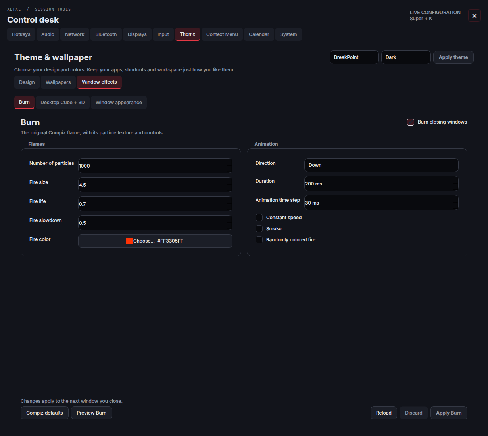](docs/screenshots/burn.png) | [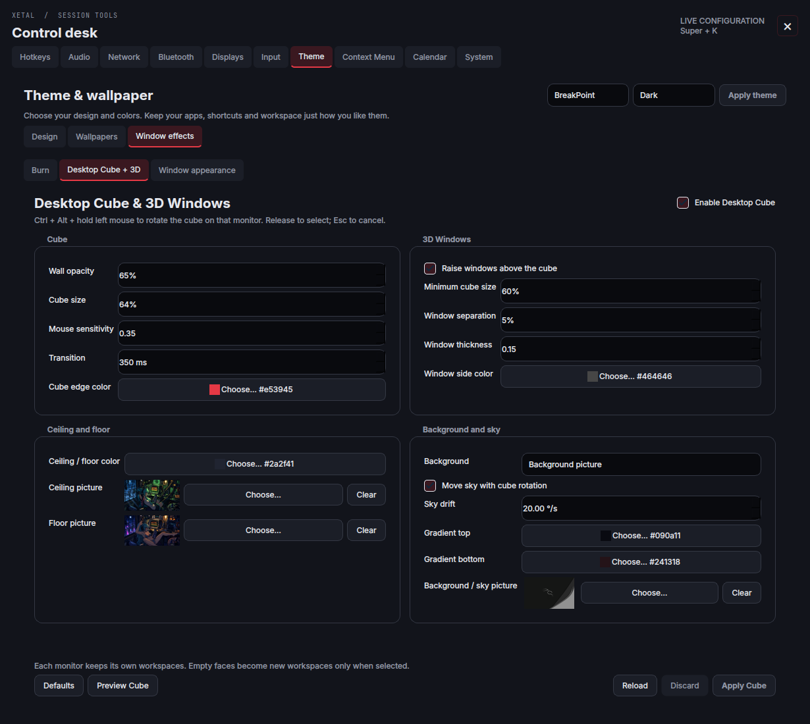](docs/screenshots/cube.png) |

**Burn** closes windows with the original Compiz particle flame and smoke. Tune the color, direction, particle count, size, lifetime and timing, or try a disposable preview window.

**Super+Z** sends the active window into a burning **Fireball** slot in an animated dock. Each monitor has its own dock, positioned opposite Waybar by default, with a distinct design for every theme. Choose any design independently, or keep the classic Left/Right edge stack. Click a slot to restore it; scroll when it fills up. In **Theme → Window effects → Minimize → Dock behavior**, choose **Slide away** or **Burn away**. Burning can leave a small **Fire indicator** along the hidden dock's edge until every window is restored. Adjust hide delay, transition time, size, proximity and hover zoom; **Preview hiding** demonstrates the effect without touching your windows. Splat is currently disabled. Apps keep running and remain accessible from their original workspace's taskbar icons. [Minimize guide →](config/hypr/effects/minimize/README.md)

**Desktop Cube + 3D Windows** gives each monitor its own four workspace faces. Hold **Ctrl+Alt+left mouse** and drag to rotate; release to select or press Escape to cancel. Adjust transparency, edge colors, ceiling/floor artwork, a moving sky, and raised windows with depth and spacing. **Standard animation is the default for ordinary workspace switching**; automatic cube rotation is an option. The drag gesture works with either choice.

**Super+Tab** uses Ring Switcher by default, with seven alternatives: Fusion Cards, Application, Static Application, Shift Cover, Shift Flip, Stack and Scale overview. Live previews follow your selected monitor and style. [Task switcher guide →](config/hypr/switcher/README.md)

Five cursor designs add optional Comet, Soft glow or Stardust trails and click ripples. Cursor effects start disabled and stop rendering when idle. [Cursor guide →](config/hypr/cursors/README.md)

The native [Burn](config/hypr/effects/burn/README.md), [Cube](config/hypr/effects/cube/README.md) and [Minimize](config/hypr/effects/minimize/README.md) sources are included, along with Compiz attribution for Burn, Cube and the minimize flame. Setup builds them against the pinned **0.56.2 x86-64/OpenGL** runtime; their effects remain individually configurable. Front/Back also handles floating windows above maximized windows and preserves their order across workspace switches.

## KVM Settings

Open **Apps → KVM** for the integrated Windows/Mac VM editor and setup wizard.

- **Single GPU, Virtual GPU and Dual GPU** launch modes, with floating console/viewer controls.
- CPU pinning/features, RAM, disks, PCI/USB passthrough, UEFI firmware, TPM, SMBIOS, OpenCore settings, command previews and saved presets.
- A first-run wizard that downloads missing components and walks through the recipient computer's hardware.
- **Create Bridge** for a suitable wired NetworkManager connection, preserving IP/DNS settings with recovery checkpoints. **NAT** shares the host connection and also works over Wi-Fi.
- Signed downloads for QEMU, OVMF, TPM, OpenCore, Looking Glass and support files. **Paths & Tools pulses red** for missing required components or a newer compatible installed-component release; updates remain an explicit action.
- Private disks, TPM state and writable NVRAM stay separate from component and desktop updates.

The **Custom KVM module · Ultra AMD Stealth Interceptor** is **optional** and appears last in Downloads. It requires the published matching AMD CPU/kernel combination; standard system KVM remains available when it does not match. The built-in Windows guest-script preview and **Copy** action are available before downloading that module; using the script still requires a compatible custom host module and SSH setup.

Runtime components download inside KVM Settings; they are not bundled with the desktop. Supply your own guest installation media and disks. Physical GPU passthrough and guest behavior still depend on the host hardware. [KVM setup, components and recovery →](docs/KVM.md)

## Windows apps with our custom Proton manager

**XetalProton is built into Hyper Fusion's Control Panel.** Manage Windows applications and games from a native interface that follows your desktop theme, with your library, prefixes, downloads, dependencies and process logs together. Open **Control Panel → Software & maintenance → Proton**.

[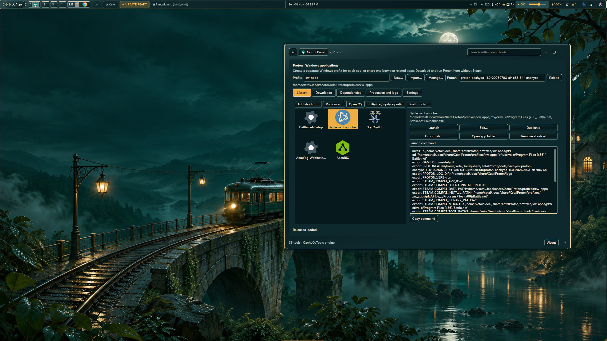](docs/screenshots/proton-library.png)

*The library on the live desktop: related applications share the selected custom prefix, with a chosen Proton version and individual launch controls. Click either screenshot to view it at full resolution.*

- **Custom, isolated prefixes:** create a separate Windows environment for each application, or share a prefix between a launcher and its games. Each prefix keeps its own Windows files, registry and dependencies. Import existing prefixes, rename them, choose their storage location, measure disk usage and open their C: drive.
- **Proton versions per prefix and per app:** select a default runner for each prefix and override it for an individual shortcut. Install newer builds alongside older ones while keeping your existing selections.
- **A Windows application library:** add installers and executables, drag and drop programs, run something once, or save a shortcut with its extracted icon. Edit, duplicate and organize shortcuts within their prefixes.
- **Dependencies and Windows utilities:** install Winetricks components into the selected prefix, review their status and retry failed installs. Open Wine configuration, Registry Editor, Windows Control Panel, Task Manager, Explorer and Command Prompt from **Prefix tools**.
- **Browser sign-in:** configure per-app URL handlers so your Linux browser can return authentication links to the correct Windows app, prefix and runner. Choose URL arguments, Hyprland defaults and private output; exported launch scripts retain the setup. Task Manager also has a direct button and an app context-menu action.
- **Detailed launch controls:** configure arguments, working directories, graphics and synchronization options, custom environment variables and wrappers. Preview or copy the generated command, export an executable `.sh` launcher, and follow each application's log under **Processes and logs**.

[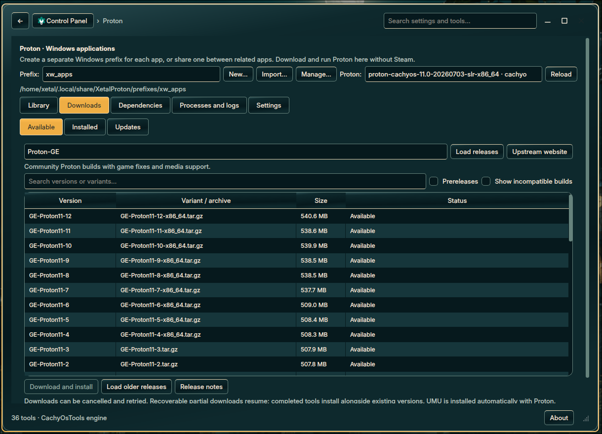](docs/screenshots/proton-downloads.png)

*Downloads → Available: browse Proton-GE releases, compare versions and sizes, then select a build to download and install.*

The downloader includes **13 tool providers**, including Proton-GE, CachyOS and UMU. Search releases, browse older versions, choose archive variants, filter prereleases and inspect CPU compatibility. Downloads show progress, support cancellation and recovery of resumable partial files, verify published checksums and stage extraction before installation. **Installed** manages downloaded tools; **Updates** finds newer matching builds without switching existing prefixes automatically.

UMU is prepared automatically when downloading Proton, and Steam is optional. Existing XetalProton prefixes, shortcuts and downloaded tools are reused; desktop updates keep that personal data separate. [Full Proton feature guide and setup instructions →](config/hypr/control_panel/proton/README.md)

## Tools that fit the desktop

| Control Panel | File picker with previews |
| :---: | :---: |
| [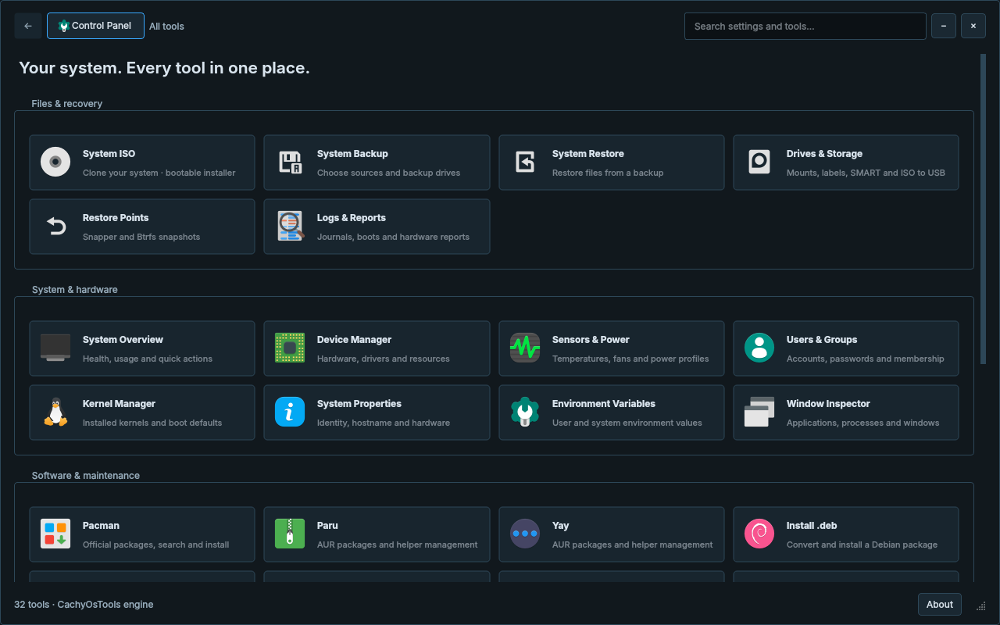](docs/CONTROL-PANEL.md) | [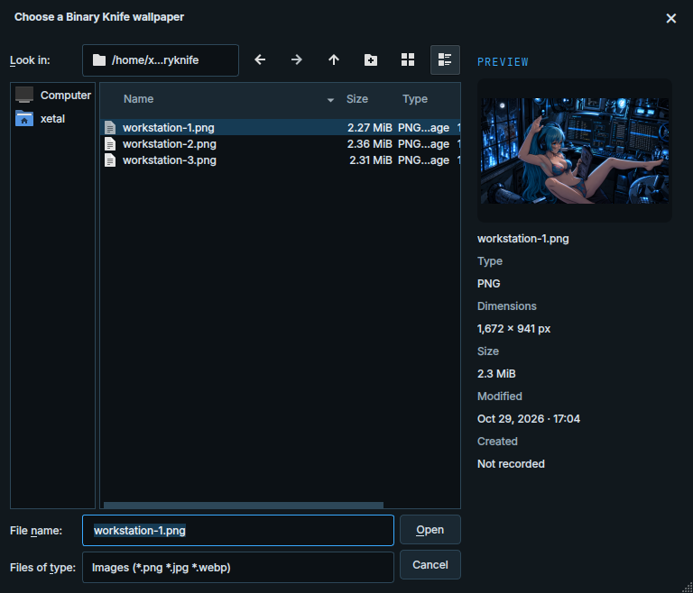](docs/FILE-PREVIEWS.md) |

| Tool | What you get |
| --- | --- |
| **Control Panel** | A searchable native interface built from CachyOsTools: hardware, storage, services, startup apps, backups, system tools and shortcuts. **Some features remain Arch-only until further notice**, including Pacman/Paru/Yay and Arch package repair/kernel tools. [Feature map and platform requirements →](docs/CONTROL-PANEL.md) |
| **Proton** | Our integrated XetalProton manager: Windows application library, custom prefixes, per-app runners, Proton downloads and updates, Winetricks, launch options and process logs. [Proton guide →](config/hypr/control_panel/proton/README.md) |
| **GRUB Boot Editor** | Select a drive, let Hyper Fusion detect Windows or Linux, give it a name and add it to your boot menu. Includes rename, removal, backups and undo while keeping your existing theme and entries. [Boot editor →](docs/GRUB-BOOT-EDITOR.md) |
| **Session log protection** | Enabled by default. Clears oversized Hyprland and Hyper Fusion session logs above 64 MiB every minute to protect runtime space. **Control Panel → System Tweaks → Hyprland** also offers **Disable session logs to file**, effective at the next login. [Log guard →](docs/CONTROL-PANEL.md#hyprland-log-guard) |
| **System ISO** | Create an Arch-based system clone, then restore through a graphical Hyper Fusion wizard with drive cards, review and progress, plus an automatic console fallback. Choose whether the ISO requires a fresh administrator account or preserves existing accounts. Try **Control Panel → System ISO → Preview installer…** with sample drives first. [Restore wizard →](docs/CONTROL-PANEL.md#system-iso) |
| **RAM Cleaner** | Manual **Normal** and **Aggressive** cache cleanup with before/after readings. It keeps applications running and does not reclaim their active memory. Linux already reclaims cache when needed; this is an occasional troubleshooting tool. |
| **Disk Visualizer** | A directory-size tree and treemap, folder navigation, allocated/apparent sizes, and confirmed file actions inside System Cleaner. |
| **[Fusion Files](docs/FILES.md)** | **My Computer** in Favorites opens **This PC**, with mounted and unmounted drives. Quick access, editable breadcrumbs, tabs, five views, configurable columns and menus, previews and Ark follow the desktop theme. **Ctrl+F** searches names/wildcards or file contents with advanced text/regex filters, matching-line results and parallel workers; **Ctrl+Shift+F** filters the current folder. |
| **Dolphin** | Available separately with recipient-specific **Places** and an embedded terminal; its private profile remains independent of KDE/Plasma. |
| **File pickers** | Matching Places and image/text/folder previews in Xetal, Qt Widgets and standard GTK 3 dialogs. Custom application and portal pickers have their own integration limits. [Coverage →](docs/FILE-PREVIEWS.md) |
| **File transfers** | Four animated transfer-card designs for Fusion Files, Dolphin/KIO and Ark, with real progress, pause/cancel where supported, error details and appearance controls. |
| **Xetal Images** | Pointer-centered zoom, pan, Fit/100%, folder navigation, GIF playback, fullscreen and remembered window sizing. |
| **Capture and sharing** | Alt+F9 screen recording with audio, 64 FPS MP4 saved to Videos by default, area/all-display screenshots, clipboard support and a custom Hyprland screen-share picker. Recording options live in Fusion Settings → Capture. |
| **Media downloader** | **Super+Ctrl+P** opens an MP3/MP4 popup with progress, cancellation and updates for its private yt-dlp copy. |
| **Kitty** | Matching colors, animated cursor, a draggable scrollback scrollbar and a configurable Fastfetch welcome. |

## Shortcuts at a glance

| Shortcut | Action |
| --- | --- |
| **Super+Space / Super+R** | Open Apps and search |
| **Super+K / Super+A** | Fusion Settings / audio mixer |
| **Super+Q / Super+Enter** | Kitty |
| **Super+E** | Fusion Files |
| **Super+D** | Show/hide Welcome |
| **Super+W** | Wallpaper carousel, slideshow preview and display picker |
| **Super+Tab / Super+Shift+Tab** | Switch applications forward/backward |
| **Super+1–4** | Select a cube workspace on the monitor under the pointer |
| **Super+Shift+1–4** | Move the focused window to that workspace |
| **Ctrl+Alt+left mouse drag** | Rotate this monitor's cube |
| **Super+V** | Toggle floating |
| **Super+Z** | Minimize the active window |
| **Super+Ctrl+Z** | Hide/show minimized Fireball and Splat effects |
| **Super+F / Super+B** | Bring to front / send to back |
| **Super+Shift+F** | Toggle fullscreen |
| **Super+left / right mouse drag** | Move / resize a window |
| **Super+C** | Close the focused window |
| **Super+/** | Show window shortcut hints |
| **Super+Ctrl+P** | MP3/MP4 downloader |
| **Print / Shift+Print** | Capture an area / all displays |
| **Alt+F9** | Start/stop recording the monitor under the pointer; save an MP4 with desktop audio |
| **Super+L / Super+M** | Lock / confirm logout |

Turn Cube off for global workspace numbering and add/remove controls. All bindings remain editable in Fusion Settings.

## Updates that keep your settings

The taskbar's **UPDATE** badge announces a newer desktop release. Opening Desktop Updates checks GitHub again; **Update!** appears only after a successful fresh check. Downloads start when you choose Update, with another release check immediately beforehand. Preparation merges personal settings, builds native components and validates the result. **UPDATE READY** activates at the next Hyprland login, without forcing you to log out.

Click the badge to inspect the live log, check again or queue a rollback. Background checks provide notices; there is no automatic-download setting. The log follows new output, and the main button changes from **Update!** to **Updating…** to **Restart** when ready. Restart requires your confirmation; updates never reboot the computer automatically. A changed compositor requirement shows **SETUP REQUIRED** and opens the graphical installer so the system runtime and desktop move together. KVM component updates are managed separately in Paths & Tools.

Your hotkeys, monitor arrangement, chosen wallpapers, private Dolphin Places and startup preferences are preserved. Conflicting edits stop an update for review. [Update behavior and recovery →](docs/UPDATES.md)

## Documentation

| Guide | Details |
| --- | --- |
| [Start here: project and AI guide](IA_START_HERE.html) | Offline architecture map, source/live paths, development, privacy, testing and releases; open the HTML in a browser or read its source |
| [Full gallery](docs/GALLERY.md) | Themes, panels, menus, transfer cards and wallpapers |
| [AI theme creation guide](AI_Theme_creation.md) | Complete theme integration map, three-wallpaper requirement, builds and verification |
| [Installer](docs/INSTALLER.md) | GUI choices, pinned runtimes, backups and recovery |
| [Dependencies](docs/DEPENDENCIES.md) | Distro scope, required tools and compatibility checks |
| [Desktop updates](docs/UPDATES.md) | Settings preservation, activation and rollback |
| [KVM Settings](docs/KVM.md) | VM setup, downloads, networking and private state |
| [Control Panel](docs/CONTROL-PANEL.md) | Administration tools, RAM Cleaner and Disk Visualizer |
| [Screen recording](config/hypr/recording/README.md) | Alt+F9, audio, video settings and saved-recording notifications |
| [File previews](docs/FILE-PREVIEWS.md) | Supported applications, Places and preview behavior |
| [Validation](docs/VALIDATION.md) | Test suites and the limits of automated coverage |
| [Desktop reference](config/hypr/README.txt) | Configuration and component layout |

<details>
<summary><strong>Development checks</strong></summary>

```bash
python3 -m unittest discover -s tests -v
./tests/run-desktop-tests.sh
python3 tests/run-file-preview-checks.py
```

The [installer compatibility workflow](.github/workflows/installer-compatibility.yml) checks Arch-family repositories and runs Fedora and Debian installation, native builds and recovery in disposable containers. Graphical login, GPU/driver and physical passthrough testing remain separate.

</details>

## Credits and licenses

Made by **Xetal**, on [Hyprland](https://github.com/hyprwm/Hyprland), with Qt, GTK, Waybar, Kitty, Dolphin and the wider Linux desktop community. Compiz effects retain their original authorship and licenses; the Control Panel includes the CachyOsTools engine. Modern takes visual inspiration from [Noctalia](https://github.com/noctalia-dev/noctalia).

See the [repository license](LICENSE), [third-party notices](THIRD_PARTY_NOTICES.md), [asset manifest](assets-manifest.json) and [distro icon sources](docs/media/distros/README.md). Distribution names and logos identify tested environments and do not imply endorsement.

Screenshots may show separately installed applications. Echo, XMusic, Linux Studio, Xetal BV and other featured projects are available separately; their presence in the launcher or Welcome dashboard does not install them. Personal bookmarks, credentials, browser profiles and runtime caches are excluded from this repository.

<p align="center"><strong>Hyper Fusion · Made for your workspace.</strong><br><a href="https://www.xetal.net/community/site/">Explore Xetal's other projects</a> · <a href="docs/GALLERY.md">See every panel</a></p>
