<!-- The original 1440p recording is linked here; GitHub's inline player is above the title. -->
https://github.com/user-attachments/assets/8a20af5b-ec30-4bbb-ad7f-06d4e392a57d

<p align="center"><sub>48-second desktop recording · Original 1440p video</sub></p>

<h1 align="center">Hyper Fusion</h1>
<p align="center"><strong>A complete Xetal desktop for Hyprland.</strong><br>Beautiful menus. Personal workspaces. A little Compiz nostalgia.</p>
<p align="center">
  <a href="#install">Install</a> ·
  <a href="#make-apps-your-own">Apps & menus</a> ·
  <a href="#float-the-way-you-want">Floating windows</a> ·
  <a href="#compiz-spirit-hyprland-desktop">Desktop effects</a> ·
  <a href="docs/GALLERY.md">Full gallery</a> ·
  <a href="docs/UPDATES.md">Updates</a>
</p>

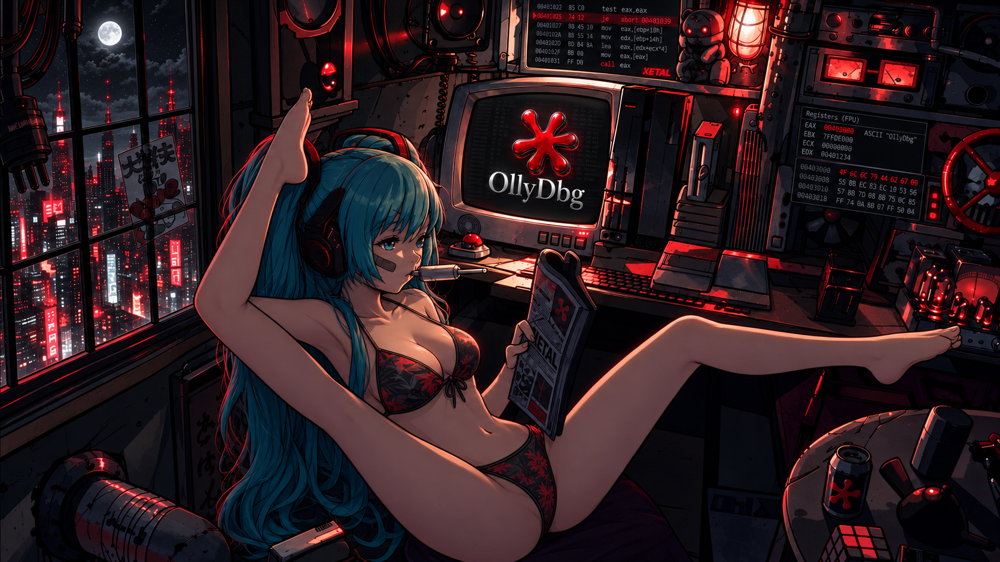

**Your desktop should feel like yours.** Hyper Fusion brings together a configurable Apps menu, native Fusion Settings, a flexible taskbar, matching tools, and original Compiz effects adapted to Hyprland. Four visual designs share one engine: **Xetal Raw**, **Xetal Modern**, **BreakPoint**, and **Binary Knife**. Mix their Start menus, keep your shortcuts, and make the details your own.

The custom desktop components, installer, native effect sources, themes, fonts, and bundled wallpapers live in this repository. They build on the machine where you install them.

**New: Control Panel.** Open it directly above Fusion Settings in Apps: a floating, searchable icon view powered by the complete CachyOsTools C++ engine. Its 32 entries cover system ISOs, backups, drives, hardware, services, networks, Shell and more, with separate **Pacman, Paru, Yay and Install .deb** icons. Startup Applications also controls the animated login dashboard while keeping Super+D available. It follows your desktop theme, uses Kitty for terminal actions and creates shortcuts in Apps. CachyOsTools stays independent. See the [complete feature map and ISO details](docs/CONTROL-PANEL.md).

Apps, Fusion Settings/Theme and Control Panel preload without opening windows and stay ready after closing. Theme opens the Theme page of the same Fusion Settings process. Apps watches application entries for changes, while hidden views pause their visible-only polling and animated avatars. A small session helper recovers exited interfaces; it and the cached applications stop with Hyprland. No shared desktop service is installed.

## Install

From a recent Hyprland session, run these commands **as your regular desktop user**:

```bash
git clone --depth 1 https://github.com/XetalEngine/x_hyperland.git
cd x_hyperland
./x_hyperinstall.sh
```

You can also choose **Code → Download ZIP** on GitHub, extract the whole archive, and open a terminal inside `x_hyperland-main`. Run `bash ./x_hyperinstall.sh` there. ZIP and tar downloads include their exact source revision in `installer/source-revision.txt`; keep that file with the installer. No Git checkout is needed for this installation method.

When retrying after an update, download the ZIP again and extract it into a new folder. The installer prints its source revision and checks the configuration before compilation. The Control Panel builds with all available CPU threads.

The command opens the graphical **Hyper Fusion Setup** wizard. It reviews your setup, requests administrator authentication for packages, shows build progress and keeps an installation log. It backs up your existing `~/.config/hypr` before installation. **Log out and select Hyprland again** to start the complete desktop. Use `--cli` for terminal installation.

**Setup uses the development desktop's tested Hyprland 0.56.2.** The signed official package **0.56.2-4** (51.3 MB) and its signature are included in the repository and Download ZIP. On Arch-based x86-64 systems, Setup installs or downgrades to this package, verifies its checksum and signature, and adds a dedicated pacman hold. Cube and Burn must both build successfully before installation completes. Future desktop releases can change the required version through the same installer and updater flow. [Installer and recovery details →](docs/INSTALLER.md)

| Tested environment | Requirements |
| --- | --- |
| Arch Linux / CachyOS | Exact **Hyprland 0.56.2** selected by Setup, Waybar **0.15+**, Kitty **0.49+**, Hyprpaper **0.8+**, Python **3.11+**, Git, Qt 5/6 development libraries, and the Hyprland portal |
| Other distributions | Install the exact required compositor manually before using the included dependency recipes. Automatic compositor installation targets Arch x86-64. See [dependencies](docs/DEPENDENCIES.md). |
| Burn & Cube | Required local builds for the tested **Hyprland 0.56.2 ABI**, x86-64 and OpenGL. Their effects can be enabled or disabled in settings. |

The default install adapts to your monitors, resolution, placement and scale. Without a running compositor, it uses preferred modes and automatic placement. KDE/Plasma settings, shell profiles, shared application associations, and system autostart stay separate from this Hyprland profile.

## Four looks. One desktop.

| Xetal Raw | Xetal Modern |
| :---: | :---: |
| [](docs/screenshots/apps-raw.png) | [](docs/screenshots/apps-modern.png) |
| Original cyan accents and transparent surfaces | Soft blue cards and a Home overview |

| BreakPoint | Binary Knife |
| :---: | :---: |
| [](docs/screenshots/apps-breakpoint.png) | [](docs/screenshots/apps-binaryknife.png) |
| Charcoal glass, crimson focus, silver text | Sharp graphite panels, electric blue edges, cool silver text |

**Binary Knife** draws from the disassembler's precise blue interface: 4px corners, 2px focus borders, compact controls, blue Burn flames and a transfer animation with files travelling along illuminated circuit traces. Its three blue workstation wallpapers preserve the characters and compositions of the original artwork. The theme covers Apps, the taskbar, desktop context menus, Fusion Settings, Control Panel, file pickers, notifications, lock screen and session tools. [See the theme and its wallpapers →](docs/GALLERY.md#binary-knife)

**Fusion Settings → Theme** separates **Presets**, **Design**, and **Custom**. Presets chooses a color family; Design offers Classic tabs, a Modern icon rail, a Gallery sidebar with labeled icons and pill buttons, or a Studio ribbon. Use any layout with any palette. **Apply theme** opens a component picker for colors, layout, wallpapers, Start Menu, profile image, File Transfer, Task Switcher, effects and terminal welcome. Unchecked parts keep their current appearance. Save an applied combination under a name in Custom, with wallpaper previews, rename/remove actions and selective restoration.

- **Mix and match** any Start menu with any desktop theme, or choose **Follow desktop theme**.
- Use **Dark, Light, or High contrast** colors. BreakPoint and Binary Knife use Inter for the interface and JetBrains Mono for technical text.
- Choose an account image or **animated GIF**. The account-picture button reads your existing Linux avatar; it does not change it.
- Give the **entire Apps menu** its own background image, follow the desktop wallpaper, or use a plain background. Adjust **background visibility** with a slider.
- Set **icon backgrounds, group strips and the left menu** anywhere from transparent to opaque. The left-menu surface covers Favorites through Session & power while keeping text and icons opaque. Group strips support their own **image or animated GIF**, with preferences saved separately for each design.
- **Show or hide shortcut names and hotkeys** globally. The remaining icon content centers automatically; small tiles stay icon-only.
- Every theme includes its own three-screen wallpaper set: **Xetal Raw**, **Xetal Modern**, **BreakPoint** and **Binary Knife**. The twelve illustrations have corrected character anatomy, and Modern has three distinct new studio scenes. Assign custom wallpapers and fit modes per monitor; selecting Wallpapers and Window effects when applying a preset restores its saved artwork and effect colors, including custom flames. Fresh installations assign Modern's set in display order.

| Theme design | Menu surfaces, artwork & profile |
| :---: | :---: |
| [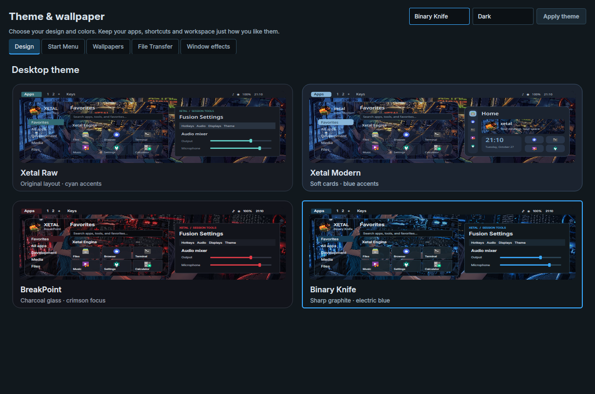](docs/screenshots/theme-design.png) | [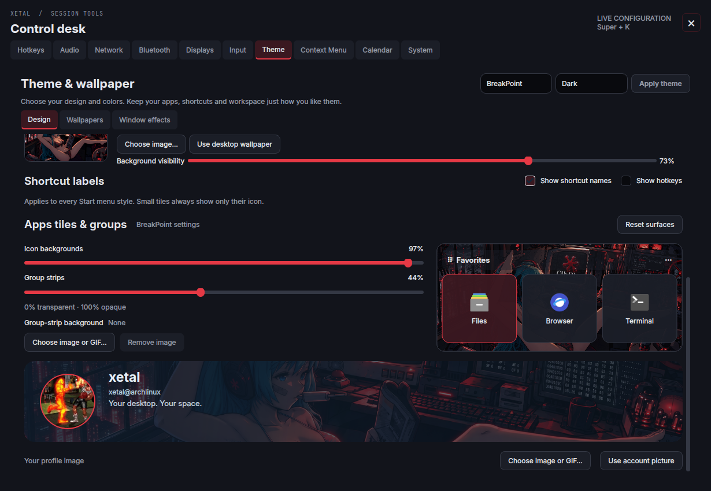](docs/screenshots/menu-design.png) |

## Make Apps your own

Click **Apps** or press **Super+Space** and start typing immediately. Search applications or browse categories; click Apps again, click outside the menu, or press Escape to close it. The launcher reuses its application and hotkey indexes for quick access.

**Favorites are a canvas.** Create titled groups, drag their headers to reorder them, double-click to rename, and move shortcuts between groups. Use medium tiles or icon-only small tiles: **four small tiles fit in one medium slot**. Place small icons above, below, or beside each other without filling a row first. Each column holds three medium tiles across. Widening the menu reveals more columns; narrowing it hides them without rearranging your layout. Resize its height independently; the tiles and sidebar scroll when needed.

**Right-click a shortcut** to access its tools:

| Launch | Organize | Customize |
| --- | --- | --- |
| Open normally, **Launch floating**, or open in a terminal | Pin/unpin Favorites or the taskbar; duplicate a shortcut; choose tile size; move it to another group | Set/change its global launch hotkey; choose an icon; toggle **Always run in terminal** or **Always start floating** |
| **Ctrl+click** for a floating launch this time | Drag pinned taskbar apps to reorder them | Copy its command, reveal its desktop file, restore original settings, or delete a custom copy |

**Properties** is the last item. Edit the name, command and arguments, working folder, icon, description, terminal behavior, keep-terminal-open option, and floating preference. Right-click **empty space** for **New shortcut** and **New favorite group**; the shortcut menu stays focused on that app.

| Favorite context menu | Shortcut Properties |
| :---: | :---: |
| [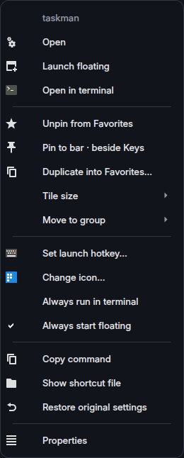](docs/screenshots/shortcut-context.png) | [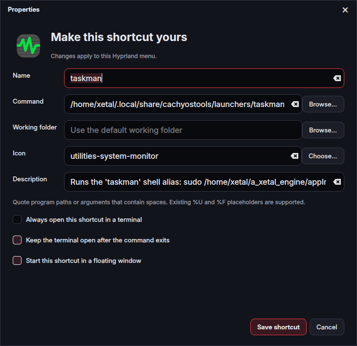](docs/screenshots/shortcut-properties.png) |

## A desktop menu you can design

Right-click the uncovered wallpaper for a compact, themed menu. Start with **File Manager**, **Wallpaper**, and **Display Settings**, then open **Fusion Settings → Context Menu** to make it yours.

Add commands, shortcuts, icons, headings, submenus, dividers, blank spacers and column splits. Assign global hotkeys, resize the menu and rows, tune its typography, rounding, opacity, colors, shadow and thin accent strip. Use the live preview, **Apply/Discard**, and **save/load JSON presets** to refine both its appearance and behavior.

[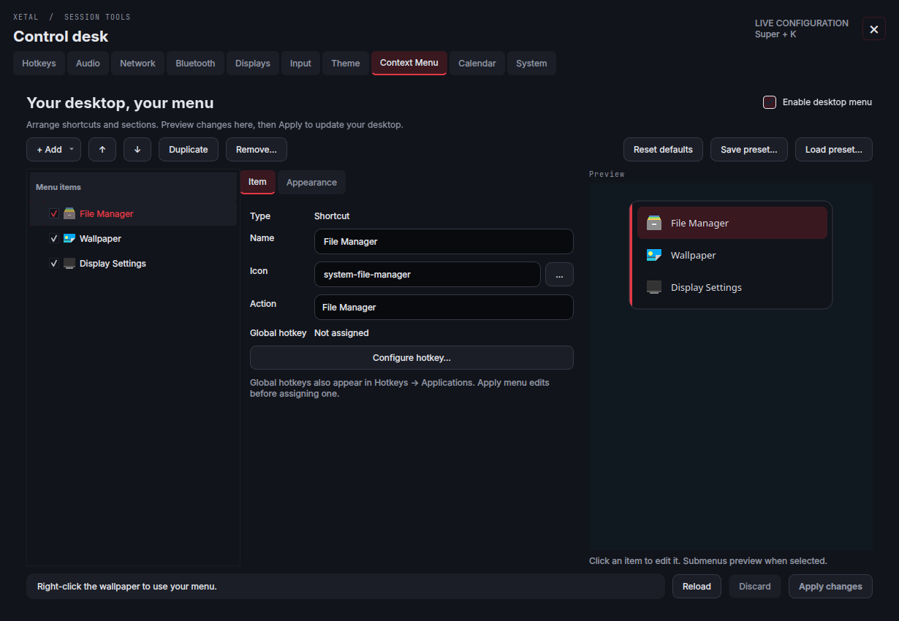](docs/screenshots/context-menu.png)

## Float the way you want

- **Ctrl+click any app** in Favorites, categories or search results to launch it floating once. Or save **Always start floating** in its context menu or Properties.
- Windows open **centered**, using the app's requested size initially and its **last floating size** afterwards. Tiled, maximized and fullscreen sizes do not overwrite that preference; intentionally tall floating windows remain tall.
- Application **Maximize/Restore** buttons work for floating windows: maximize fills the monitor's usable workspace, and restore returns to that window's previous floating size and position.
- Floating launch tracking follows child processes through **scripts, sudo wrappers and AppImages**. Password prompts keep their own sizing.
- **Drag the upper area with the left mouse button**, like an invisible title bar, without holding Super. **Super+V** toggles floating; **Super+left drag** and **Super+right drag** remain available for moving and resizing.
- **Xetal Images** remembers its size separately for each **screen resolution and scale**, fits inside that monitor's usable area, and opens centered.

For elevated graphical tools, the included `~/.config/hypr/scripts/xsudo.sh command [arguments...]` preserves the display connection, prompts when needed, and removes its temporary root display access afterwards.

## A taskbar that works where you do

The bar shows workspaces and app icons for each display. Add workspaces with **+**, remove empty ones with **×**, switch without moving the mouse, and keep favorite apps pinned beside **Keys**.

**Right-click → Options** lets you move the bar between **Top and Bottom**, and show/hide CPU, RAM, temperature, disk, internet, LAN, Wi-Fi, VPN, Bluetooth, media playback, volume, microphone, notifications, tray, clock, power, Apps, workspaces, pins, and desktop updates. Popups and the Start menu open inward from the selected edge. Visibility settings survive login.

If the taskbar crashes, its session helper automatically brings it back. Your applications, workspaces and desktop effects keep running.

The **animated UPDATE notice beside Keys** appears when an update is available or pending, and stays hidden when you're up to date. Automatic updates prepare in the background, preserve your personal settings, and activate at your **next Hyprland login**. A compositor mismatch shows **SETUP REQUIRED**; its button opens the graphical installer to coordinate the system package and desktop. Click the badge to check now, pause automatic updates, inspect the log, or queue a rollback. Updates never log you out. [How updates work →](docs/UPDATES.md)

## Fusion Settings

Press **Super+K** or click **Keys**. The desktop's controls live together, with matching colors and visible close buttons.

| Hotkeys | Modern Home |
| :---: | :---: |
| [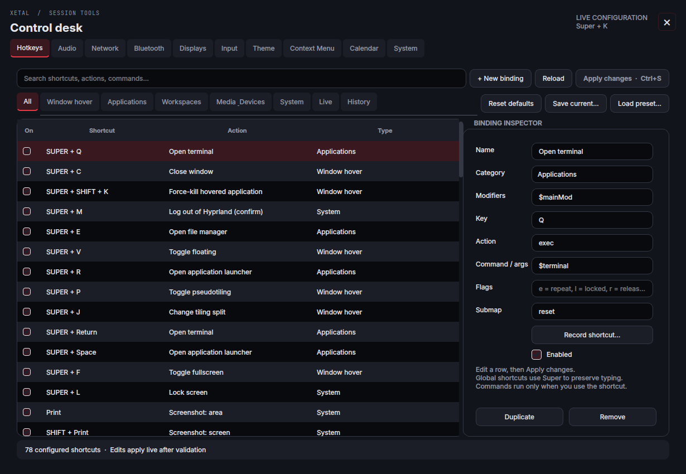](docs/screenshots/hotkeys.png) | [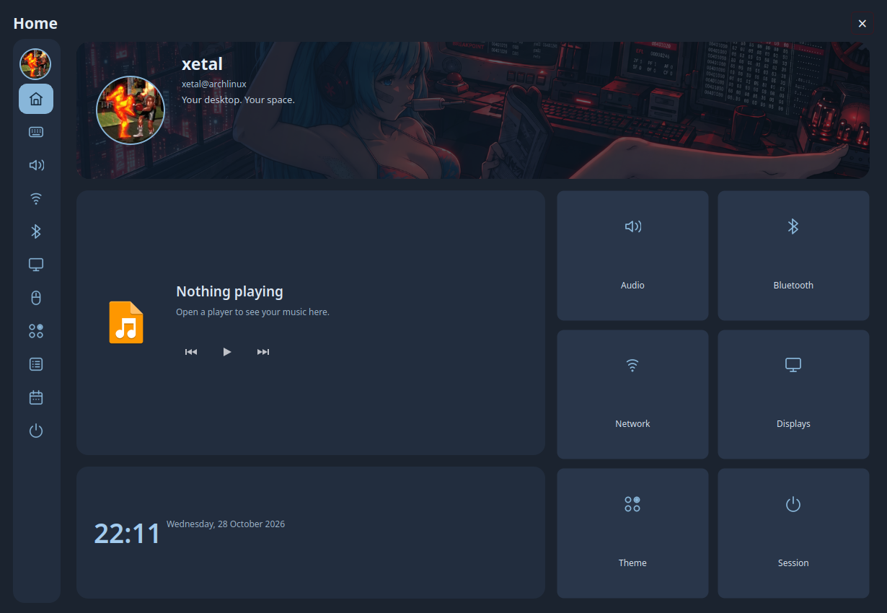](docs/screenshots/modern-home.png) |

| Panel | What you can do |
| --- | --- |
| **Hotkeys** | Search/filter bindings, record combinations, inspect commands, enable/disable, duplicate/remove, validate and apply changes, restore defaults, save/load preset files, and recover from backup history. |
| **Audio** | Control output and microphone levels, mute, choose devices, and use the embedded per-application mixer with playback/recording routing. |
| **Network & Bluetooth** | Inspect and manage connections, Wi-Fi, VPNs and paired devices through the session's controls. |
| **Displays** | Drag monitor rectangles; change resolution, refresh, scale, position, rotation and mirroring with timed **Keep/Revert** protection. |
| **Input** | Adjust keyboard, mouse and touchpad preferences. |
| **Theme** | Presets, independent navigation Design, named Custom combinations, Start Menu, Task Switcher, Cursors, wallpapers, File Transfer, Burn, Cube + 3D Windows, borders, gaps, blur, shadows and animation settings. |
| **Context Menu** | Build and style the wallpaper menu, including its actions and hotkeys. |
| **Calendar & System** | Browse dates, inspect system information, lock and access session/power controls. Logout asks for confirmation. |
| **Terminal** | Choose the neon, mecha-inspired Arch emblem, a text Arch/Fusion logo, information fields, username and palette for the Fastfetch-powered welcome. The emblem follows the desktop colors and scrolls with the text in Kitty; other terminals retain a text fallback. |
| **Modern Home** | Profile image/GIF, media controls, clock, system cards and shortcuts to the same settings pages. |

Click the taskbar **clock** for a compact clock/calendar dropdown; right-click it or choose **Full calendar** for the full settings calendar. The **power button** opens a compact dashboard with your animated profile, uptime, CPU/RAM/disk gauges, temperature history, volume, laptop brightness and media controls. Laptops show their real battery level; desktops show **AC power · 100%**. Popups follow the clicked monitor and the top/bottom taskbar position.

The separate Fusion Kitty profile loads your usual shell rc file and then the theme-colored welcome. Existing Neofetch startup lines can be guarded with `[[ -z ${XETAL_FUSION_TERMINAL:-} ]]` to avoid a second banner while retaining other desktop sessions.

[**Open the full panel gallery →**](docs/GALLERY.md)

## Compiz spirit. Hyprland desktop.

### Burn

Close a window and watch it burn away with the **original Compiz particle flame and smoke**. Configure the nine Burn options, RGBA flame color/opacity, direction, particle count, size, life, slowdown, constant speed, mystical fire, duration and time step. Toggle it, restore Compiz defaults, or try a disposable preview window.

### Cursors and workspace navigation

**Theme → Cursors** offers Pearl, Carbon, Neon Cyan, Orchid and Ember, with adjustable
size, Comet / Soft glow / Stardust trails, and optional click ripples. Cursor artwork
is built locally during installation. Effects default to off and stop rendering
when idle. [Cursor guide](config/hypr/cursors/README.md).

Cube defaults to four workspaces per monitor, each labeled 1–4. Workspace shortcuts
follow the mouse. Turn Cube off to return to global workspace numbers; choose
cube rotation or standard animation in the Cube page. Displays & Arrangement lets
you select the primary monitor, which can also host the task switcher.

### Desktop Cube + 3D Windows

**One cube per monitor.** Hold **Ctrl+Alt+left mouse** and drag to rotate; release to choose a workspace or press **Escape** to cancel. Each monitor keeps its own workspaces.

Tune wall transparency, cube zoom, mouse sensitivity, transition timing, edge colors, ceiling and floor pictures, and a static background or moving sky. Add raised **3D Windows** with adjustable separation, thickness, side colors and activation size. Both effects have their complete native source and controls included.

| Burn controls | Cube + 3D Windows |
| :---: | :---: |
| [](docs/screenshots/burn.png) | [](docs/screenshots/cube.png) |

See the [Burn guide](config/hypr/effects/burn/README.md) and [Cube guide](config/hypr/effects/cube/README.md) for the tested compositor ABI, build requirements, controls and licensing.

## The tools belong to the desktop, too

| Xetal Images | File picker with previews |
| :---: | :---: |
| [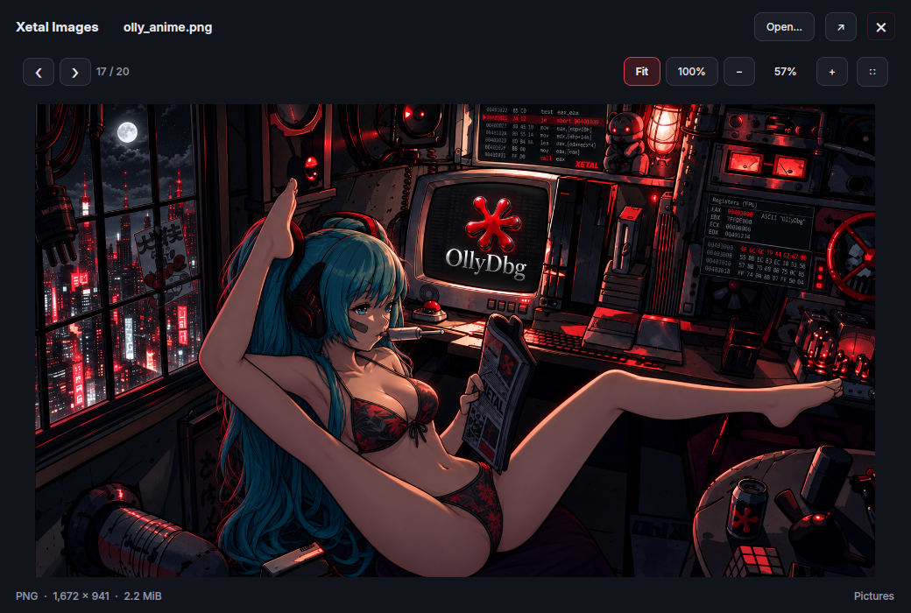](docs/screenshots/image-viewer.png) | [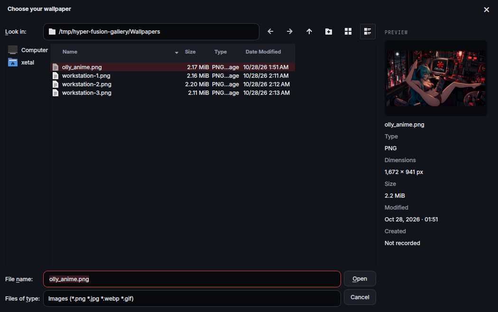](docs/screenshots/file-picker.png) |

| Tool | Included behavior |
| --- | --- |
| **Xetal Images** | Pointer-centered wheel zoom, drag to pan, Fit/100%, previous/next pictures in the folder, GIF Play/Pause, F11 fullscreen, reveal in Dolphin, and per-resolution floating size memory. |
| **File previews** | Right-side image, text and folder previews in Xetal dialogs, themed Qt 5/6 Widgets file pickers and standard GTK 3 choosers. [Coverage →](docs/FILE-PREVIEWS.md) |
| **Xetal Files** | Four interchangeable animated transfer cards: **Xetal Raw**, **Xetal Modern**, **BreakPoint**, and **Binary Knife**. Compact **448 × 168** defaults, freely draggable, with real copy/archive progress, pause/cancel where supported, and error details for Dolphin/KIO and Ark jobs. |
| **MP3 / MP4 popup** | **Super+Ctrl+P** opens the downloader. Selected links can prefill the address; choose MP3 to Music or MP4 to Videos, highest available source quality, with logs, cancel and an update button for the private yt-dlp copy. |
| **Screenshots** | Area/all-display capture, clipboard support, clickable notifications and reveal-in-folder. Print keeps Apps open during capture. |
| **Screen sharing** | A custom Hyprland portal picker with updating monitor/window previews and region selection. |
| **KVM Settings** | Theme-aware Windows and Apple VM editor with first-run setup, Single/Virtual/Dual GPU modes, CPU/memory/disks, TPM, firmware and signed component downloads. Opens in a large floating window from **Apps → KVM**. Runtime components download inside the app. [Setup and updates](docs/KVM.md). |
| **Task Switcher** | **Ring Switcher is the default. Super+Tab** across monitors/workspaces with eight choices: Fusion Cards, Compiz Application, Static Application, Ring, Shift Cover, Shift Flip, Stack, and Scale overview. Cards float directly over the desktop with live window previews and no surrounding panel. Animation controls, per-style settings, and a preview in **Fusion Settings → Theme → Task Switcher**. Release Super to focus the chosen app on its original monitor. [Details and Compiz sources](config/hypr/switcher/README.md). |
| **Dolphin & Kitty** | A separate themed file-manager profile, folder-link handling, Places icons and wallpaper actions; themed terminal colors, animated cursor and draggable scrollback scrollbar. |
| **Session** | Matching notifications and lock screen, logout confirmation, and helpers that stop with Hyprland. |

**Fusion Settings → Theme → File Transfer** lets the card follow your desktop or use any of the four designs independently. Each design remembers its own dimensions, corner radius, border, progress thickness, opacity, glow and accent color. Adjust animation speed, flying-file count, trails, progress smoothing, visible paths and statistics, estimated time remaining, display delay and automatic completion closing. Errors stay visible.

| Xetal Raw · flying files | Xetal Modern · soft blue cards | BreakPoint · crimson packets |
| :---: | :---: | :---: |
| [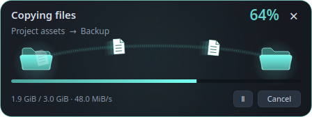](docs/screenshots/file-progress.png) | [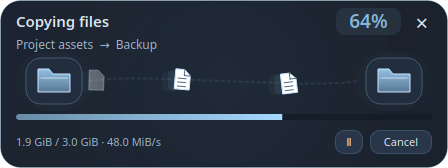](docs/screenshots/file-progress-modern.png) | [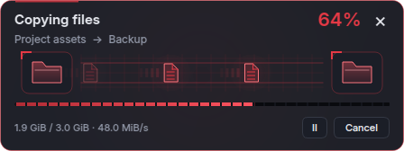](docs/screenshots/file-progress-breakpoint.png) |

[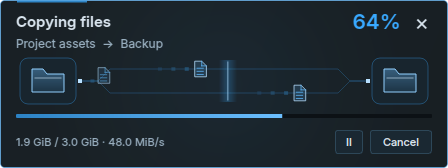](docs/screenshots/file-progress-binaryknife.png)

The live preview includes copy, move, compression and extraction examples, plus paused, completed, error and unknown-size states. **Preview popup** opens a floating simulation without changing files. Applied preferences update open transfer cards while their operations continue.

[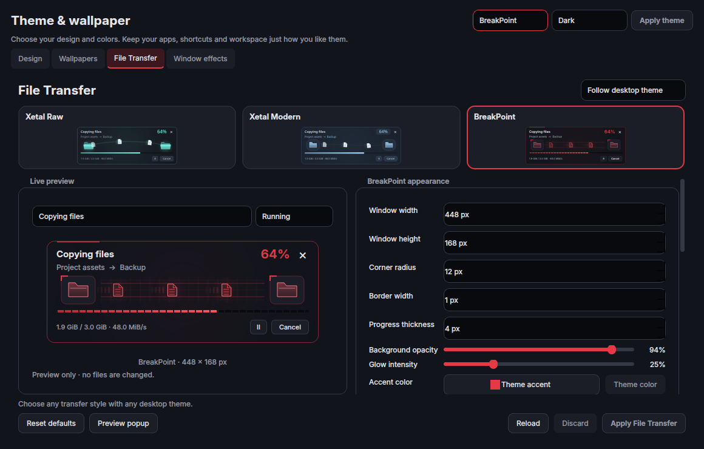](docs/screenshots/file-transfer-settings.png)

## Super+D: your launch scene

System information, Matrix rain and a large digital clock sit beside **six floating, clickable project cubes**: Echo, Linux Studio, Xetal BV, CachyOsTools, XMusic and Xetal Video Editor. Click a cube or navigate with Tab and Enter/Space to visit its project. **Super+D** toggles the dashboard; hidden animations pause. It appears after a short login delay, or stays manual with `--no-startup`.

[](docs/screenshots/startup-dashboard.png)

## Shortcuts at a glance

| Shortcut | Action |
| --- | --- |
| **Super+Space / Super+R** | Apps, ready to type |
| **Super+K** | Fusion Settings / Hotkeys |
| **Super+A** | Audio mixer |
| **Super+Q / Super+Enter** | Kitty |
| **Super+E** | Dolphin |
| **Super+Ctrl+P** | MP3 / MP4 downloader |
| **Super+Tab / Super+Shift+Tab** | App switcher, forward/reverse |
| **Super+number** | Switch workspace |
| **Super+Shift+number** | Move the focused app to that workspace |
| **Super+V** | Toggle floating |
| **Ctrl+click an app** | Launch floating once |
| **Super+C** | Close the focused window |
| **Super+Shift+K** | Force-kill the app under the pointer |
| **Super+/** | Window shortcut overlay |
| **Super+D** | Show/hide the startup dashboard |
| **Ctrl+Alt+left mouse drag** | Rotate this monitor's cube, when enabled |
| **Super+Shift+S / Super+S** | Send to / show the Magic workspace |
| **Super+L** | Lock |
| **Super+M** | Log out **after confirmation** |
| **Print / Shift+Print** | Capture an area / all displays |

Force-kill is for stuck applications and can lose unsaved work. It targets the app's process, so other windows in that same process may also close. Use normal Close when possible. All bindings remain editable in Fusion Settings.

<details>
<summary><strong>Installer options, backups & portability</strong></summary>

```bash
./x_hyperinstall.sh --cli                           # Terminal installer instead of the default GUI
./x_hyperinstall.sh --check                         # Dependency/version checks; no writes
./x_hyperinstall.sh --dry-run                       # Installation plan; no writes
./x_hyperinstall.sh --skip-packages                 # Use installed dependencies
./x_hyperinstall.sh --prepare /tmp/xetal-review      # Build/validate a separate review copy
./x_hyperinstall.sh --no-startup                    # Dashboard available only on demand
./x_hyperinstall.sh --profile original              # Original DP-4 / DP-5 / DP-6 arrangement
./x_hyperinstall.sh --yes                           # Accept package/install prompts
./x_hyperinstall.sh --restore /path/printed/backup  # Restore the previous configuration
```

Use a new destination for `--prepare`. The normal installer checks for edits made during preparation before replacing the profile. Restore retains the replaced profile separately, including later personal changes. A previous symlinked profile is backed up/restored as a symlink without changing its target.

Normal installation uses your hardware; [`profiles/xetal-original`](profiles/xetal-original) is explicitly optional. Network adapters and temperature sensors are detected at runtime. Older distro packages may need upgrading before the desktop can be installed.

The Apps screenshots show the author's installed applications. **Separate projects and programs—Echo, XMusic, CachyOsTools, Linux Studio, Discord, GitHub Desktop and others—are installed separately.** Their binaries and separate source repositories are not bundled here. Portable favorites appear when the corresponding app is installed.

</details>

<details>
<summary><strong>Source, validation & credits</strong></summary>

```bash
python3 -m unittest discover -s tests -v
./tests/run-desktop-tests.sh
python3 tests/run-file-preview-checks.py
```

Read the [validation notes](docs/VALIDATION.md), [dependency guide](docs/DEPENDENCIES.md), [update architecture](docs/UPDATES.md), [desktop reference](config/hypr/README.txt), and [third-party notices](THIRD_PARTY_NOTICES.md).

Compiz effect provenance and licenses are retained with their source. Modern takes visual inspiration from [Noctalia](https://github.com/noctalia-dev/noctalia) while using the Xetal implementation. Bundled fonts stay within this profile. Wallpaper and font checksums are recorded in [`assets-manifest.json`](assets-manifest.json).

Private browser profiles, credentials, caches, recent-file history, bookmarks, session logs and compiled binaries are excluded. Native components build locally against the recipient's libraries. Automated validation does not imply testing on every GPU or distribution.

</details>

<p align="center"><strong>Hyper Fusion · Made by Xetal</strong><br><a href="https://www.xetal.net/community/site/">Explore the other projects</a> · <a href="docs/GALLERY.md">Explore every panel</a></p>
