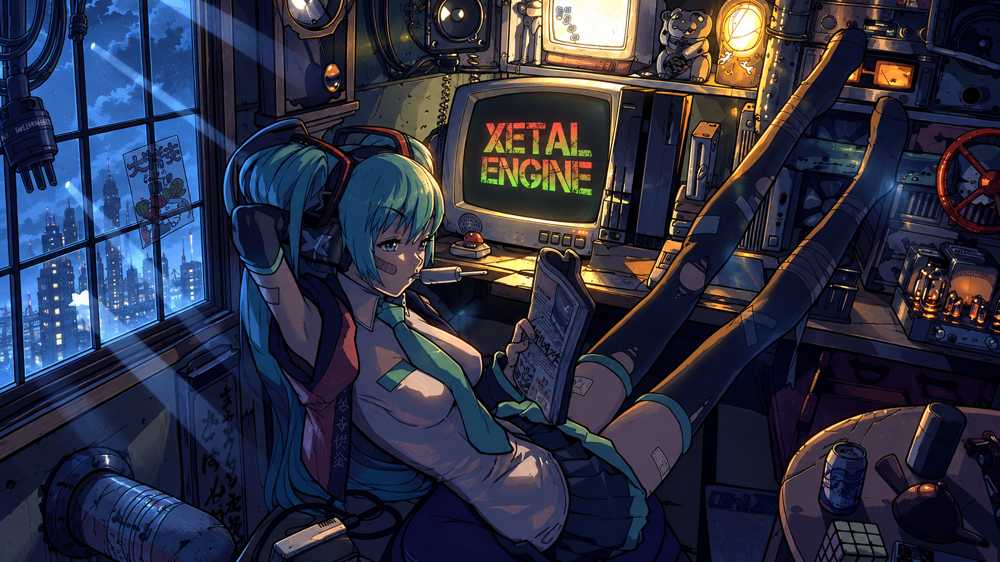

# Xetal / Hyprland

The complete Xetal desktop: our application menu, Control desk, themes, animated startup, workspace bar, screen-sharing picker, and the original wallpaper. All custom components are included as source and built on the computer where you install them.



## Install

Use a recent Hyprland installation, open a terminal **as your regular desktop user**, and run:

```bash
git clone https://github.com/XetalEngine/x_hyperland.git
cd x_hyperland
./x_hyperinstall.sh
```

The installer checks dependencies, offers the appropriate distribution packages, builds all native components, and validates the complete configuration. It then asks to install the prepared desktop and backs up your existing `~/.config/hypr` before replacing it. **Log out and select Hyprland again** to start the complete desktop, including the portal picker.

Current requirements: **Hyprland 0.56+, Waybar 0.15+, Kitty 0.49+, Hyprpaper 0.8+, Python 3.11+**, Qt 5/6 development headers, and the Hyprland desktop portal. These minimums preserve the actual features in this desktop, including Kitty's draggable scrollbar and the native workspace taskbar. Older distribution packages need upgrading first; the installer stops before replacing your configuration if requirements are unmet.

Arch/CachyOS is the tested build environment. Package recipes are also provided for Fedora and Debian/Ubuntu; their installed versions still have to pass the same checks. Other distributions can install the [listed dependencies](docs/DEPENDENCIES.md) and use `--skip-packages`. Distribution recipes outside Arch have not been execution-tested here.

## The whole desktop

| Component | Included behavior |
| --- | --- |
| Apps menu | Resizable menu, search and categories, favorites, custom icons/commands, terminal options, duplicate shortcuts, floating launch, and hotkey badges/editing. |
| Top bar | Per-display workspaces, every app's icon, + to add a workspace, red × to remove an empty one, draggable pinned apps, media controls, device/status indicators and tray. |
| Control desk | Hotkeys, Audio, Network, Bluetooth, Displays, Input, Theme, Calendar and System tabs, with visible close controls. |
| Hotkeys | Capture/edit shortcuts, searchable categories, pending-change log, Apply/Discard, remove confirmation, validation, history and rollback. |
| Audio | Output/microphone controls and an embedded mixer with horizontally scrolling columns for each app, playback/recording, mute and routing. |
| Displays | Drag monitor rectangles; configure resolution, refresh, scaling, rotation and mirroring with timed Keep/Revert protection. |
| Theme | Dark, Light and High contrast palettes, live Qt 5/6 theme plugins, matching GTK appearance, window effects and per-monitor wallpapers. |
| Wallpaper | The exact included image, monitor previews, individual assignments, fit modes, and image-picker previews/file properties. |
| Startup | Five-second login delay, then the staggered Fastfetch, Matrix, clock and Xetal animated ASCII consoles. |
| App switcher | Super+Tab across all monitors/workspaces; release Super to focus the selected app on its original monitor. |
| Dolphin | Separate themed profile, Places icons, image wallpaper action, and folder-link handling. |
| Kitty | Animated cursor, themed colors and an interactive scrollback scrollbar. |
| Screenshots | Area/all-display capture, clipboard copy, clickable notifications and Open containing folder with the image selected. |
| Screen sharing | Custom Hyprland portal picker with updating monitor/window previews and region selection. |
| Session | Matching lock screen, notifications and session-owned helpers. |

## Your hardware and existing desktop

The default install uses **your current monitor names, positions, resolutions and scaling**. Outside a running Hyprland session, it uses preferred modes and automatic placement. The startup scene uses the second display when available, and fits a single-display setup too. Network adapters and temperature sensors are detected at runtime.

The complete original three-monitor configuration is retained in [`profiles/xetal-original`](profiles/xetal-original). Use `--profile original` only for the original DP-4/DP-5/DP-6 arrangement and supported modes. You can otherwise arrange screens through Control desk → Displays.

Installation is scoped to `~/.config/hypr` and private backups under `~/.local/state/xetal-hyprland`. It preserves shared KDE/Plasma settings, shell profiles, application associations outside this session, and system autostart. It does not restart portal/audio services, close your applications, or change your login manager. Package installation uses your distribution's package manager and its normal administrator permissions.

The bundled Fira Code Nerd Font is loaded by this session's font configuration. Papirus and Noto are installed as dependencies. Your existing shell and prompt stay available in Kitty.

Favorites retain the original desktop-entry IDs and include portable terminal, file manager and browser entries. Apps appear when installed. **Separate programs such as Echo, XMusic, CachyOS Tools, Linux Studio, Discord and GitHub Desktop are not bundled application binaries or separate source repositories.** This repo contains the entire Hyprland desktop and its custom tools; you install your applications separately. Launch preferences, pinning and app hotkeys work with any installed application.

## Check, prepare, restore

```bash
./x_hyperinstall.sh --check                         # Dependencies and versions; no writes
./x_hyperinstall.sh --dry-run                       # Installation plan; no writes
./x_hyperinstall.sh --skip-packages                 # Use dependencies already installed
./x_hyperinstall.sh --prepare /tmp/xetal-review      # Build/validate a separate review copy
./x_hyperinstall.sh --no-startup                    # Keep Super+D; skip the login animation
./x_hyperinstall.sh --yes                           # Accept package/install prompts
./x_hyperinstall.sh --restore /path/printed/backup  # Restore the previous configuration
```

The prepare destination must not already exist. The normal installer builds in a staging directory and refuses to overwrite configuration edited during preparation. Restore retains the replaced Xetal profile in the installer's `replaced/` directory, including any changes you made after installing. A symlinked previous Hyprland directory is backed up/restored as a symlink; its original target is left intact.

## Shortcuts

| Shortcut | Action |
| --- | --- |
| Super+Space / Super+R | Apps |
| Super+K | Control desk / Hotkeys |
| Super+A | Audio mixer |
| Super+Q / Super+Enter | Kitty |
| Super+E | Dolphin |
| Super+Tab / Super+Shift+Tab | App switcher, forward/reverse |
| Super+number | Switch workspace |
| Super+Shift+number | Move the focused app to that workspace |
| Super+V | Toggle floating |
| Super+C | Close the focused window |
| Super+Shift+K | Force-kill the application under the pointer |
| Super+/ | Window shortcut overlay |
| Super+D | Show/hide the animated dashboard |
| Super+Shift+S / Super+S | Send to / show the Magic workspace |
| Super+L | Lock |
| Print / Shift+Print | Capture an area / all displays |

Super+Shift+K is for stuck applications: it sends SIGKILL without a save prompt, which can close other windows belonging to the same app process. It targets the window under the pointer, does nothing over empty desktop or the bar, and appears in Control desk → Hotkeys → Window hover.

## Source and checks

`config/hypr/` contains the complete desktop payload. `installer/` handles dependency checks, rendering, builds, installation and restore. Machine-specific original settings live under `profiles/`. Native modules are compiled locally, rather than distributing binaries tied to the author's Qt version or architecture.

```bash
python3 -m unittest discover -s tests -v
./tests/run-desktop-tests.sh
./x_hyperinstall.sh --skip-packages --prepare /tmp/xetal-build-check
```

See [validation notes](docs/VALIDATION.md), [dependencies](docs/DEPENDENCIES.md), [third-party notices](THIRD_PARTY_NOTICES.md), and the detailed [desktop guide](config/hypr/README.txt).

Browser profiles, credentials, caches, recent-file history, private bookmarks, session logs and compiled build artifacts are excluded. The wallpaper and font assets have checksums in [`assets-manifest.json`](assets-manifest.json).
