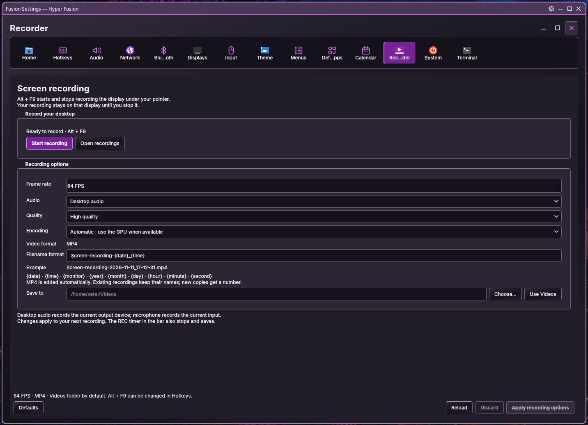
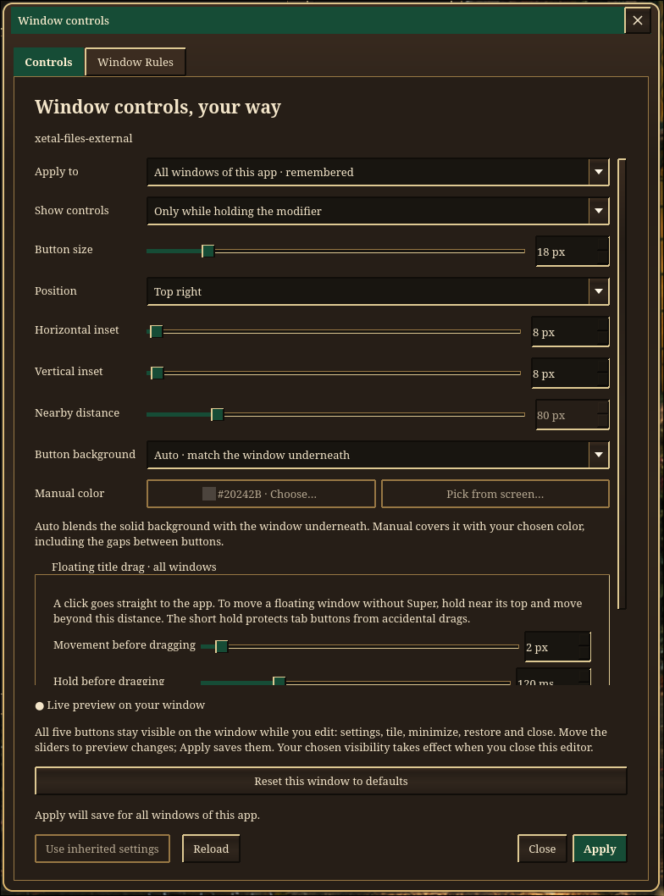
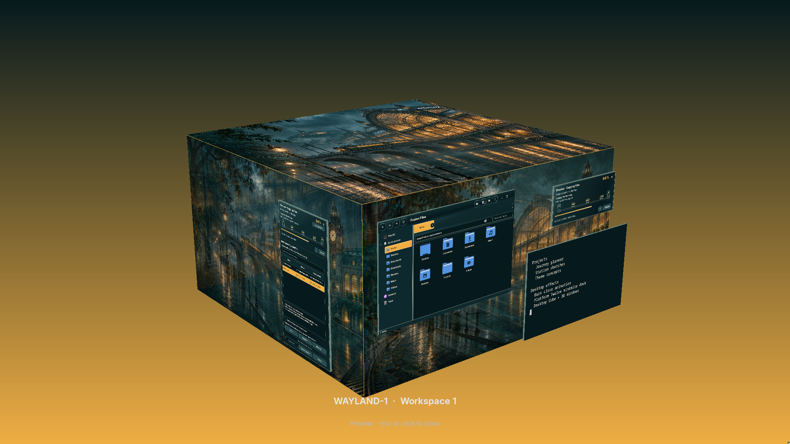
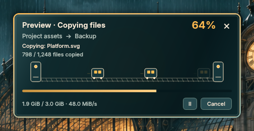
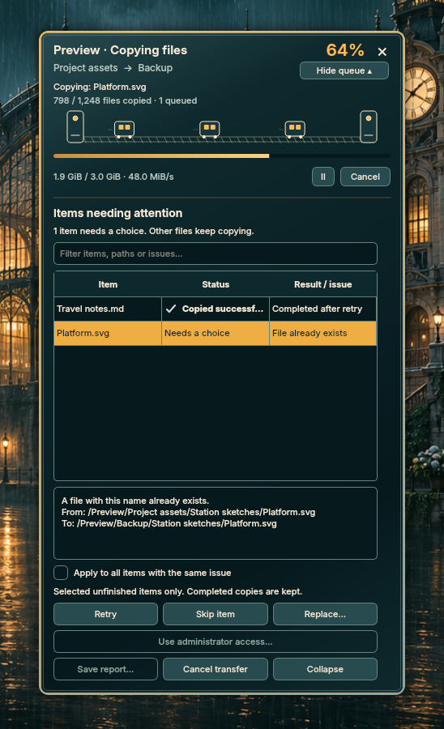

# Hyper Fusion · Highlighted features

  
   <a href="https://youtu.be/z3_uTzZglvg"><strong>▶ Watch Hyper Fusion in action on YouTube</strong></a>

- **[Alt+F9 screen recording](#altf9-screen-recording)** — capture a monitor with audio, automatic GPU encoding and MP4 saving.
- **[Four window modes](#four-window-modes)** — Individual, Force tiling, Force floating and KDE mode, chosen per workspace.
- **[One cube per monitor](#one-cube-per-monitor)** — four independent workspace faces on each display, with live windows and optional 3D depth.
- **[Fusion's file-transfer engine](#copy-cut-and-move-with-fusion-files)** — Copy, Cut/Paste and Move with animated progress, visible decisions, verified moves and Undo.

## Alt+F9 screen recording

Press **Alt+F9** to record the monitor under your pointer. Press it again, or click the taskbar's **REC** timer, to stop and save. The recording stays on that monitor when you move the pointer or switch workspaces.

The defaults are **64 FPS · MP4 · desktop audio · high quality · your Videos folder**. Open **Fusion Settings → Recorder** to choose the frame rate, quality, GPU/CPU encoding, desktop audio/microphone/no audio, filename pattern and save location. The saved-recording notification opens Fusion Files with your video selected.

**Recording and codec support are included in Setup:** `wf-recorder` captures the desktop, and FFmpeg supplies encoding/decoding support and MP4 finalization. Automatic encoding probes **NVIDIA NVENC** and **VA-API**, with a software fallback; you can also choose CPU encoding directly. Capture performance depends on your hardware and display. [Recording guide →](recording/README.md)

*Author-supplied live desktop capture. The thin bar at the very top belongs to KDE mode; the Recorder page and its own header remain below it.*

## Four window modes

Each workspace remembers its own mode. **Left-click the mode indicator between Keys and Update** to cycle **Individual → Force tiling → Force floating → KDE mode**. Or right-click a numbered workspace and choose **Force window layout**. Different workspaces and monitors can use different modes at the same time.

| Mode | How windows behave |
| --- | --- |
| **Individual** | Normal Hyprland behavior and each app's saved floating/tiling choices. Returning here releases layout forcing and keeps the current arrangement. |
| **Force tiling** | Managed app windows join the tiling layout, including newly opened or incoming windows. Maximize/restore remains available within that layout. |
| **Force floating** | Managed app windows float, using remembered dimensions fitted to the display. Activating a window brings its drawing and input to the front together, including over maximized apps. |
| **KDE mode** | Floating behavior plus a dedicated title bar above app content, with gear, minimize, maximize/restore and close. This is a mode inside Hyprland; it does not switch your session to KDE Plasma. |

These policies manage application windows. Menus, tooltips and desktop panels keep their own behavior. [Workspace guide →](workspaces/README.md)

## KDE title bars and Super overlays

**KDE mode extends the window above its content.** Its title bar is **30 pixels tall with the default 18-pixel buttons**, and grows with your chosen button size. Drag the bar without Super, or double-click its title area to maximize/restore. Maximization leaves space for the bar; true fullscreen hides it. Apps retain their own headers.

**Super-key overlay controls appear over the existing window.** Hold Super over a window to reveal Fusion's controls without adding a permanent title bar. The gear editor offers modifier-only, Always, Nearby and Off visibility, plus button size, position, insets and background choices.

| | KDE title bar | Super-key overlay controls |
| --- | --- | --- |
| **Placement** | A reserved strip above the app's content. | Buttons drawn over the app's existing surface. |
| **Visibility** | Present while enabled; hidden in true fullscreen. | Modifier-only by default; Always, Nearby and Off are also available. |
| **Actions** | Gear, minimize, maximize/restore and close. | Gear, tile, minimize, maximize/restore and close. Tile is omitted where floating is forced. |
| **Moving windows** | Drag the title area without Super; the bar moves and wobbles with the window. | Super+left-drag remains available; overlays hide while the window moves or settles. |
| **Saved choices** | Separate KDE settings for this app or this window. | Standard app/window settings, with optional workspace overrides. |

To disable the added bar, open its **gear**, uncheck **Add a title bar above the app**, choose **Only this window** or **All windows of this app**, and **Apply**. Window-only choices last until that window closes; app choices persist across logins. KDE returns to its overlay controls for that window/app. Hold Super to reach the gear again when those controls are hidden. KDE choices stay separate from the other modes.

Outside KDE mode, the workspace's **Force modifier buttons** menu independently selects **Individual** (your app/window choices), **On** (shared, always-visible controls), or **Off** (hide all Fusion overlay buttons, including under Super). KDE temporarily uses its own settings and preserves that workspace choice for when you leave KDE mode.

See the Super-overlay settings editor

*Author-supplied screenshot of the overlay editor. It shows the settings for controls drawn on the target window; it is not an extra title bar on that target.*

[Window-controls guide →](effects/window_close/README.md)

## One cube per monitor

**Each monitor owns a cube with four workspace faces, numbered 1–4 on its own taskbar.** Hold **Ctrl+Alt+left mouse** and drag to rotate the cube on that monitor. Release to choose a face; Escape cancels. The other monitors keep their current workspaces.

**Super+1–4** switches faces on the monitor under the pointer; **Super+Shift+1–4** sends the active window to a face there. Choose standard workspace animations or automatic cube rotation when switching normally. Customize wall transparency, ceiling/floor artwork, moving skies and the spacing/thickness of raised **3D windows**.

*Actual compositor preview of one monitor's cube, captured in an isolated session. Each connected monitor has its own cube and workspace selection.* [Cube guide →](effects/cube/README.md)

## Copy, Cut and Move with Fusion Files

**Fusion Files has its own streaming engine for local Copy, Cut/Paste and Move operations.** Files begin transferring while totals are counted in the background. The themed card shows the current file, file counts, bytes, speed and progress, with pause/resume and cancel controls.

| Compact progress | Expanded attention queue |
| :---: | :---: |
|  |  |

- **Keep useful work moving.** Accessible files continue while conflicts or errors collect in an expandable attention panel below the same card.
- **See what your choice did.** Retry, Skip, Replace and administrator-access actions update each row's status. Apply a decision to similar issues, filter the queue, or save a report.
- **Move with verification.** Same-filesystem moves use an atomic rename when possible. Cross-filesystem moves copy and compare the contents before removing unchanged, verified originals. Skipped items stay at the source.
- **Undo local transfers.** A disk-backed journal records the operation, and Undo checks for changed files before removing copied results.
- **Use the same progress interface for archives.** The bundled **7-Zip** manager handles compression and extraction with Fusion's animated cards and attention queue.

*The transfer pictures are previews with sample jobs; their speeds and counts are examples.* [File-engine guide →](file_manager/README.md#dragging-files) · [Archive manager →](archive_manager/README.md)

## More of the desktop, built in

**Wobbly windows, Burn closing effects, per-monitor minimize docks and live task switchers** bring the Compiz-style desktop together. **Real Desktop icons** show your files and folders, with positions remembered per monitor. Theme presets coordinate the launcher, panels, controls, icons, cursors, sounds, wallpapers and transfer animations, while Mix & match lets you choose pieces independently.

**Fusion Files, the Control Panel, KVM tools, the Proton application manager and Fusion RDP** are part of the desktop. The RDP client has saved connections, credential storage and an auto-hiding session toolbar, using FreeRDP's protocol libraries. [Desktop icons →](desktop_menu/README.md) · [Control Panel →](control_panel/README.md) · [Fusion RDP →](control_panel/rdp/README.md)
