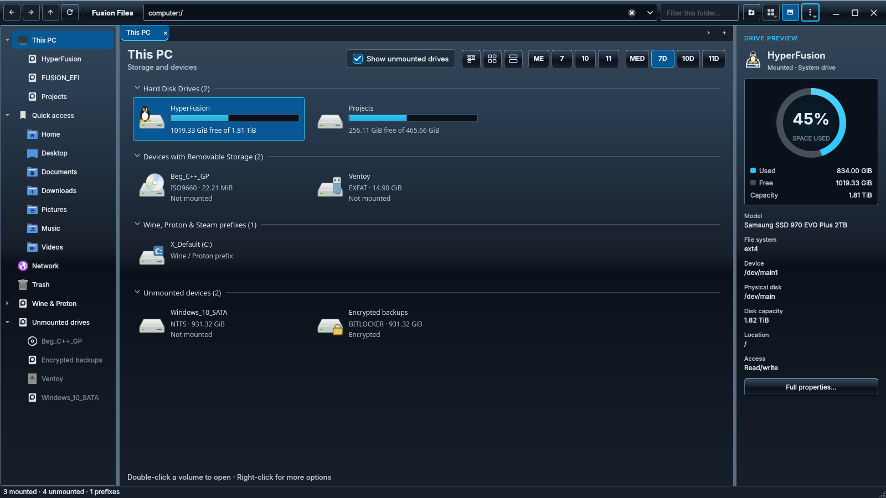
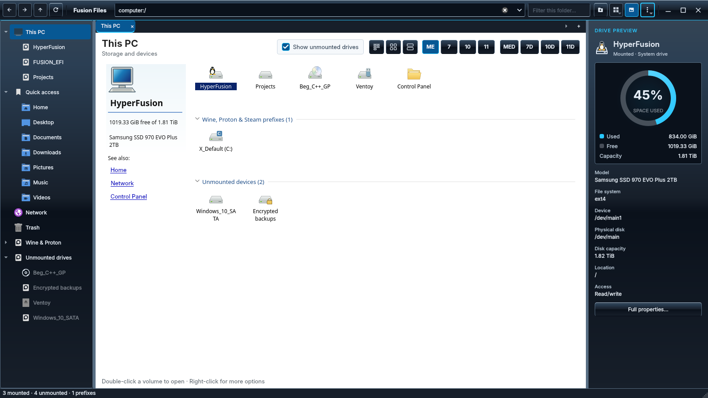
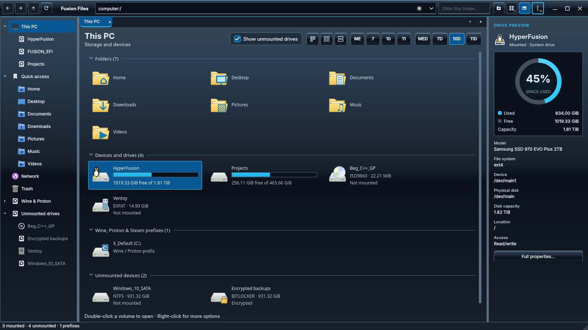
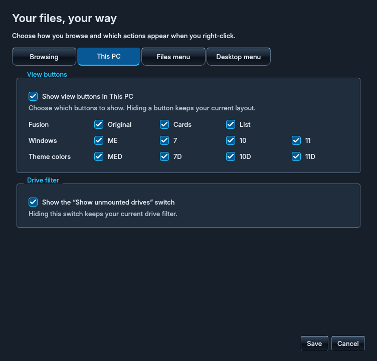
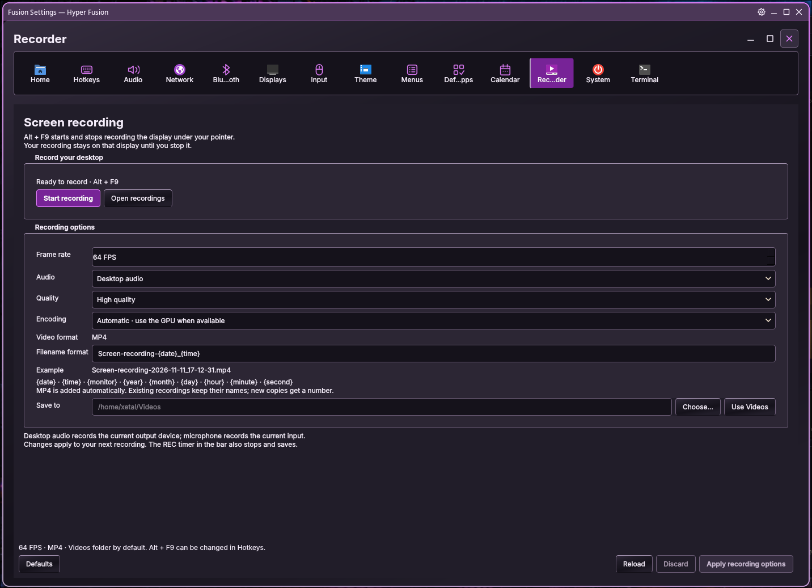
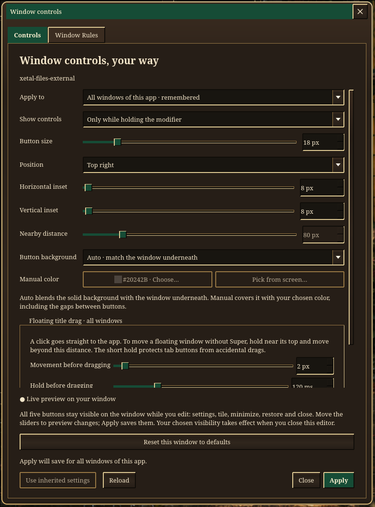
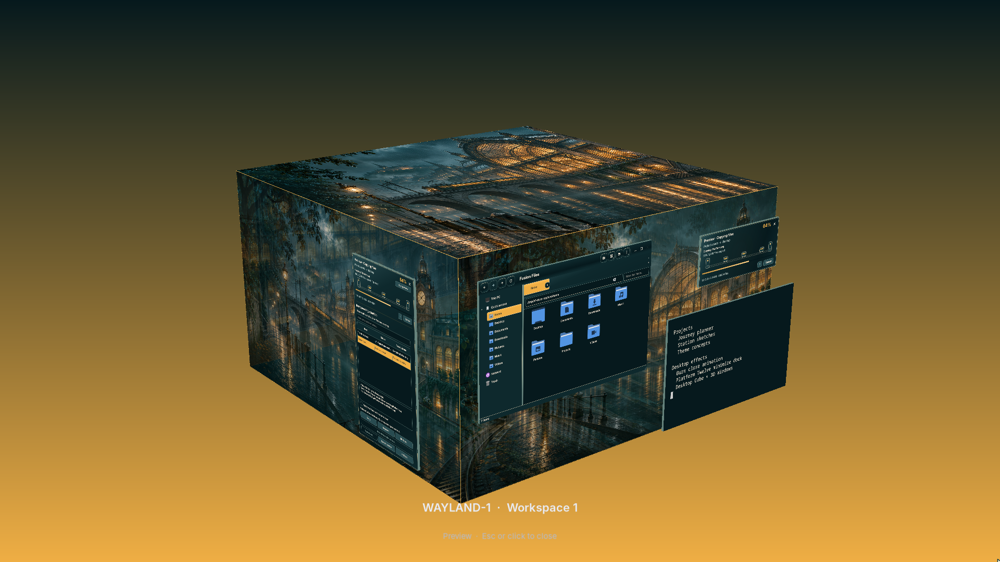
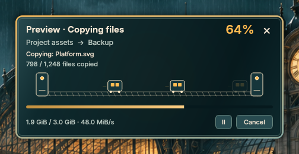
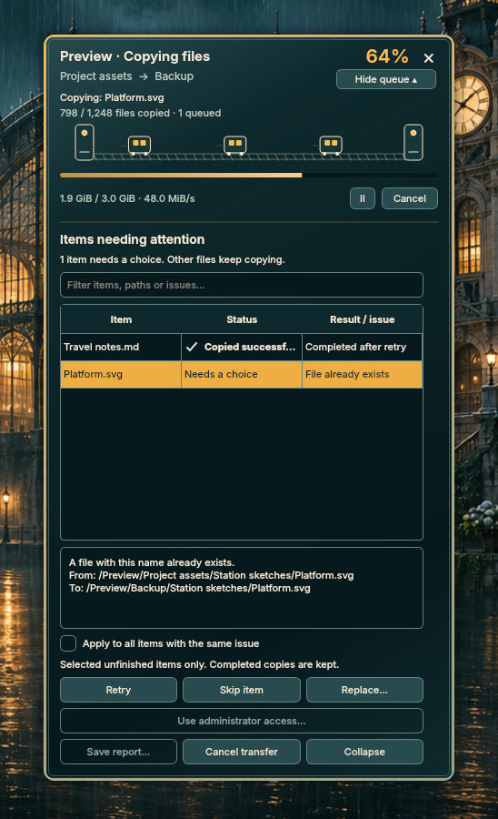

# Hyper Fusion · Highlighted features

**Fusion Files, redesigned.** Eleven This PC layouts, theme gradients and controls you choose.

[Watch Hyper Fusion in action on YouTube](https://youtu.be/z3_uTzZglvg)

- **[Fusion Files](#fusion-files)** — eleven This PC layouts, theme gradients, drive previews, Wine/Proton drives and controls you can make your own.
- **[Alt+F9 screen recording](#altf9-screen-recording)** — capture a monitor with audio, automatic GPU encoding and MP4 saving.
- **[Four window modes](#four-window-modes)** — Individual, Force tiling, Force floating and KDE mode, chosen per workspace.
- **[One cube per monitor](#one-cube-per-monitor)** — 4–10 independent workspace sides on each display, with live windows and optional 3D depth.
- **[Fusion's file-transfer engine](#copy-cut-and-move-with-fusion-files)** — Copy, Cut/Paste and Move with animated progress, visible decisions, verified moves and Undo.

## Fusion Files

**Your whole computer, in one place.** Fusion Files brings system disks, connected media and Windows-app prefixes into a native file manager built for Hyper Fusion. The redesigned **This PC** keeps your main drive first, puts mounted and removable storage within reach, and gives unmounted internal drives their own section at the bottom.

**Choose from eleven layouts.** Fresh installs open in **7D**, with compact drive tiles and your theme's colors and background gradient. Existing saved choices stay yours.

| Look | View buttons | What changes |
| --- | --- | --- |
| **Fusion** | Original · Cards · List | Separate disk headings, uniform cards or compact storage rows; system-partition controls stay with their disk. |
| **Classic Windows styles** | ME · 7 · 10 · 11 | White main panes: ME's small icons and information column, 7's grouped tiles, 10's folders and drives, or 11's larger tiles. |
| **Your theme colors** | MED · **7D** · 10D · 11D | The same four layouts with Fusion Files' palette, selections, capacity bars and background gradient, in dark, light or high-contrast mode. |

| ME · classic icons and information | 10D · folders and drives in your theme |
| :---: | :---: |
|  |  |

- **Click a drive to understand it.** The slim preview shows its label, model, capacity, filesystem and location. Mounted drives add a space-usage chart; unmounted drives show the information already available. Open **Full properties…** for the complete overview.
- **Find your Windows-app files.** Custom prefixes from **Control Panel → Proton**, Wine and Steam appear as browsable **C:** drives. Connected CD/DVD and ZIP media come before USB devices; the Linux system disk keeps its little penguin.
- **Keep the theme you love.** Follow the current desktop theme or pick a separate theme for Files in **⋮ → Configure Fusion Files… → Browsing → Appearance**. The D layouts carry that palette and gradient into This PC.
- **Choose what stays visible.** The **Show unmounted drives** switch filters the final section while connected removable media stays available. The new **This PC** settings tab lets you show or hide each layout button, the entire button set, or the filter switch. All controls start visible; hiding them keeps your selected view and filter.

<strong>See the new This PC settings</strong>

Open **⋮ → Configure Fusion Files… → This PC**, choose the controls you want, then **Save**. The larger dialog gives Browsing and This PC their own pages, and your choices survive reopening.

**More than a drive browser:** tabs with reopen-closed-tab support, five folder views, remembered folder settings, local thumbnails, image/text previews, name and content search, network locations, configurable menus and the bundled **7-Zip** archive manager. Copy, Cut/Paste and Move use [Fusion's streaming transfer engine](#copy-cut-and-move-with-fusion-files), with an attention queue and Undo.

*Screenshots show the actual native application with sample drives and usage figures.* [Compare the layouts →](https://github.com/XetalEngine/x_hyperland/blob/main/docs/GALLERY.md#fusion-files) · [Fusion Files guide →](file_manager/README.md)

## Alt+F9 screen recording

Press **Alt+F9** to record the monitor under your pointer. Press it again, or click the taskbar's **REC** timer, to stop and save. The recording stays on that monitor when you move the pointer or switch workspaces.

The defaults are **64 FPS · MP4 · desktop audio · high quality · your Videos folder**. Open **Fusion Settings → Recorder** to choose the frame rate, quality, GPU/CPU encoding, desktop audio/microphone/no audio, filename pattern and save location. The saved-recording notification opens Fusion Files with your video selected.

**Recording and codec support are included in Setup:** `wf-recorder` captures the desktop, and FFmpeg supplies encoding/decoding support and MP4 finalization. Automatic encoding probes **NVIDIA NVENC** and **VA-API**, with a software fallback; you can also choose CPU encoding directly. Capture performance depends on your hardware and display. [Recording guide →](recording/README.md)

*Author-supplied live desktop capture. The thin bar at the very top belongs to KDE mode; the Recorder page and its own header remain below it.*

## Four window modes

Each workspace remembers its own mode. **Left-click the mode indicator between Keys and Update** to cycle **Individual → Force tiling → Force floating → KDE mode**. Or right-click a numbered workspace and choose **Force window layout**. Different workspaces and monitors can use different modes at the same time.

**Fresh installs default to KDE mode on every workspace**, including new workspaces and Cube faces added later on any monitor. Per-workspace choices override that default. Updates keep existing users' workspace settings.

| Mode | How windows behave |
| --- | --- |
| **Individual** | Normal Hyprland behavior and each app's saved floating/tiling choices. Returning here releases layout forcing and keeps the current arrangement. |
| **Force tiling** | Managed app windows join the tiling layout, including newly opened or incoming windows. Maximize/restore remains available within that layout. |
| **Force floating** | Managed app windows float, using remembered dimensions fitted to the display. Activating a window brings its drawing and input to the front together, including over maximized apps. |
| **KDE mode** | Floating behavior plus a dedicated title bar above app content, with gear, minimize, maximize/restore and close. This is a mode inside Hyprland; it does not switch your session to KDE Plasma. |

These policies manage application windows. Menus, tooltips and desktop panels keep their own behavior. [Workspace guide →](workspaces/README.md)

## KDE title bars and Super overlays

**KDE mode extends the window above its content.** Its title bar is **30 pixels tall with the default 18-pixel buttons**, and grows with your chosen button size. Drag the bar without Super, or double-click its title area to maximize/restore. Maximization leaves space for the bar; true fullscreen hides it. Apps retain their own headers.

**Super-key overlay controls appear over the existing window.** Hold Super over a window to reveal Fusion's controls without adding a permanent title bar. The gear editor offers modifier-only, Always, Nearby and Off visibility, plus button size, position, insets and background choices.

| | KDE title bar | Super-key overlay controls |
| --- | --- | --- |
| **Placement** | A reserved strip above the app's content. | Buttons drawn over the app's existing surface. |
| **Visibility** | Present while enabled; hidden in true fullscreen. | Modifier-only by default; Always, Nearby and Off are also available. |
| **Actions** | Gear, minimize, maximize/restore and close. | Gear, tile, minimize, maximize/restore and close. Tile is omitted where floating is forced. |
| **Moving windows** | Drag the title area without Super; the bar moves and wobbles with the window. | Super+left-drag remains available; overlays hide while the window moves or settles. |
| **Saved choices** | Separate KDE settings for this app or this window. | Standard app/window settings, with optional workspace overrides. |

To disable the added bar, open its **gear**, uncheck **Add a title bar above the app**, choose **Only this window** or **All windows of this app**, and **Apply**. Window-only choices last until that window closes; app choices persist across logins. KDE returns to its overlay controls for that window/app. Hold Super to reach the gear again when those controls are hidden. KDE choices stay separate from the other modes.

Outside KDE mode, the workspace's **Force modifier buttons** menu independently selects **Individual** (your app/window choices), **On** (shared, always-visible controls), or **Off** (hide all Fusion overlay buttons, including under Super). KDE temporarily uses its own settings and preserves that workspace choice for when you leave KDE mode.

See the Super-overlay settings editor

*Author-supplied screenshot of the overlay editor. It shows the settings for controls drawn on the target window; it is not an extra title bar on that target.*

[Window-controls guide →](effects/window_close/README.md)

## Clipboard history and KDE snap layouts

**The clipboard icon beside Notifications, or Super+Shift+V, opens clipboard history.**
The themed dropdown follows your monitor and top/bottom bar, and uses the same
close effects as Apps and Power, including Burn when enabled. Search recent text and images, pin
useful entries, delete items, or pause collection. Enter copies the selected
item and returns you to the app; Ctrl+V pastes. Recent history stays in memory,
while explicit pins survive logout. [Clipboard guide →](clipboard/README.md)

**KDE mode supports snap layouts.** Drag to a side for halves or a corner for
quarters. Drag to the top edge to reveal a compact picker with halves, quarters
and thirds. Pause briefly over the preview, then release. Dragging away restores
the window's previous size; Escape cancels snapping. The gear editor includes
an **Apply snap settings** control for all KDE workspaces. Other workspace modes
keep their existing drag behavior.

## One cube per monitor

**Each monitor owns a cube with 4–10 workspace sides, numbered locally on its own taskbar.** Hold **Ctrl+Alt+left mouse** and drag to rotate the cube on that monitor. Release to choose a face; Escape cancels. The other monitors keep their current workspaces. Use **+** to add a side, up to ten. The red **×** removes an empty workspace while keeping at least four. Added and removed sides are saved for future logins. **Super+0** selects side 10 when it exists.

**Super+1–0** switches faces on the monitor under the pointer; **Super+Shift+1–0** sends the active window to a face there. Choose standard workspace animations or automatic cube rotation when switching normally. Customize wall transparency, ceiling/floor artwork, moving skies and the spacing/thickness of raised **3D windows**.

*Actual compositor preview of one monitor's cube, captured in an isolated session. Each connected monitor has its own cube and workspace selection.* [Cube guide →](effects/cube/README.md)

## Copy, Cut and Move with Fusion Files

**Fusion Files has its own streaming engine for local Copy, Cut/Paste and Move operations.** Files begin transferring while totals are counted in the background. The themed card shows the current file, file counts, bytes, speed and progress, with pause/resume and cancel controls.

| Compact progress | Expanded attention queue |
| :---: | :---: |
|  |  |

- **Keep useful work moving.** Accessible files continue while conflicts or errors collect in an expandable attention panel below the same card.
- **See what your choice did.** Retry, Skip, Replace and administrator-access actions update each row's status. Apply a decision to similar issues, filter the queue, or save a report.
- **Move with verification.** Same-filesystem moves use an atomic rename when possible. Cross-filesystem moves copy and compare the contents before removing unchanged, verified originals. Skipped items stay at the source.
- **Undo local transfers.** A disk-backed journal records the operation, and Undo checks for changed files before removing copied results.
- **Use the same progress interface for archives.** The bundled **7-Zip** manager handles compression and extraction with Fusion's animated cards and attention queue.

*The transfer pictures are previews with sample jobs; their speeds and counts are examples.* [File-engine guide →](file_manager/README.md#dragging-files) · [Archive manager →](archive_manager/README.md)

## More of the desktop, built in

**Wobbly windows, Burn closing effects, per-monitor minimize docks and live task switchers** bring the Compiz-style desktop together. **Real Desktop icons** show your files and folders, with positions remembered per monitor. Theme presets coordinate the launcher, panels, controls, icons, cursors, sounds, wallpapers and transfer animations, while Mix & match lets you choose pieces independently.

**Fusion Files, Fusion Viewer, the Control Panel, KVM tools, the Proton application manager and remote desktop** are part of the desktop. **Control Panel → RDP** combines outgoing RDP/VNC connections and incoming desktop sharing in two tabs. RDP keeps its native session window, saved connections, wallet credentials and auto-hiding toolbar; VNC connections use TigerVNC. [Desktop icons →](desktop_menu/README.md) · [Control Panel →](control_panel/README.md) · [Remote desktop →](control_panel/rdp/README.md)

**Video wallpapers, unified Start search, phone integration, persistent power settings and per-monitor picture controls** extend the everyday desktop. Super+W remembers Pictures or Videos, and the Start menu finds apps, Control Panel tools and Fusion Settings pages together. Phone, Power and Displays & arrangement live in Fusion Settings.
