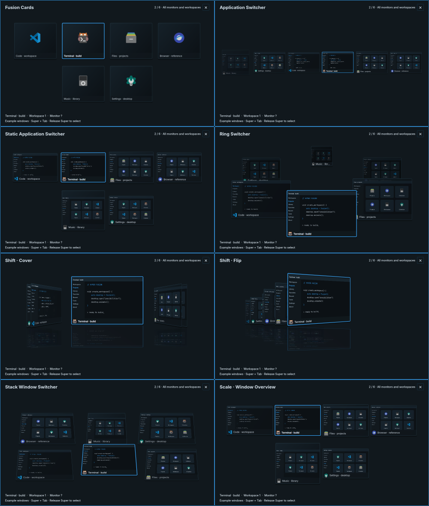

# Task Switcher

Open **Fusion Settings → Theme → Task Switcher**. Choose a style, adjust its
preview, and press **Apply Task Switcher**. The next **Super+Tab** uses that choice;
no compositor reload is required. Hold Super while cycling, use Shift+Tab for
reverse order, and release Super to focus the selection. Escape cancels. Clicking
a window preview also selects it.

| Style | Appearance | Individual controls |
| --- | --- | --- |
| Fusion Cards | Existing icon cards | Columns |
| Application Switcher | Compiz's moving thumbnail strip | Preview size, icons only |
| Static Application Switcher | Stationary thumbnail grid | Columns, preview size |
| Ring Switcher | Elliptical carousel with depth | Ring dimensions, preview size, depth scale/brightness, direction |
| Shift · Cover | Perspective covers with a reflected floor | Window size, cover offset, reflection/intensity |
| Shift · Flip | Angled window deck | Window size, flip angle, reflection/intensity |
| Stack Window Switcher | Tilted, aspect-aware window rows | Tilt, inactive window rotation |
| Scale · Window Overview | Window overview | Spacing |



Shared controls cover the window scope, animation duration, overall size, panel
opacity, inactive window opacity, live previews, titles, and icons. Appearance
follows all desktop themes and color modes. Each style keeps its own settings.
Mouse-wheel gestures over the settings controls scroll the page without changing
their values. The preview buttons operate on example windows; they never switch
applications or save settings. Reload detects external edits, and Discard restores
the last saved choices. Closing Fusion Settings includes these unsaved edits in
its existing confirmation.

All monitors/workspaces are included by default, including mapped hidden group
members and special workspaces. Optional scopes narrow this to the current
monitor, workspace, or application. Choosing a window only calls `focuswindow`;
windows retain their monitor, workspace, size, and tiled/floating state. The
switcher fits the focused monitor's logical dimensions and reserved panel area.
Grid styles page through large lists; keyboard cycling reaches every window.

## Implementation

This is a **Wayland adaptation** of all application-switching plugins found in
the supplied Compiz source: Application, Static Application, Ring, Shift's two
modes, and Stack. Scale is included as a window overview; Fusion Cards remains
available. Compiz's `vpswitch` and `mswitch` change viewports and belong to desktop
navigation rather than Super+Tab.

The original sources and option metadata are bundled in [compiz](compiz/NOTICE.md).
`geometry.py` adapts Ring's ellipse/depth equations, Shift's cover/flip equations,
and Stack's aspect-aware rows and tilt. `scene.py` projects captured window
textures onto these layouts. Application/Static/Scale use bounded strip/grid
layouts appropriate to a monitor-local popup. This does not load X11 Compiz
plugins into Hyprland, or reproduce their compositor-wide dimming/zooming of
other windows. Animation duration replaces Compiz's frame-dependent spring
speed/timestep; X11-only plugin options are not exposed as nonfunctional controls.

Thumbnails use the already-bundled `share-picker/window-preview` helper and
Hyprland's toplevel export protocol. Captures run asynchronously, two at a time,
only while the switcher is visible, with a 2.2-second timeout. At most 24 scaled
previews are held in memory. Nothing is written to disk; hiding the switcher
cancels capture and clears the cache. Missing or unavailable previews fall back
to app icons. The helper is built by the existing installer. The switcher remains
a single session-owned process and exits with the compositor.

Settings are stored in `switcher/preferences.json` inside the Hyprland profile,
using a locked, atomic write and external-edit detection. Missing settings use
the existing Fusion Cards default. The shipped default JSON is safe for the
updater's preference-preserving three-way merge.

The adapted renderer/layout and this combined switcher are distributed under
**GPL-2.0-or-later**; original permissive portions retain their notices. Original
copyrights, licenses, source paths, and SHA-256 hashes are in
[compiz/NOTICE.md](compiz/NOTICE.md) and [compiz/COPYING](compiz/COPYING).

## Verification

```sh
cd config/hypr/switcher
QT_QPA_PLATFORM=offscreen QT_QPA_PLATFORMTHEME= python3 -m unittest test_switcher test_styles
```

For a standalone sample preview, run `app.py --demo --style ring`. To render an
image without interacting with the desktop, use
`QT_QPA_PLATFORM=offscreen app.py --style cover --preview /tmp/switcher.png`.
