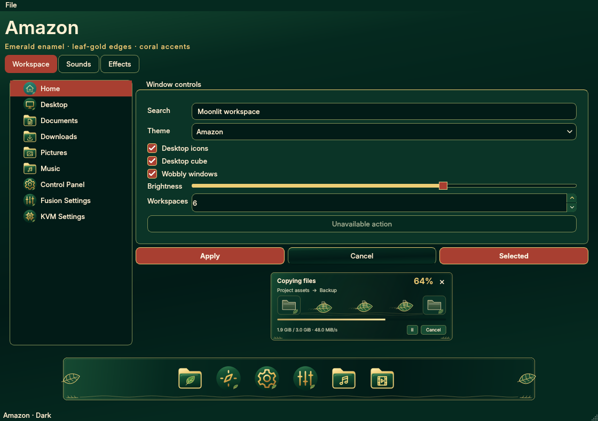
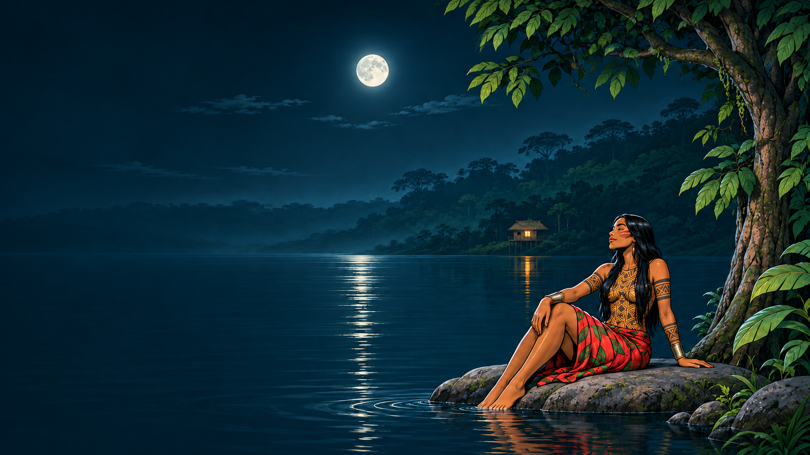
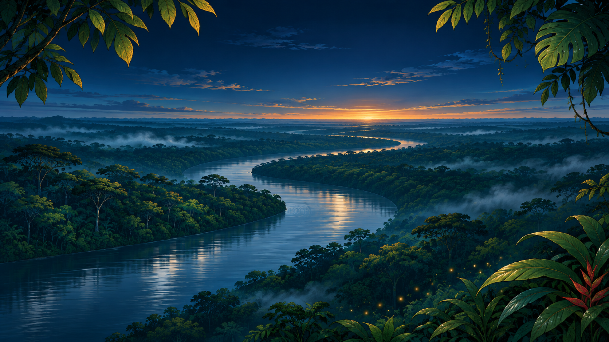
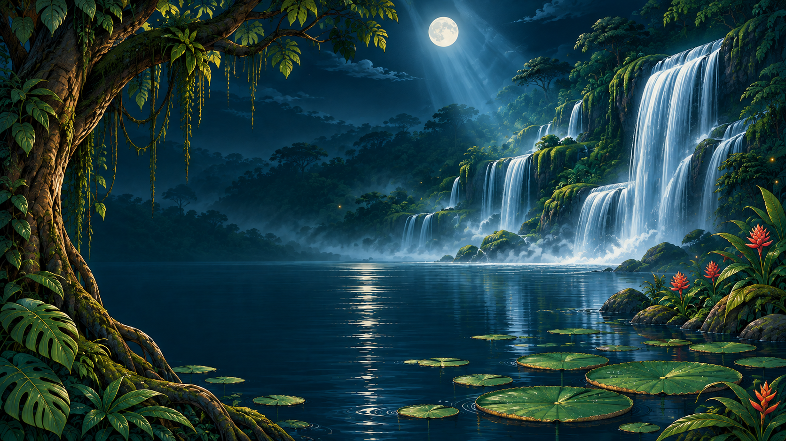
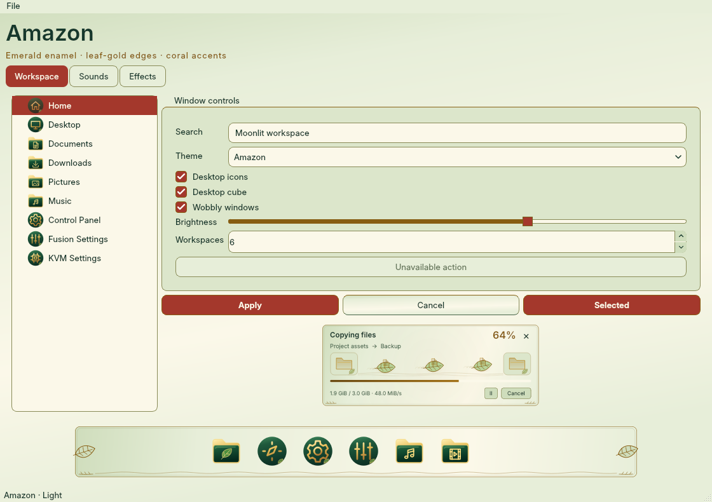
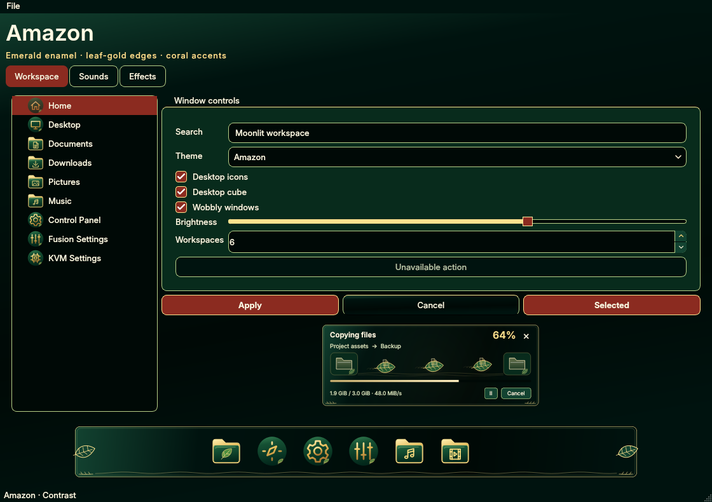

# Amazon

Moonlit rainforest greens, emerald enamel, fine gold edges, ivory text and
warm coral selections, based on the supplied Amazon desktop concept.

Choose **Fusion Settings → Theme → Presets → Amazon** and select the components
you want. Icons starts unchecked; enable it to use the matching gold and green
pack. Existing desktop choices are preserved when this theme is installed.

The theme covers Apps, all taskbar layouts, Fusion Files, file pickers, Control
Panel, menus, dialogs, notifications, task switching, terminal, lock screen,
cursors and effect colors. Amazon is also selectable in the greeter and GRUB
editors. The ISO installer retains Polaris and its Killer Instinct cabinet
GRUB default.

- **Golden Leaf cursors:** twenty shapes in Hyprcursor and XCursor formats,
  including an animated busy leaf, with the existing gold Soft glow trail.
- **Leaf-gold icons:** emerald folders, document pages and gold instruments.
  Control Panel, Fusion Settings and KVM retain distinct gear, sliders and chip
  symbols. Application fallbacks and individual overrides continue to work.
- **River transfers:** documents drift on emerald leaves; archives use small
  zip packets. Packets, wakes and glows fade before wrapping, and extraction
  reverses their direction. Speed, density and trails remain independent.
- **Riverbank dock:** enamel, leaf-vein end details and a slow gold water ripple.
  Native tray and slot rendering supports all four monitor edges.
- **River chimes:** eight original synthesized bamboo-like plucks and water
  bells, covering startup, shutdown, notification, question, warning, error,
  success and information. No sampled recordings are used.

| Moonlit River | Canopy at Dawn | Emerald Lagoon |
| --- | --- | --- |
|  |  |  |

The original illustrations were generated with the built-in imagegen tool.
[Prompts, provenance, actual dimensions and hashes](../wallpaper/amazon/prompts.json)
are included alongside the PNG originals.

| Light | High contrast |
| --- | --- |
|  |  |

The pictures above are real Qt renders with sample jobs, not a running desktop.
Validation includes three-palette native Files, picker and Control Panel
captures; Settings and Apps previews; Qt 5/6 and GTK builds; actual GTK parsing
of taskbar CSS; and icon, cursor, sound, palette and preset regression checks.
Production transfer widgets ran for three cycles across 108 speed/density/
direction/trail combinations. The production OpenGL ES dock shader rendered
both orientations and tray/slot materials. An isolated Hyprland 0.57.2 session
loaded the new cursor and dock adapters and completed minimize/restore on all
four edges. Nested compositor screenshots timed out on this host, so compositor
pixel capture is not claimed. One existing long-filter picker geometry test
also fails unchanged on the pre-Amazon source under Qt 6.12.

Native effects activate on the next desktop login; adding Amazon does not
unload effects or close current application windows.
