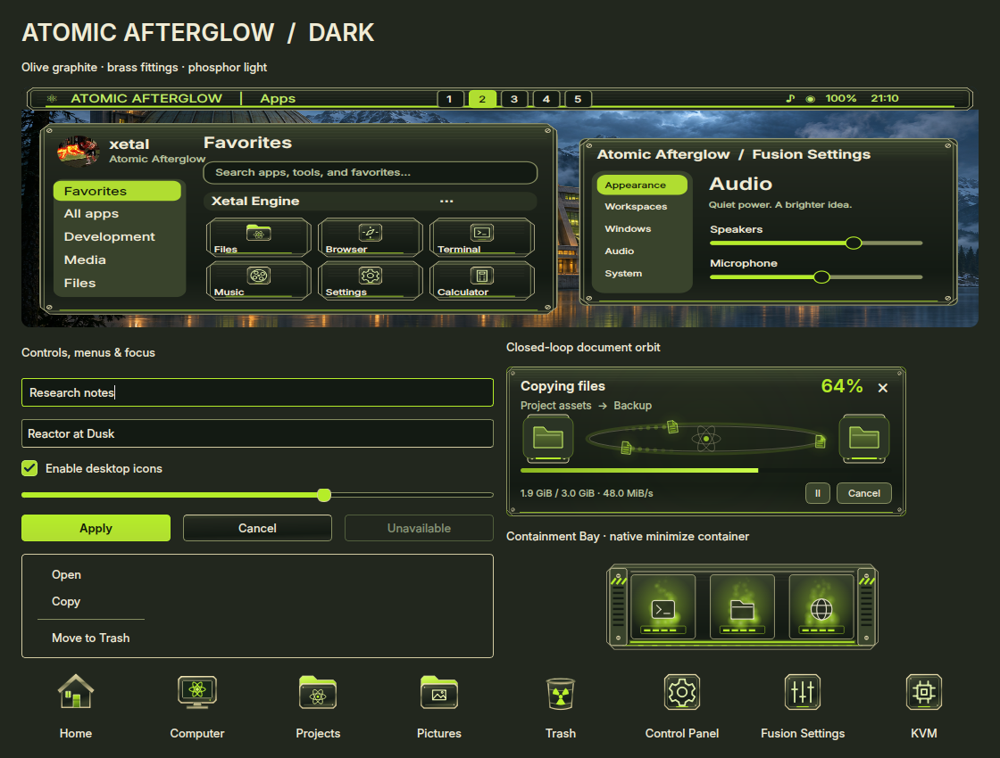

# Atomic Afterglow

Olive graphite, brass fasteners, phosphor instruments and an illuminated research
complex. Atomic Afterglow translates the reactor concept into a complete desktop
design with dark, light and high-contrast palettes.

The preview renders actual Qt controls, the gallery painter, icons, transfer
window and minimize artwork. Choose **Fusion Settings → Theme → Atomic Afterglow
→ Apply preset** and select the components you want. **Icons** stays unchecked
by default; check it to include this theme's original icon pack.

## Included

- Graphite panels, clipped corners, brass fittings and lime selections across
  Settings, launcher, Files, application file pickers and Control Panel.
- An atomic badge, instrument-style workspace buttons and hazard endcaps on the
  taskbar, including Full, Partial and Centered arrangements.
- **Containment Bay**, a native minimize container with vented sides, cartridge
  slots, fasteners and phosphor indicators. It is independently selectable.
- Documents orbiting a small reactor in the file-transfer window. Closed paths
  and periodic motion keep the animation continuous at every cycle boundary.
- Opaque notification cards and control center, matching terminal, lock screen,
  compositor accents, and optional greeter/GRUB editor palettes.
- A complete original icon pack. Control Panel uses a gear, Fusion Settings uses
  sliders, and KVM uses a CPU with pins.
- **Atomic Phosphor** cursor artwork, including an orbiting busy cursor, text,
  resize, drag/drop and unavailable shapes, with a matching Soft glow trail.
- **Phosphor signals**, eight original analog-inspired sound cues. Existing
  volume, event switches and independently selected effects are preserved.

## Three wallpapers

| Scene | Artwork |
| --- | --- |
| Reactor at Dusk | [Mountain research complex at twilight](../wallpaper/atomicafterglow/reactor-at-dusk.png) |
| Cooling Lake | [Reactor lights reflected across still water](../wallpaper/atomicafterglow/cooling-lake.png) |
| Control Hall | [Analog instruments and warm industrial light](../wallpaper/atomicafterglow/control-hall.png) |

All three original PNGs are 1672 × 941 pixels. Their exact generation prompts and
provenance are recorded in [prompts.json](../wallpaper/atomicafterglow/prompts.json).

## Verification

The theme, icon, cursor, transfer, minimize and sound suites passed. Qt 5/6,
GTK integration, cursor formats, Cube, Minimize and Control Panel builds passed.
Actual controls, menus, Files, pickers and the Control Panel were rendered in
all three palette modes. Navigation and preview panes remained visible.

Transfer motion was captured over three complete slow cycles in both the
Settings preview and transfer renderer, with 25%, 100% and 250% speeds,
densities 1/3/7, copy/extraction and trails on/off. Frame sequences and loop
boundaries were inspected; automated boundary and continuing-motion checks pass.
A disposable Hyprland session passed all 15 native minimize designs and all
nine cursor families, including restore, edges, overflow, reduced motion and
idle suspension. These focused checks do not replace every compositor stress test.

Adding the design does not select it or change personal settings. See
[AI_Theme_creation.md](../../../AI_Theme_creation.md) for the integration map.
