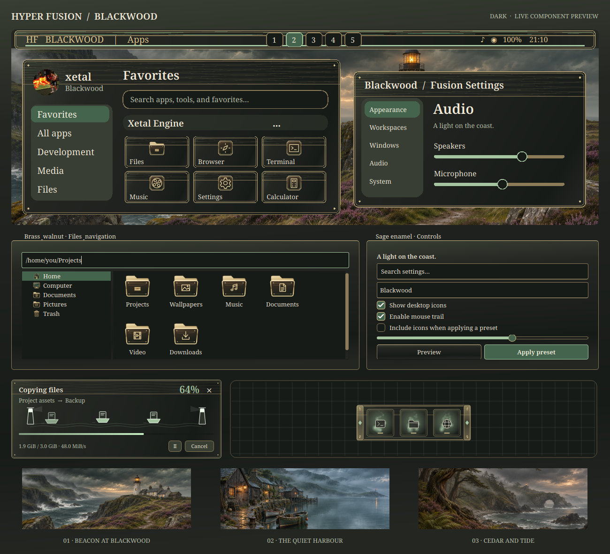

# Blackwood

Walnut joinery, aged brass, sage enamel and stormy coastal light. Blackwood
translates the user's lighthouse concept into a complete desktop design with
dark, light and high-contrast modes.

This showcase renders the actual Qt controls, gallery painter, icon pack,
file-transfer window and minimize preview. Window placement remains controlled
by your desktop settings.

Choose **Fusion Settings → Theme → Design → Blackwood → Apply preset**.
Select the components you want. **Icons** remains unchecked by default; check
it to include the original brass-and-walnut icon pack. Adding Blackwood does
not change your current theme or personal settings.

## Included

- Walnut headers, brass borders and fittings, sage selections, serif typography,
  matching window controls, launcher, Files, file pickers and Control Panel.
- An engraved HF monogram and brass workspace buttons on the taskbar, with
  Full, Partial and Centered arrangements.
- **Harbour Cabinet**, a native minimize dock with walnut grain, brass corner
  straps, sage inlays and little drawer pulls beneath the application icons.
  It can also be selected independently in Minimize settings.
- A file-transfer scene carrying document boats between two lighthouse beacons.
- Opaque notification cards and control center, plus matching terminal, lock,
  effect colors and greeter/GRUB editor palettes.
- **Blackwood Brass** cursor artwork with text, resize, busy, drag/drop and
  unavailable shapes, accompanied by a restrained sage Soft glow trail.
- **Harbour bells**, eight original cues combining wooden mallets and soft brass
  overtones. Existing volume and event switches remain yours.

## Three wallpapers

| Scene | Image |
| --- | --- |
| Beacon at Blackwood | [Stormbound lighthouse and heather path](../wallpaper/blackwood/beacon-at-blackwood.png) |
| The Quiet Harbour | [Rain on a sheltered fishing village](../wallpaper/blackwood/the-quiet-harbour.png) |
| Cedar and Tide | [Coastal woodland and a misty sea arch](../wallpaper/blackwood/cedar-and-tide.png) |

The three original wallpapers were made with the built-in image generator.
Each supplied PNG is 1672 × 941 pixels. The exact
[prompts and provenance](../wallpaper/blackwood/prompts.json) accompany the artwork.

For complete theme integration instructions, see
[AI_Theme_creation.md](../../../AI_Theme_creation.md).

## Verification

The theme, icon, cursor, transfer, minimize and sound suites passed 219 checks,
including taskbar layout on a private display. Qt 5/6, Cube and Minimize builds
succeeded. Dark, light and high-contrast renders and all three wallpapers were
visually inspected; notification CSS parsed in every mode.

A disposable Hyprland session rendered all 14 native dock designs and passed
restore, four-edge hiding, burn effects, reduced motion, multiple monitors,
overflow/scrolling and idle checks. A separate run passed all eight cursor
families with the other effects loaded. These are focused dock/cursor checks,
not a new run of every unrelated compositor stress test.
