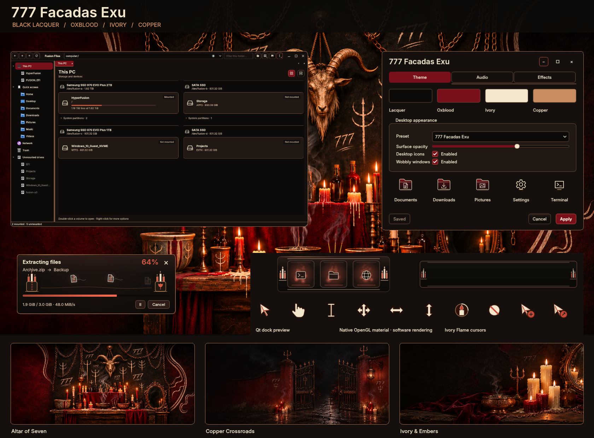

# 777 Facadas Exu

Black lacquer, oxblood velvet, warm ivory and aged copper, inspired by the
supplied candlelit desktop concept. Quiet borders, red selections and clear
Inter typography keep the artwork's atmosphere without crowding the controls.
Dark, parchment-light and high-contrast palettes are included.

Choose **777 Facadas Exu** in **Fusion Settings → Theme → Presets**. Select
**Icons** if you want the matching folder and system icons; that component stays
unchecked by default. The components can also be mixed with other themes.

The collection includes:

- Matching Fusion Settings, Start menu, Control Panel, Fusion Files and file
  picker controls, menus, title buttons, notifications and taskbar variants.
- Oxblood folder icons with ivory linework and copper details. Application
  identities remain recognizable; personal icon overrides are preserved.
- **777 Ivory Flame** cursors, including an animated candle for busy states,
  text, resize, hand, drag and other functional shapes. The preset uses the
  existing glow effect in warm red.
- Documents following a smoke ribbon between copper candle stands during file
  transfers. Extraction reverses their direction; each document and its trail
  fade together before wrapping. Pause, errors and completion use the existing
  transfer controls.
- **Candlelight Rail**, a native minimize dock with black lacquer, copper rails,
  small candle lamps and matching window slots.
- **Copper whispers**, eight original stereo sound cues: startup, shutdown,
  error, warning, information, question, success and notification. Existing
  volume, mute and per-event choices remain independent.
- Palette integration for compositor effects, terminal colors, lock screen,
  greeter presentation and GRUB appearance previews.

The three original wallpapers are available in the wallpaper picker:

| Wallpaper | Composition |
| --- | --- |
| [Altar of Seven](../wallpaper/facadasexu/altar-of-seven.png) | Red and ivory candles, a carved goat sculpture, copper mirror and chalk 777 markings. |
| [Copper Crossroads](../wallpaper/facadasexu/copper-crossroads.png) | Open iron gates, warm lanterns and a rain-dark courtyard. |
| [Ivory & Embers](../wallpaper/facadasexu/ivory-and-embers.png) | Candlelight, incense and copper, with a quieter left side for windows. |

All three were generated with the built-in imagegen tool. Exact prompts,
dimensions and asset hashes are saved in
[prompts.json](../wallpaper/facadasexu/prompts.json). The preview above combines
actual offscreen Fusion Files and transfer captures, a Qt control sample using
the production stylesheet, the production dock preview and its native shader
rendered with software OpenGL. It is not a live desktop screenshot.

## Verification and installation

The theme, icons, cursors, File Transfer, minimize and sound suites ran 253 tests
with one existing skip. Rendered-frame tests include this theme's complete
cycle and every individual document wrap. Three-cycle frame sequences were
recorded and inspected in both the Settings preview and transfer window, at
25/100/250% speed and densities 1/3/7, with copy/extraction, trails on/off and all
three palettes. Nine transfer states were also rendered in every palette.

GTK parsed all three taskbar layouts and notification palettes. The eight
sound files were decoded and checked for duration, hashes, headroom and quiet
endpoints. Native Fusion Files layouts and native Control Panel header controls
were checked offscreen. Qt 5/6 integrations, Cube's cursor adapter and Minimize
were rebuilt. The actual dock shader compiled, linked and rendered both tray
orientations and slots in all three palettes with Mesa software rendering.

A nested Hyprland session could not start in the sandbox, so live dock/cursor
behavior remains unverified here. The broader Control Panel adapter suite also
reports an existing upstream-hash mismatch for `iso/restore-boot.sh`, confirmed
in the unchanged repository HEAD; it is unrelated to this theme.

Source and assets are mirrored to the live Hyper Fusion profile, with backups
before replacement. Installation preserves the active theme and personal and
shared desktop settings. Reopen Fusion Settings to refresh its catalog. Log
out and back into Hyprland once before using the complete preset so the updated
native dock and cursor adapters load through the normal session lifecycle.
No greeter or bootloader changes are applied by adding the theme.
