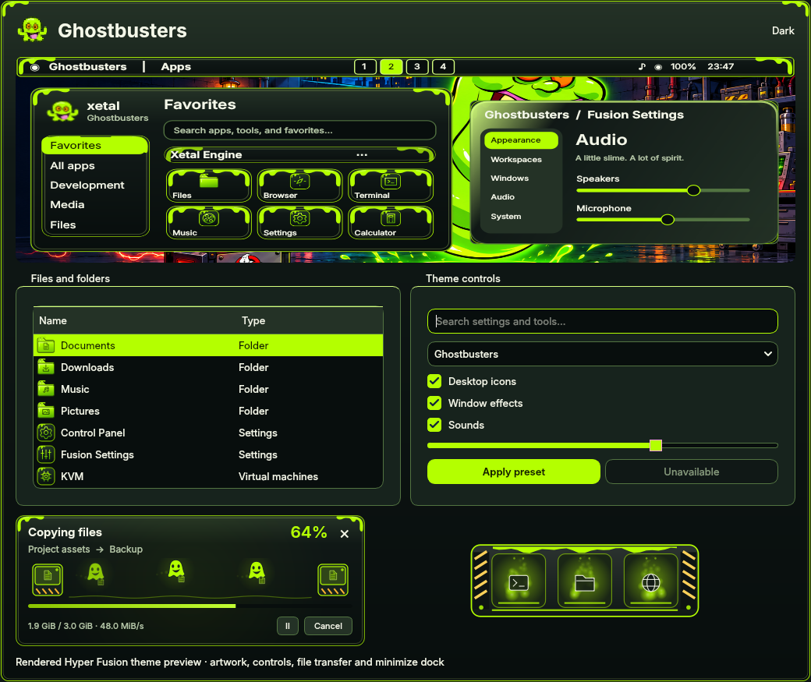

# Ghostbusters

Neon ectoplasm, midnight enamel and a little slime at the edges. This theme
takes its direction from the supplied Slimer desktop concept, with dark, light
and high-contrast palettes and Inter typography.

Choose **Ghostbusters** in **Fusion Settings → Theme → Presets** and select the
components to apply. Icons remain unchecked by default; select **Icons** for the
matching green pack. The system icon default remains Papirus for new installs.
Adding this theme preserves the current theme, wallpapers, monitor layout and
personal preferences. Components can also be selected independently.

The design includes:

- Rounded enamel controls, lime focus borders, and small slime corners on the
  launcher, theme preview and transfer cards. Decoration stays within painted
  edges and adds no input surfaces or draggable overlays.
- Full, Partial and Centered taskbars; notifications; Fusion Files and file
  pickers; Control Panel; themed menus, dialogs, terminal and lock colours.
- 133 system icon files including aliases, with separate gear, slider and
  processor symbols for Control Panel, Fusion Settings and KVM.
- The **Ectoplasm** cursor family in XCursor and Hyprcursor formats, including
  functional resize/text/drag shapes and an animated ghost busy cursor.
- Slime couriers moving documents between ghost traps during file transfers.
  Each courier, trail and glow fades before wrapping; the liquid rail and trap
  lights complete whole periodic cycles.
- The **Ghost Trap** minimize dock: striped end guards, a green liquid lip and
  illuminated slots, implemented in both the Qt preview and native shader.
  Its native ID is appended as 21; existing IDs are unchanged.
- Eight original **Ectoplasm echoes** sound cues, synthesized from the score in
  `tools/generate_sound_packs.py`. No film score or audio samples are used.

## Wallpapers

| Wallpaper | Scene |
| --- | --- |
| [Slimer at the Firehouse](../wallpaper/ghostbusters/slimer-at-the-firehouse.png) | Slimer, a moonlit arch and glowing ectoplasm inside the firehouse |
| [Ecto-1 After Hours](../wallpaper/ghostbusters/ecto-one-after-hours.png) | Ecto-1 outside the firehouse on a rainy night |
| [Containment Breach](../wallpaper/ghostbusters/containment-breach.png) | A ghost escaping into a dark containment laboratory |

All three wallpapers are **1672 × 941** and contain no painted desktop UI. The
built-in imagegen tool generated them from the supplied reference. Exact prompts,
dimensions, provenance and SHA-256 hashes are recorded in
[prompts.json](../wallpaper/ghostbusters/prompts.json). These three images are the
default monitor set in physical left-to-right order; saved personal choices
continue to take precedence.

## Validation and installation

The six theme, icon, cursor, transfer, minimize and sound suites ran **253 tests**:
252 passed and one display-dependent test was skipped. The new transfer scene
is included in the rendered cycle-boundary, per-courier wrap and continuing-motion
regressions. Semantic text pairs exceed 4.5:1 contrast in all three palettes.
Waybar CSS parses across palette/style/variant combinations; notification CSS
parses in all three modes.

Offscreen Qt screenshots cover all palettes, controls, menus, dialogs, and
running, paused, conflict, completion and error transfer cards. A timer-driven
matrix exercised **216 production widgets** (Settings preview and transfer
window): three palettes, 25/100/250% speed, density 1/3/7, copying/extraction, and
trails off/on. Every widget completed at least three loops and visited all 16
phase intervals; representative three-loop frame sequences were inspected.

Qt 5/6 integrations, both cursor formats, Cube and Minimize built successfully.
The actual native dock shader compiled and rendered through surfaceless EGL
with Mesa llvmpipe in horizontal and vertical layouts and all three palettes.
The complete live Hyprland configuration passed `--verify-config`.

The isolated nested compositor could not create its IPC/display backend in the
execution sandbox. Real-session dock restore/hover, cursor loading and native
Files/Control Panel interaction therefore remain unverified here. Offscreen
images are rendering checks, not evidence of live interaction.

Sources, assets and native outputs are installed in the repository and live
profile. **Sign out and back in once** to load the new native cursor/dock adapters,
then reopen Fusion Settings to select the theme. Existing plugins are not
unloaded underneath open applications. No commit or push is part of this change.
