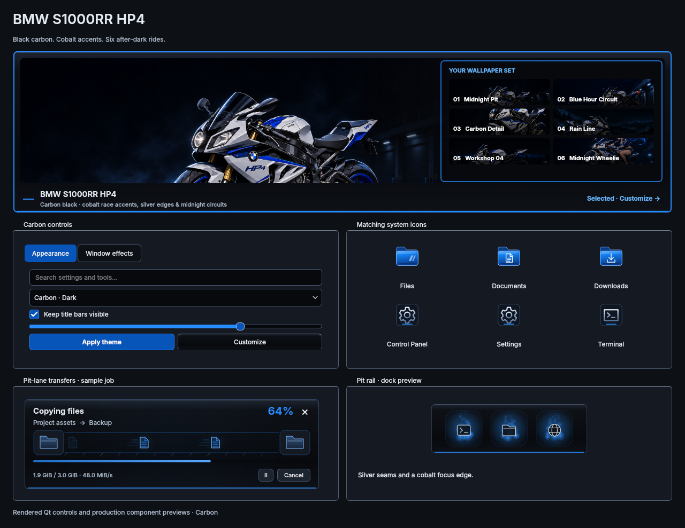
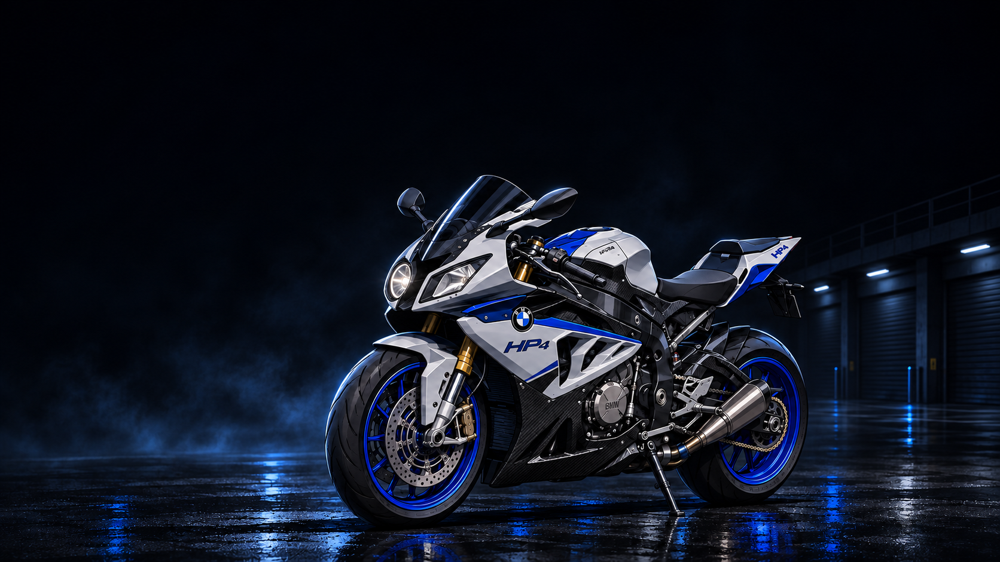
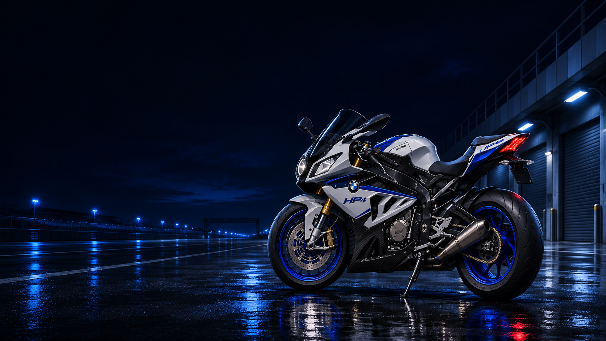
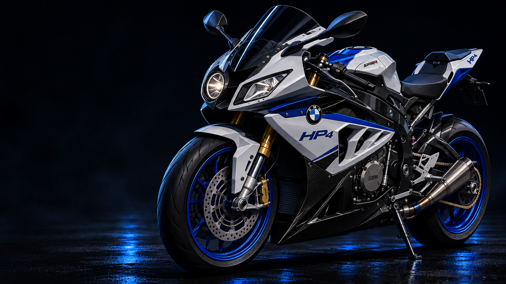
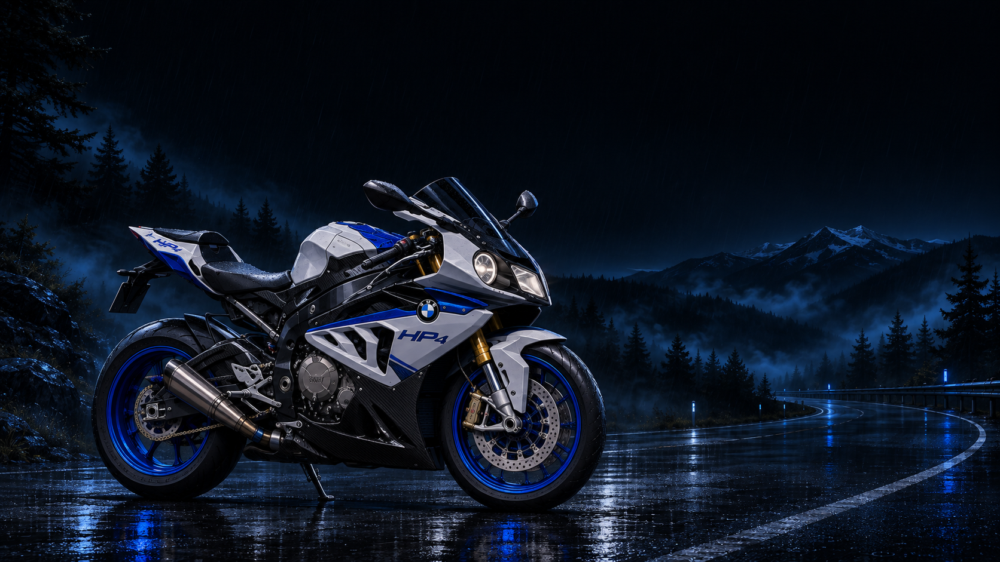
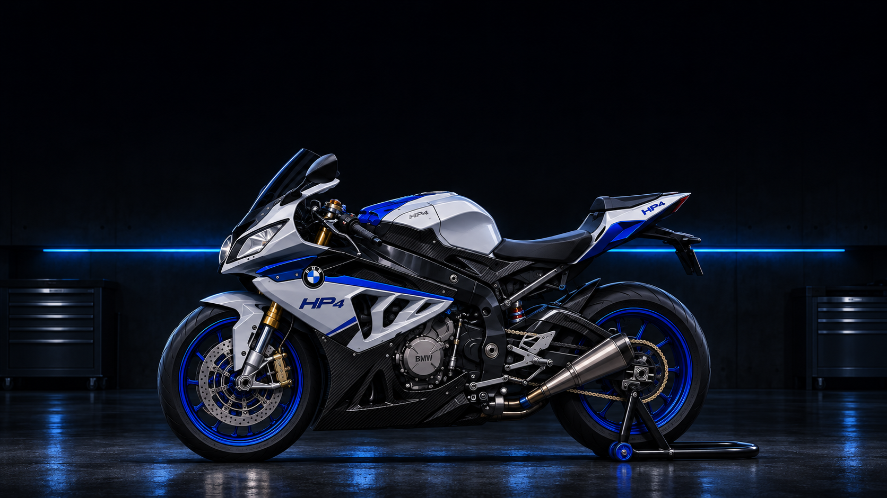
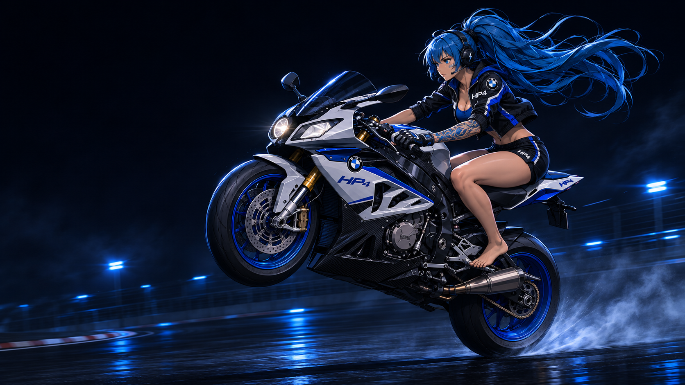
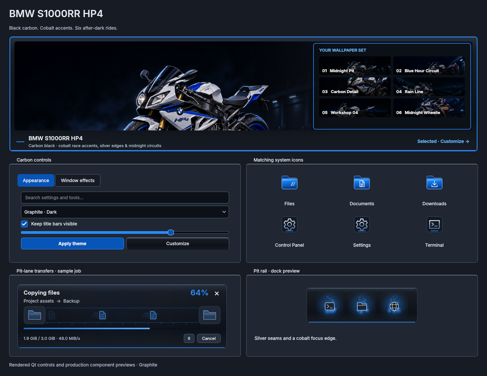
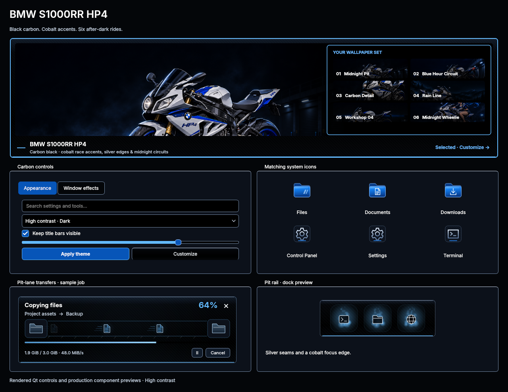

# BMW S1000RR HP4

Black carbon, cobalt blue and machined silver, inspired by the supplied 2012
HP4 concept. Every background stays dark. The global **Light** mode provides a
slightly brighter graphite palette; it does not turn this theme white.

HP4 in dark mode is the default for fresh installations and Reset Defaults.
The default wallpaper is **Midnight Pit**; additional monitors use the other
wallpapers in screen order. Existing installations keep their selected theme
when updating.

Fresh installs and Reset Defaults initialize closing flames and desktop-cube
colors from the HP4 palette, including cobalt blue accents. Animation timing,
physics and cube artwork keep their configured defaults; updates preserve
existing effect preferences and personal theme-color history.

Choose **Fusion Settings → Theme → Presets → BMW S1000RR HP4**, then select
the components to apply. Enable **Icons** in the component chooser for the
matching cobalt folder and silver tool icons.

The design covers Apps, taskbar layouts, Fusion Files, file pickers, Control
Panel, window controls, menus, notifications, task switching, terminal colors
and lock-screen colors. It is also available in the greeter and GRUB editors.

- **Carbon Apex cursors:** silver pointers with cobalt details and an animated
  wheel for busy states, in Hyprcursor and XCursor formats.
- **Pit-lane transfers:** documents travel between folders along a blue lane.
  Archives use zip packets; extraction reverses travel. Packets fade at the
  ends, with independent speed, density and trail controls.
- **Pit rail dock:** subtle carbon weave, a silver seam and a cobalt edge.
- **Pit-lane signals:** eight original synthesized cues for startup, shutdown,
  notification, question, warning, error, success and information.

## Six wallpapers

| Midnight Pit | Blue Hour Circuit | Carbon Detail |
| --- | --- | --- |
|  |  |  |

| Rain Line | Workshop 04 | Midnight Wheelie |
| --- | --- | --- |
|  |  |  |

The six original PNGs were created with the built-in imagegen tool using the
supplied motorcycle and character references. Each is **1672 × 941**.
[Generation prompts and SHA-256 hashes](../wallpaper/hp4/prompts.json) accompany
the artwork.

## Palette previews

| Graphite (global Light mode) | High contrast |
| --- | --- |
|  |  |

These are actual Qt controls and production component previews with a sample
transfer job. Validation includes preset and palette checks, launcher opacity,
gallery navigation, icon resolution, cursor shapes, sound decoding and GTK
parsing of all nine HP4 taskbar mode/layout combinations. Qt 5/6 integration and
the native cursor and dock adapters were built against the installed desktop.
The production OpenGL ES dock material rendered both tray and slot shapes in
both orientations. A disposable Hyprland session loaded the adapters and
completed minimize/restore on all four screen edges.

Installing the theme preserves current selections. Native cursor and dock
support becomes available at the next desktop login.
