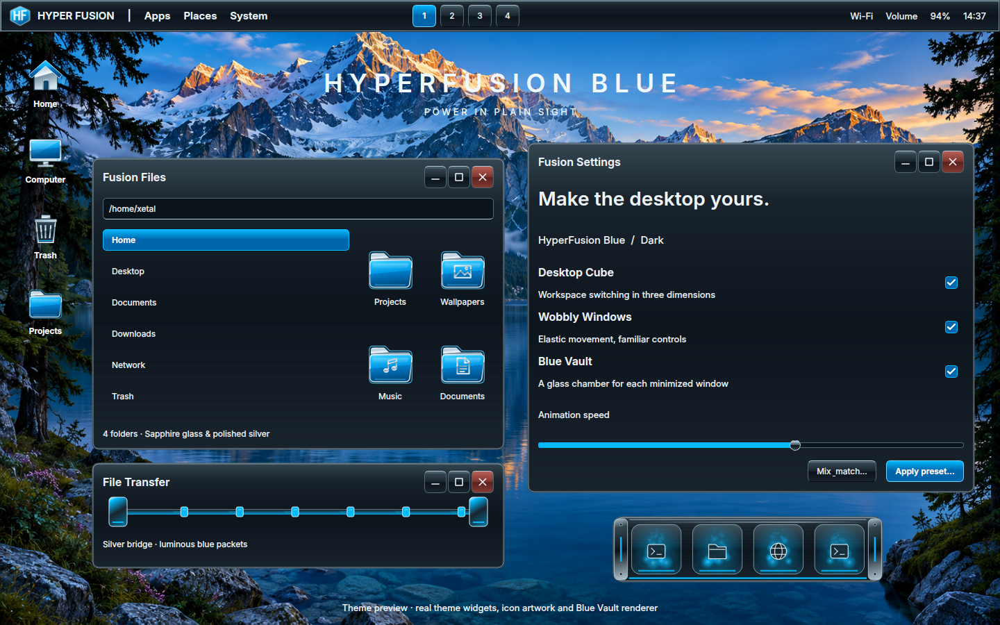

# HyperFusion Blue

A desktop inspired by polished metal, luminous blue glass and an alpine lake.
The preset uses the same applications and window behaviors as the other Fusion
themes. Its artwork and surface rendering are original to this theme.

This is a preview assembled from the theme's real Qt widgets, icon artwork and
dock preview renderer. It illustrates the visual design; application layout and
taskbar contents follow the user's configuration.

## Use it

Open **Fusion Settings → Theme → Design**, choose **HyperFusion Blue**, and
select **Apply preset**. Pick the components you want in the existing chooser.
**Icons** remains unchecked by default; check it to use the blue glass folders,
silver Home, Computer and Trash icons, and matching application artwork.

The palette supports **Dark**, **Light**, and **High contrast**. The full-width
taskbar can also use the existing partial and centered variants. In
**Theme → Mix & match**, the taskbar and **HyperFusion Blue · Blue Vault** dock
can be selected independently of the rest of the theme.

## Included

- Polished graphite application surfaces, silver borders and window controls,
  a red close button, blue active controls, and Inter typography.
- A matching taskbar with an original HF crest and luminous workspace buttons.
- Blue Vault: a native minimize dock with machined silver end caps, cyan edge
  lighting, glass chambers and the existing animated minimize effects.
- Original scalable icons for system locations, applications and file types.
- Matching Fusion Files, launcher, notifications, file-transfer surfaces and a
  silver-bridge transfer animation. The greeter and GRUB editors also offer the
  new palette; adding the preset does not change the configured login manager.
- A pearl cursor with blue glow, three alpine wallpapers, and the eight-cue
  **Blue horizon** sound pack. Existing sound volume and mute settings are kept.

## Assets and implementation

The wallpaper set was made with the built-in imagegen tool from original scene
prompts. The supplied desktop concept guided the aesthetic; the wallpapers
contain no embedded windows, menus, logos or text. Images and exact prompts are
in [`wallpaper/hyperfusionblue`](../wallpaper/hyperfusionblue/prompts.json).

The Qt surface implementation is `hyperfusionblue.py`; palette values are in
`palettes.json`. Taskbar rendering is in `bar_styles.py`. Icon source artwork is
`../icon_themes/blue.py` and is exported by `../icon_themes/art.py`. Sound cues are
generated by the repository's `tools/generate_sound_packs.py hyperfusionblue`.
Blue Vault uses native dock style 11 and preserves all previous style IDs.

The release installer builds the native dock and Qt integrations against the
supported compositor and installed Qt headers. A running session needs the new
compiled minimize plugin to display the new dock material. After a profile code
update, signing in again loads the current build. Applying the Minimize settings
also builds and activates it; minimized windows are restored before a plugin
replacement. The local development install already activates the tested build.

## Validation

The theme, icon, sound, file-transfer and minimize unit suites passed, together
with GTK/Qt integration builds. All 12 dock designs passed in a disposable
Hyprland session: all four edges, multiple monitors, hover/restore, overflow,
auto-hide, burning indicators, reduced motion and idle rendering. Dark, light
and high-contrast widget previews were inspected for legibility.
