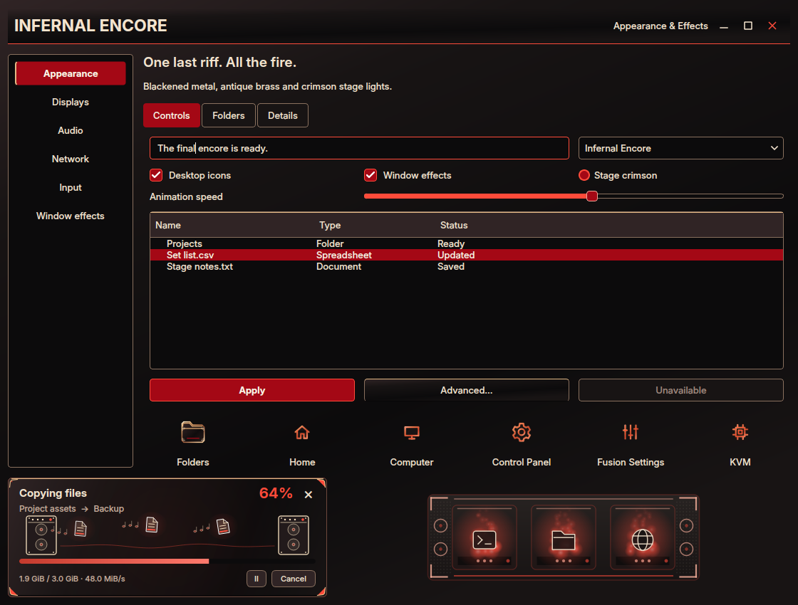

# Infernal Encore

Blackened metal, antique brass and crimson stage lights inspired by the gothic
concert desktop concept. Inter typography, beveled switches, red selections and
small faceted corner guards carry the look across the desktop. The ornaments
stay at the edges, clear of text and controls. Dark mode follows the reference;
light mode uses warm ivory and bronze, while high contrast uses black, bone and
bright coral.

This capture uses real Qt widgets and the production transfer and dock painters.
Choose **Fusion Settings → Theme → Presets → Infernal Encore**, select **Dark**,
and choose the components to apply. Enable **Icons** in the component chooser
to include the matching pack; it stays unchecked by default. Individual styles,
wallpapers and other personal choices remain independent.

The theme covers the launcher, all three taskbar variations, notifications,
Files and file pickers, Control Panel, terminal and lock palettes, task switcher
colors, and greeter/GRUB editor choices. The **Amplifier Rack** minimize dock has
brass corner protectors, speaker grilles at each end, miniature control knobs
and red power lamps. Its materials follow the selected palette in both the
native compositor and Settings preview.

File transfers send documents along a sound wave between amplifier cabinets.
Musical notes trail each document, and archive/extraction jobs add zipper marks
and reverse travel. Documents, notes and glow fade together before wrapping;
the sound wave and document tilt use complete repeating periods.

The **133 original icons and aliases** include separate gear, sliders and CPU
symbols for Control Panel, Fusion Settings and KVM. **Infernal Blade** supplies
a bone-and-crimson angular pointer, a rotating star busy cursor, all 20 functional
shapes and toolkit aliases in Hyprcursor and XCursor formats. The preset uses the
existing Soft glow trail in red. **Backstage signals** provides eight original
synthesized cues with muted guitar harmonics and a restrained minor-key welcome.
Existing sound volume and event selections are preserved.

| Wallpaper | Scene |
| --- | --- |
| [Final Encore](../wallpaper/infernalencore/final-encore.png) | Two fictional guitarists, a gothic stage, flames and a purple storm |
| [Cathedral of Sound](../wallpaper/infernalencore/cathedral-of-sound.png) | An empty cathedral venue with brass speaker towers and crimson light |
| [Backstage Embers](../wallpaper/infernalencore/backstage-embers.png) | An angular guitar, worn amplifier and glowing backstage doorway |

All three original generated PNGs are **1672 × 941**, with no painted desktop
interface. Their exact prompts, provenance and hashes are in
[prompts.json](../wallpaper/infernalencore/prompts.json). The icon/cursor vectors
and sound synthesis are original repository artwork; native effects retain
their existing GPL license.

Verification covers 228 theme, icon, cursor, transfer, minimize and sound tests
(one environment-dependent test skipped), plus focused rendered-frame transfer
boundary tests. Actual GTK parsing passed for all taskbar variations and
notification palettes. Real controls, menus, dialogs, native Files, Open File
and Control Panel were rendered in all three modes, including normal, hover and
disabled native header controls. Qt 5 and Qt 6 integrations were rebuilt.

Settings and transfer-window previews were captured for 27 seconds at
25/100/250% speed and densities 1/3/7, with copy/extraction and trails on/off in
all three modes. Every card completed at least three loops; chronological
frames were inspected alongside the wrap-boundary tests. Existing tests cover
pause/resume, hidden timers, errors and completion. The preview jobs do not copy
personal files. Disposable Hyprland checks passed all **19 dock designs** and
**13 cursor families**, including palette following, hover/restore, overflow,
monitor edges, reduced motion and idle suspension.

Installation preserves current selections. The new theme appears after Fusion
Settings reloads its catalog. Log out and back into Hyprland once before applying
the complete preset to load the updated native dock and cursor adapters through
the supported session lifecycle. Installing this design does not install a
greeter, rewrite GRUB or change shared KDE/GTK/Qt preferences.

See [AI_Theme_creation.md](../../../AI_Theme_creation.md) for integration details.
