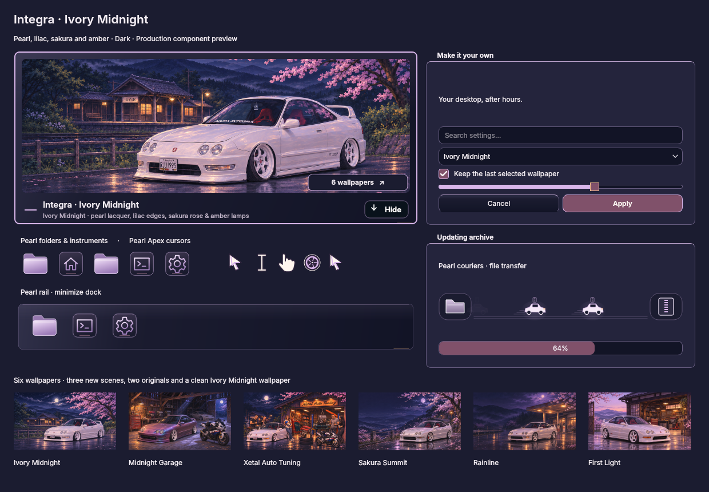
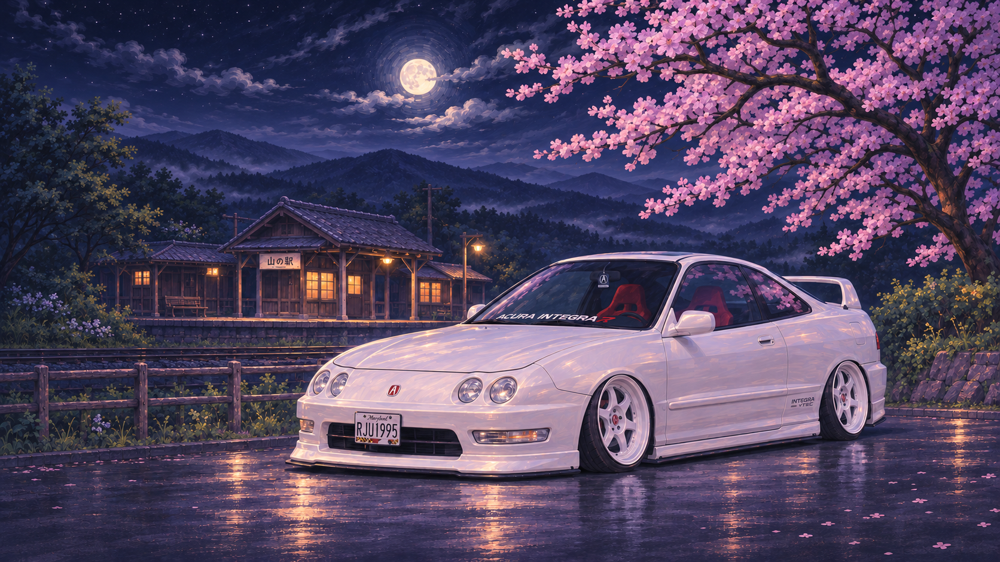
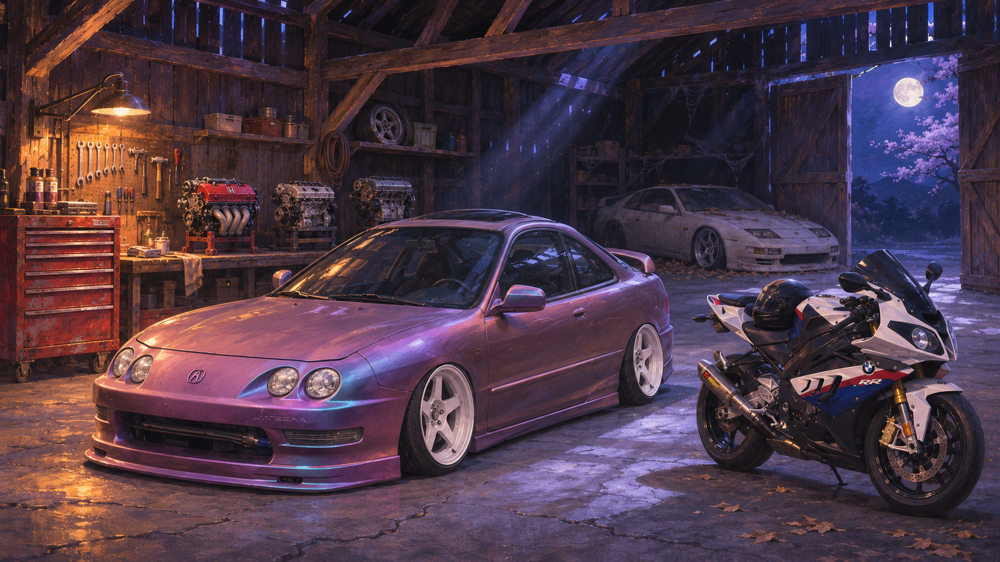
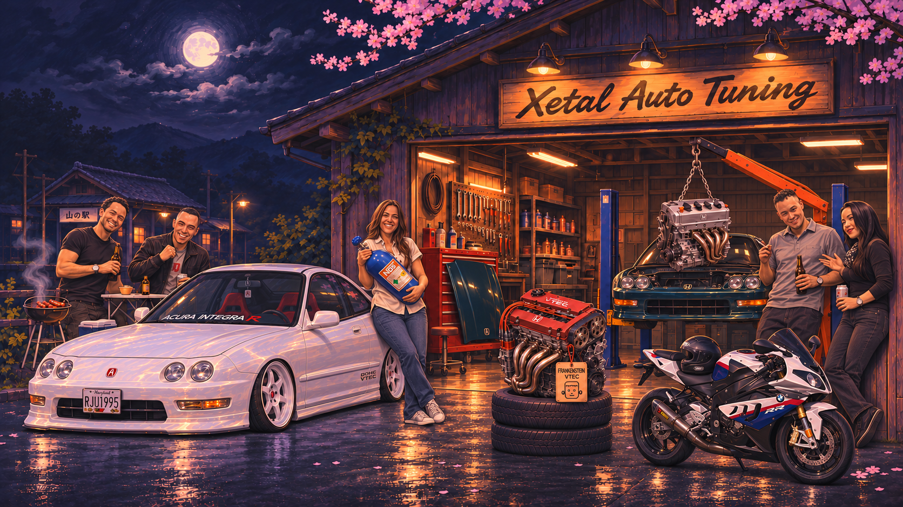
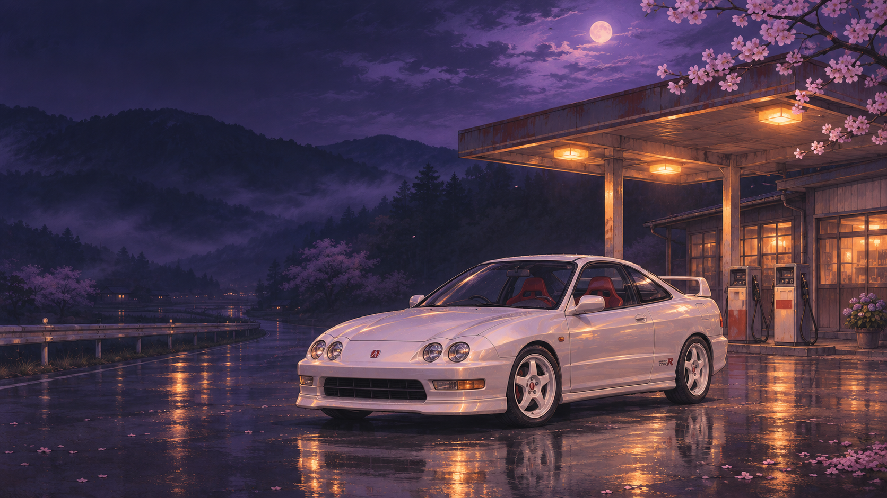
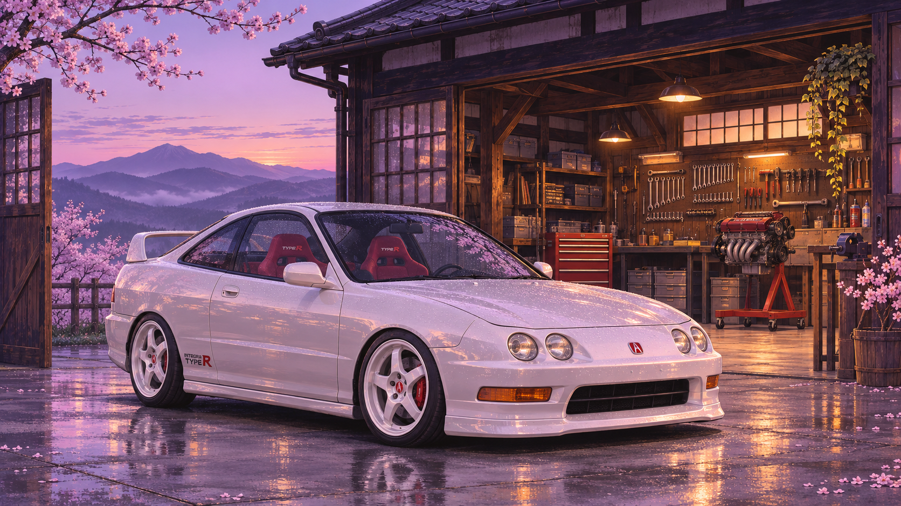
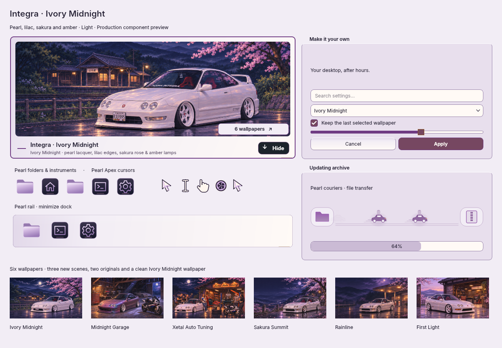
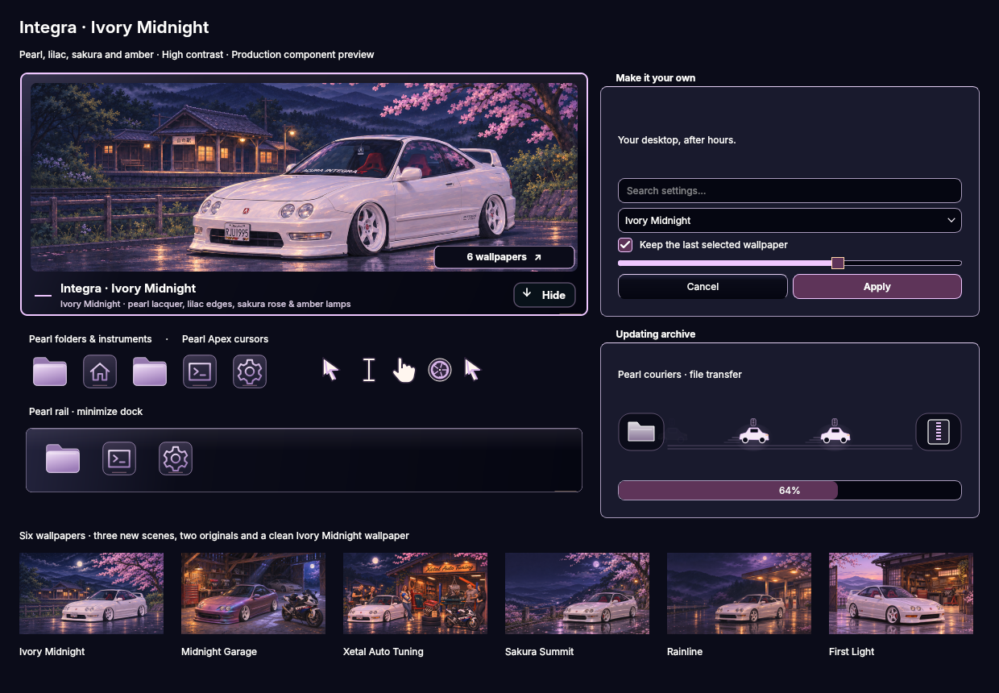

# Integra · Ivory Midnight

Midnight indigo, pearl ivory, lilac edges and sakura-rose selections, with warm
amber details inspired by the supplied Integra artwork. Dark, Light and High
contrast each have a complete palette. Light uses pale pearl surfaces.

Choose **Fusion Settings → Theme → Presets → Integra · Ivory Midnight**, then
choose the components to apply. Include **Icons** for the matching lilac folders
and instrument-style icons. The existing BMW HP4 fresh-install default stays in
place; adding this preset preserves your current theme and personal settings.

The preset includes app controls, Fusion Files, Control Panel, launcher and
taskbar layouts, window borders and controls, notifications, task switching,
terminal and lock-screen colors, wallpaper sets and theme-aware effect colors.
It is also available in the greeter and GRUB appearance selectors.

- **Pearl Apex cursors:** ivory pointers, lilac details and an animated wheel
  for busy states, provided in Hyprcursor and XCursor formats.
- **Pearl drift couriers:** overhead Integra cars carry documents and archive
  packets through a smooth zigzag between folders. Countersteering front wheels,
  twin fading tire marks and a little tire smoke follow the drift. Extraction
  mirrors the route; cars and trails fade at the ends. Existing animation speed,
  density, motion-trail and glow settings still apply.
- **Pearl rail:** a smooth midnight dock, lilac seam and warm end reflection.
- **Sakura afterhours:** eight original synthesized cues for startup, shutdown,
  notification, question, warning, error, success and information.

Native cursor and minimize-dock support is built for the installed compositor
and becomes available on the next desktop login. Existing loaded plugins are
left running during installation.

## Six wallpapers

| Ivory Midnight | Midnight Garage | Xetal Auto Tuning |
| --- | --- | --- |
|  |  |  |

| Sakura Summit | Rainline | First Light |
| --- | --- | --- |
|  |  |  |

Midnight Garage and Xetal Auto Tuning preserve the supplied originals.
Ivory Midnight is a clean wallpaper derived from the desktop concept, with the
baked-in windows, panels, icons and title removed. The three new companion
scenes and the clean wallpaper were made with the built-in image generation
tool. All six PNGs are **1672 × 941**. Their [prompts, provenance and SHA-256
hashes](../wallpaper/integra/prompts.json) are included beside the images.

## Palette previews

| Light | High contrast |
| --- | --- |
|  |  |

These previews use actual Qt controls and production painters with sample
content. Validation includes theme/preset contracts, gallery navigation,
launcher opacity, icon resolution, cursor shapes, transfer animation loops,
sound decoding, text contrast, all nine taskbar mode/layout combinations and
notification CSS. Qt 5/6 integration and the native cursor/dock adapters were
built against the installed desktop. The native dock shader rendered tray and
slot shapes in both orientations in all three palettes using a private OpenGL
ES context; the user's running compositor was not restarted.

## Preset gallery organization

Presets use two columns at ordinary desktop widths, with one column when the
window is narrow. Each card has an animated **Hide** button. Hidden presets move
into the scrollable thumbnail dock below the gallery; restoring one makes it
visible without applying it.

Use **+**, **Rename** and **Delete** to organize dock tabs. The last selected tab
is remembered. Drag a thumbnail onto another tab to move it; the destination
highlights, and Escape cancels the drag. Deleting a tab requires choosing another
tab to receive its contents. Hiding the active preset keeps it applied.

The small center arrow folds the dock into a slim tab strip, giving more space
to the preset gallery. Click it again to expand the thumbnails. This choice is
remembered across tabs and reopening Settings, including when more presets are
hidden while the dock is folded.

Organization is stored separately in `theme/state/preset-gallery.json` and is
included in **Default Settings → Themes & artwork** save, load and reset,
including the dock's expanded/collapsed state. Theme and
wallpaper hidden tabs remain independent. Updates preserve both sets of tabs.
