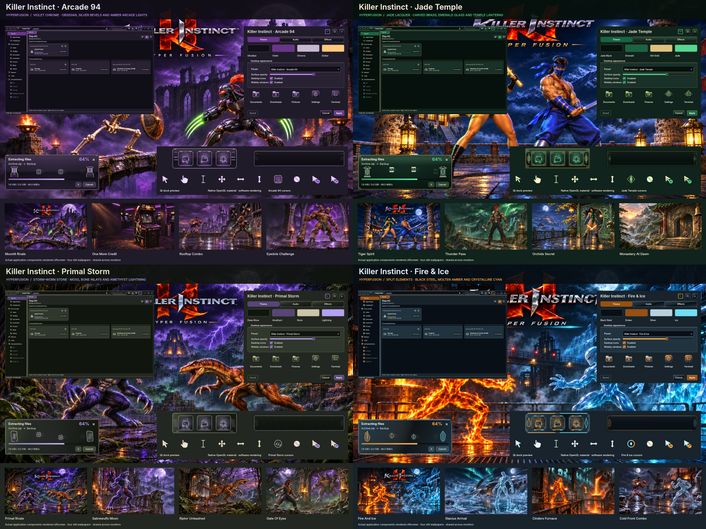

# Killer Instinct · 1994 collection

Four complete themes and **16 shared wallpapers**, inspired by the original
arcade characters and the supplied desktop concepts. Spinal, Fulgore, Orchid,
Jago, Chief Thunder, Sabrewulf, Riptor, Cinder, Glacius, TJ Combo and Eyedol all
appear. **One More Credit** gives the Midway cabinet its own quiet arcade scene.

Reopen **Fusion Settings → Theme → Presets** and search for **Killer Instinct**.
Choose any of the four variations below. Check **Icons** in the component
chooser to include the matching icon pack; it is optional and unchecked by
default. Each variation supports dark, light and high-contrast palettes.

| Theme | Materials and details | Preview |
| --- | --- | --- |
| **Arcade 94** | Obsidian, violet chrome, silver bevels and amber lamps. Arcade Console dock, cabinet transfers and an animated arcade cursor. | [Overview](assets/killerinstinct-preview.png) · [All palettes](assets/killerinstinct-controls.png) |
| **Jade Temple** | Jade lacquer, carved brass, emerald glass and diamond lanterns. Temple Altar dock, scroll transfers and a jade spinner. | [Overview](assets/kitemple-preview.png) · [All palettes](assets/kitemple-controls.png) |
| **Primal Storm** | Moss stone, bone inlays, claw marks and amethyst lightning. Primal Relic dock, rune transfers and a spinning claw cursor. | [Overview](assets/kiprimal-preview.png) · [All palettes](assets/kiprimal-controls.png) |
| **Fire & Ice** | Black steel, molten amber, crystalline cyan and opposing hot/cold rails. Thermal Chamber dock, elemental transfers and a two-tone spinner. | [Overview](assets/kifireice-preview.png) · [All palettes](assets/kifireice-controls.png) |

These styles extend through Start menus, application controls, Fusion Files,
Control Panel, notifications and all three Waybar layouts. Each includes an
original set of eight synthesized sound cues: arcade synth, temple bells,
wooden storm percussion or warm embers and crystalline notes.

## Wallpapers

There are **16 wallpapers total**, available to every monitor. A theme's
wallpaper component supplies its four matching images in the usual display
order. Use **Super+W** to choose from the whole collection independently for
each monitor, including images from another variation.

| Theme | Wallpaper | Scene |
| --- | --- | --- |
| Arcade 94 | [Moonlit Rivals](../wallpaper/killerinstinct/moonlit-rivals.png) | Spinal and Fulgore face off on a violet gothic bridge. |
| Arcade 94 | [One More Credit](../wallpaper/killerinstinct/one-more-credit.png) | A 1994 Midway cabinet with Spinal side art, blue controls and a glowing CRT. |
| Arcade 94 | [Rooftop Combo](../wallpaper/killerinstinct/rooftop-combo.png) | TJ Combo and Fulgore above a rain-soaked city. |
| Arcade 94 | [Eyedol's Challenge](../wallpaper/killerinstinct/eyedols-challenge.png) | The classic two-headed boss in an immense stone arena. |
| Jade Temple | [Tiger Spirit](../wallpaper/kitemple/tiger-spirit.png) | Orchid and Jago among golden lanterns and mountain temples. |
| Jade Temple | [Thunder Pass](../wallpaper/kitemple/thunder-pass.png) | Chief Thunder beneath a mountain storm. |
| Jade Temple | [Orchid's Secret](../wallpaper/kitemple/orchids-secret.png) | Orchid in a moonlit jade garden. |
| Jade Temple | [Monastery at Dawn](../wallpaper/kitemple/monastery-at-dawn.png) | Jago meditates above a sunlit mountain valley. |
| Primal Storm | [Primal Rivals](../wallpaper/kiprimal/primal-rivals.png) | Sabrewulf and Riptor in rain-soaked jungle ruins. |
| Primal Storm | [Sabrewulf's Moon](../wallpaper/kiprimal/sabrewulfs-moon.png) | Sabrewulf on a moonlit castle balcony. |
| Primal Storm | [Riptor Unleashed](../wallpaper/kiprimal/riptor-unleashed.png) | Riptor escapes an overgrown laboratory. |
| Primal Storm | [Gate of Eyes](../wallpaper/kiprimal/gate-of-eyes.png) | Chief Thunder faces Eyedol at a ruined gateway. |
| Fire & Ice | [Fire and Ice](../wallpaper/kifireice/fire-and-ice.png) | Cinder and Glacius divide a foundry between fire and frost. |
| Fire & Ice | [Glacius' Arrival](../wallpaper/kifireice/glacius-arrival.png) | Glacius beside a crashed ship in an arctic landscape. |
| Fire & Ice | [Cinder's Furnace](../wallpaper/kifireice/cinders-furnace.png) | Cinder amid molten metal and industrial gantries. |
| Fire & Ice | [Cold Front Combo](../wallpaper/kifireice/cold-front-combo.png) | TJ Combo and Glacius on a frozen waterfront. |

The still illustrations were generated with the **built-in imagegen tool** at
**1672 × 941**. They contain no baked-in desktop windows or panels. Exact
prompts, reference hashes, actual dimensions and image SHA-256 hashes are kept
with each set:
[Arcade 94](../wallpaper/killerinstinct/prompts.json),
[Jade Temple](../wallpaper/kitemple/prompts.json),
[Primal Storm](../wallpaper/kiprimal/prompts.json),
[Fire & Ice](../wallpaper/kifireice/prompts.json).

Icons and cursor shapes are original editable vectors. Sound cues use the
original scores and synthesis in
[generate_sound_packs.py](../../../tools/generate_sound_packs.py), without
game recordings or soundtrack samples.

## Validation and installation

The previews assemble real offscreen Fusion Files, production-stylesheet Qt
controls, file-transfer widgets and dock renders over the artwork. They are
component previews, not captures of a running desktop session.

The six regression suites cover 255 tests, with one existing skip. Native
Fusion Files captures cover all four themes in all three palettes. Copy and
extract animations were recorded for three loops at slow, normal and fast
speeds in each palette, with representative temporal sequences visually
inspected. Wrap-boundary regression checks also pass. GTK accepts all Waybar
layout/palette combinations and notification palettes. The native dock shader
compiled and rendered every theme in both orientations, including slots,
with software OpenGL. Qt 5/6, Cube's cursor adapter and Minimize were rebuilt;
all 32 sound files were checked for decoding, levels and edge discontinuities.

Nested Hyprland validation could not start in this sandbox: the compositor
could not bind its IPC socket or initialize its backend. Live compositor
behavior still needs a normal desktop session.

The local installation preserves the selected theme and personal settings.
Log out and back into Hyprland once to load the updated native dock and cursor
adapters. Then reopen Fusion Settings to choose a variation.
