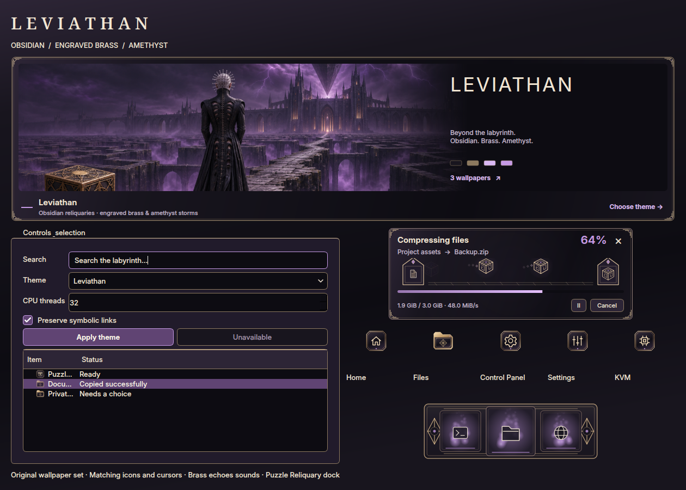

# Leviathan

Obsidian surfaces, amethyst selections and engraved brass edges, inspired by the
supplied labyrinth desktop concept. Fine geometric corner details stay outside
text and controls. Inter keeps everyday controls readable; Noto Serif gives
headings a restrained ceremonial character. Dark, light and high-contrast
palettes are included.

Choose **Fusion Settings → Theme → Presets → Leviathan**, then choose which
components to apply. **Icons** starts unchecked; enable it for the matching
brass icon pack. Adding this preset preserves your current theme, wallpaper,
app preferences and independently chosen components.

The preset covers Apps, Full/Partial/Centered taskbars, Fusion Files, file
pickers, Control Panel, menus, dialogs, notifications, task switcher, terminal,
lock screen and effect colors. It is also available in the greeter and GRUB
editors; choosing a desktop theme does not install or change those services.

Brass folders and geometric plaques provide a full icon pack with file types,
actions, devices and application aliases. Control Panel uses a gear, Fusion
Settings uses sliders, and KVM uses a chip. **Leviathan Gilded** supplies all 20
cursor shapes, including an animated faceted busy jewel, in Hyprcursor and
XCursor formats. Its preset uses the existing Soft glow trail in violet.
**Brass echoes** supplies eight original synthesized chimes.

Animated file transfers carry documents through engraved gateways; compression
and extraction use little brass puzzle cubes. Packets, trails and glows fade
before wrapping so movement remains continuous. The **Puzzle Reliquary**
minimize dock has inset brass rims, geometric end seals and violet-lit slots.
Both styles remain independently selectable and keep the existing transfer and
minimize behavior, including the expanding transfer attention panel.

| Wallpaper | Composition |
| --- | --- |
| [Leviathan’s Approach](../wallpaper/leviathan/leviathans-approach.png) | A solitary figure on a labyrinth causeway beneath a hovering black octahedron |
| [The Brass Configuration](../wallpaper/leviathan/the-brass-configuration.png) | An engraved puzzle cube in an obsidian observatory overlooking the maze |
| [Endless Dominion](../wallpaper/leviathan/endless-dominion.png) | An elevated panorama of impossible bridges, dark citadels and violet storm clouds |

The three PNGs are **1672 × 941**, with no painted desktop interface. They form
the default three-monitor set and are also individually selectable. The
built-in imagegen tool produced the wallpapers. Exact prompts, dimensions,
provenance and hashes are recorded in
[prompts.json](../wallpaper/leviathan/prompts.json). Icon/cursor vectors and sound
synthesis are repository artwork; native effects retain their existing license.

Validation includes 250 tests across theme, icon, cursor, sound, transfer and
minimize suites. The display-dependent taskbar spacing test also passes under
Xvfb; taskbar CSS parses across all variants, and notification CSS parses in
all three modes. Native Files, file pickers and Control
Panel were rendered in all three palettes on an isolated display, along with
actual Qt controls, menus, dialogs and the wallpaper gallery.

Transfer validation records at least three complete timer-driven cycles for
108 production Settings-preview and transfer cards: all three palettes,
25/100/250% speeds, densities 1/3/7, copying/extraction and trails off/on.
Rendered frame sequences and wrap-boundary regressions verify continued motion.
Qt 5/6 integrations, cursors, Cube and Minimize were rebuilt. Disposable native
Hyprland sessions passed all 21 dock materials, all 15 cursor families, all four
dock edges, multi-monitor placement, window restore and cleanup checks.

The gallery is available in a newly loaded Fusion Settings process. On an
already-running desktop, **sign out and back in once** to load the newly built
native cursor and minimize components before applying those two pieces. This
avoids replacing compositor code underneath open applications.

See [AI_Theme_creation.md](../../../AI_Theme_creation.md) for the integration map.
