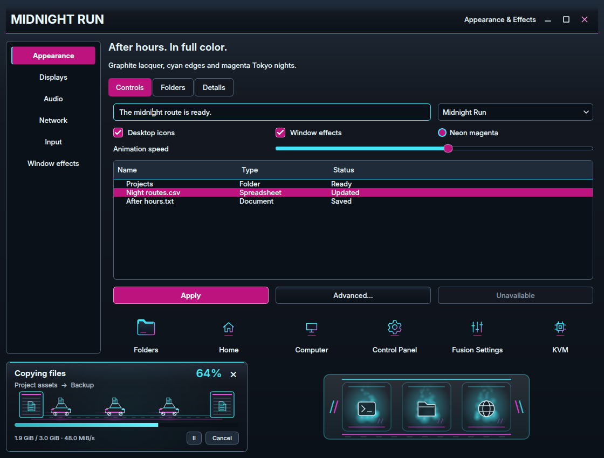

# Midnight Run

Graphite lacquer, cyan window edges and magenta selections inspired by the rainy
Tokyo desktop concept. Inter typography, compact ribbon navigation and neon
outline icons carry the look across the desktop. Dark mode follows the concept;
light mode uses cool silver, and high contrast pairs black with bright cyan and
pale pink.

This capture uses real Qt widgets and the production transfer and dock painters.
Choose **Fusion Settings → Theme → Presets → Midnight Run**, select **Dark**,
and choose the components to apply. Enable **Icons** in the component chooser
to include the matching pack; it stays unchecked by default. Individual styles,
wallpapers and other personal choices remain independent.

The theme covers the launcher, all three taskbar variations, notifications,
Files and file pickers, Control Panel, terminal and lock palettes, task switcher
colors, and greeter/GRUB editor choices. The **Neon Pit Lane** minimize dock has
a graphite tray, cyan and magenta rails, angled light fins and matching slots.
Its two accents follow the selected palette. File transfers use little neon
courier cars carrying documents between garages; every car, light and trail
fades out before wrapping to the start.

The **133 original icons** include separate gear, sliders and CPU symbols for
Control Panel, Fusion Settings and KVM. **Midnight Run Neon** supplies an angular
pointer, a rotating wheel busy cursor, all 20 functional shapes and toolkit
aliases in Hyprcursor and XCursor formats. The preset pairs it with the existing
Soft glow trail. **After-hours signals** provides eight original synthesized
cues with soft electronic plucks and a minor-key welcome. Existing sound volume
and event selections are preserved.

| Wallpaper | Scene |
| --- | --- |
| [Neon After Hours](../wallpaper/midnightrun/neon-after-hours.png) | A black sports sedan, sakura and neon reflected in a wet Tokyo street |
| [Expressway Blue Hour](../wallpaper/midnightrun/expressway-blue-hour.png) | An elevated road sweeping toward an indigo skyline |
| [Sakura Rain](../wallpaper/midnightrun/sakura-rain.png) | A quiet canal, cherry blossoms and glowing storefronts |
| [Audi Sakura Nights](../wallpaper/midnightrun/audi-sakura-nights.png) | A black Audi Avant under sakura, with cyan and magenta Tokyo street reflections |
| [Audi Bayside Run](../wallpaper/midnightrun/audi-bayside-run.png) | A rear view of the Audi on a wet bay expressway beneath the city skyline |
| [Audi Mountain Midnight](../wallpaper/midnightrun/audi-mountain-midnight.png) | The Audi at a moonlit mountain overlook above the neon city |
| [Audi A4 · Sakura Stance](../wallpaper/midnightrun/audi-a4-sakura-stance.png) | A slammed black 2014 A4 sedan from the front, with tucked silver wheels and neon sakura reflections |
| [Audi A4 · Neon Profile](../wallpaper/midnightrun/audi-a4-neon-profile.png) | The lowered four-door A4 in side profile beside the rainy Tokyo ramen shop |
| [Audi A4 · Midnight Return](../wallpaper/midnightrun/audi-a4-midnight-return.png) | A rear three-quarter view of the A4 sedan, with red tail lights reflected in cyan and magenta puddles |

The collection includes three Audi Avant scenes and three **slammed black 2014
Audi A4 sedan** scenes, preserving the existing theme and original artwork.
The A4 trio follows the supplied rainy Tokyo concept from front, side and rear
angles, with a separate sedan trunk, tucked silver wheels and a very low stance.
The first three wallpapers remain the default monitor set. Choose any of the
nine in **Theme → Wallpapers** or the **Super+W** Wallpaper Selector; search for
**A4** to find the sedan trio. The preset banner shows **9 wallpapers**, with
all nine previews in three columns on hover or focus.
Current wallpaper selections are preserved; these additions need no logout.

All nine original generated PNGs are **1672 × 941**, with no painted desktop
interface. Their exact prompts, provenance and hashes are in
[prompts.json](../wallpaper/midnightrun/prompts.json). The icon/cursor vectors and
sound synthesis are original repository artwork; native effects retain their
existing GPL license.

Verification covers the theme, icon, cursor, transfer, minimize and sound suites;
GTK parsing of every taskbar variation and notification palette; and rendered
controls, menus and dialogs in all three modes. Real native Files, Open File and
Control Panel windows were captured in an isolated profile, including normal,
hover and disabled header controls. Qt 5 and Qt 6 integrations were rebuilt for
the Inter font selection.

The Settings transfer preview and transfer window were captured for 26 seconds
at 25/100/250% speed and densities 1/3/7, with copy/extraction and trails on/off
across all three modes. Every card completed at least three loops. Chronological
frames and rendered wrap-boundary tests were checked; existing tests also cover
pause/resume, hidden timers, errors and completion. These are preview jobs and
do not copy personal files.

Disposable Hyprland checks passed all **18 dock designs** and **12 cursor
families**, including palette following, hover/restore, overflow, monitor edges,
reduced motion and idle suspension. The test compositor was isolated from
physical-seat access so an inactive logind seat could not stall its rendering.

Installation preserves current selections. The new theme appears after Fusion
Settings reloads its catalog. Log out and back into Hyprland once before applying
the complete preset to load the updated native dock and cursor adapters through
the supported session lifecycle. Installing this design does not install a
greeter, rewrite GRUB or change shared KDE/GTK/Qt preferences.

See [AI_Theme_creation.md](../../../AI_Theme_creation.md) for integration details.
