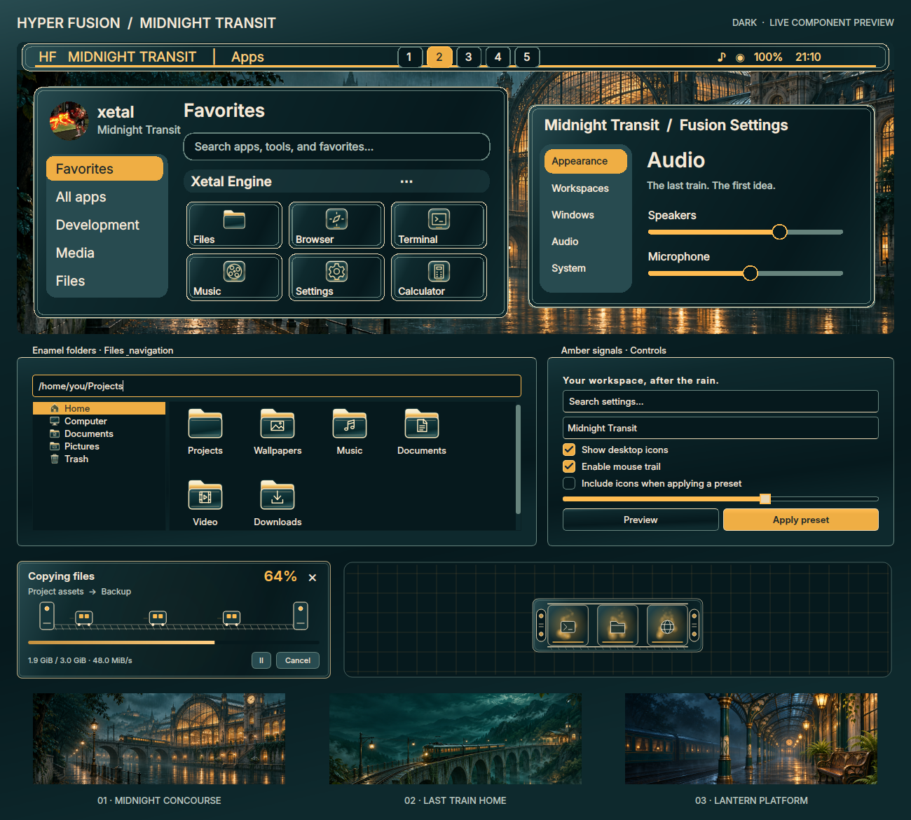

# Midnight Transit

Teal enamel, cream pinstripes and amber railway signals, inspired by the user's
rainy city concept. The design has dark, light and high-contrast modes.

Rendered with the theme's Qt controls, gallery painter, original icons, transfer
window and minimize preview. This is a component showcase, not a screenshot of
an installed user's desktop; window arrangement follows the user's settings.

Open **Fusion Settings → Theme → Design**, choose **Midnight Transit** and use
**Apply preset**. Select the components you want. **Icons** stays unchecked by
default; enable it to use the original enamel folders, cream document icons and
matching system/application artwork. Adding this theme does not change your
currently selected desktop or icon pack.

The theme includes:

- Enamel application surfaces, cream borders, amber selections, Inter text and
  matching window controls, launcher, Files, file pickers and Control Panel.
- A taskbar with a winged HF badge and amber workspace buttons; Full, Partial
  and Centered arrangements remain available.
- **Platform Twelve**, a native minimize container with twin cream rails,
  signal lanterns and carriage-like window slots. It can be chosen independently
  under **Theme → Window effects → Minimize**.
- An animated railway file-transfer scene and opaque, readable notifications.
- Original **Transit Enamel** cursor artwork, including functional resize,
  text, drag/drop and busy shapes, with an amber Soft glow trail.
- An eight-cue **Platform chimes** sound pack and coordinated palette support
  for terminals, other effects, the greeter and GRUB theme editors.

## Three wallpapers

| Scene | Image |
| --- | --- |
| Midnight Concourse | [Rainy riverside station](../wallpaper/midnighttransit/midnight-concourse.png) |
| Last Train Home | [Moonlit viaduct and valley](../wallpaper/midnighttransit/last-train-home.png) |
| Lantern Platform | [Covered platform after the rain](../wallpaper/midnighttransit/lantern-platform.png) |

Original artwork generated with the built-in image generator. Each supplied
image is 1672 × 941 pixels. [Exact prompts and provenance](../wallpaper/midnighttransit/prompts.json)
are included. These are desktop backgrounds without painted application windows.

For extending this design or creating another complete theme, read the
[AI theme creation guide](../../../AI_Theme_creation.md).

## Verification

The theme, icon, cursor, transfer, minimize and sound suites passed **219 checks**,
including GTK taskbar text layout on a virtual display. Qt 5/6 integrations and
the native Cube/Minimize adapters built successfully. The real Fusion Files tree
was rendered across every theme/mode, and the three Midnight Transit modes and
wallpapers were inspected visually. Notification CSS parsed in all three modes.

A disposable Hyprland session rendered all 13 dock designs, including Platform
Twelve, and checked restoration, four-edge hiding and reduced motion. A separate
focused run loaded all seven cursor families and checked glow rendering and idle
suspension with the other effect adapters present.

The broader native stress suites were **not fully green**: the legacy stack run
hit an overflow-bound assertion, the dock run timed out revealing a second
monitor, and the Wobbly run hit a tiled-window ordering assertion before its
cursor section. Those layout checks remain unresolved; the focused cursor run
passed. This is not a claim that every multi-monitor configuration was verified.
