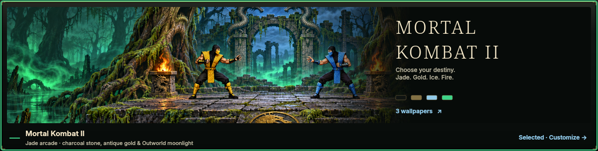
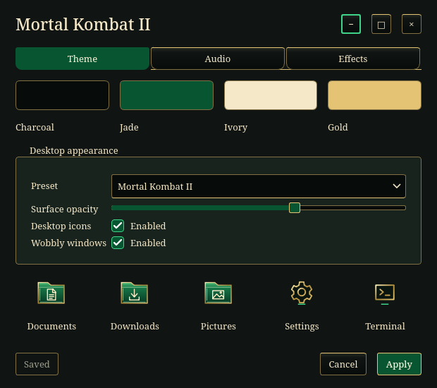

# Mortal Kombat II

Charcoal stone, jade enamel, antique-gold bevels and ivory serif lettering,
inspired by the supplied arcade desktop concepts. Includes dark, light and
high-contrast palettes.

Choose **Fusion Settings → Theme → Presets → Mortal Kombat II**. The component
chooser lets you apply the complete atmosphere or mix it with other themes.
Select **Icons** for the matching jade folders; that component is unchecked by
default, just as it is for the other presets.

The theme includes coordinated application controls, Start menu surfaces,
Fusion Files, Control Panel, notifications, three Waybar layouts, gold-edged
system icons, **Outworld Jade** cursors, portal-themed file transfers and an
**Outworld Arcade** minimize dock. **Outworld arcade** supplies eight original
synthesized sound cues, with independent volume and event settings.

Three wallpapers are included in the wallpaper picker and assigned to monitors
in the usual left-to-right order when the wallpaper component is applied:

| Wallpaper | Scene |
| --- | --- |
| [Living Forest](../wallpaper/mortalkombat2/living-forest.png) | Scorpion and Sub-Zero face off between ancient face trees, jade mist and a moonlit castle. |
| [Toasty!](../wallpaper/mortalkombat2/toasty.png) | Scorpion's fire finisher in a dragon-carved temple arena. |
| [Soul Steal](../wallpaper/mortalkombat2/soul-steal.png) | Shang Tsung channels emerald soul energy across an Outworld throne hall. |

These are still, arcade-inspired illustrations. They were generated with the
built-in imagegen tool at 1672 × 941. Exact prompts, dimensions and SHA-256
hashes are recorded in [prompts.json](../wallpaper/mortalkombat2/prompts.json).
The sound pack uses original synthesis from
[generate_sound_packs.py](../../../tools/generate_sound_packs.py), without game
recordings or soundtrack samples.

The images above are offscreen renders of the production gallery and a Qt
control sample using the production stylesheet. Native Fusion Files was also
rendered in all three palettes. Automated checks cover theme transactions,
text contrast, icons, cursors, transfer animation boundaries, minimize settings
and sounds. GTK parsed all three bar layouts and notification palettes; the
native dock shader compiled and rendered both orientations and slots with
software OpenGL. Qt 5/6, Cube's cursor adapter and Minimize were rebuilt.

Reopen Fusion Settings after installing to refresh the catalog. Log out and
back into Hyprland once to load the updated native dock and cursor adapters.
Live compositor behavior could not be exercised in the sandbox. Installing
the theme preserves the currently selected theme and personal settings.
