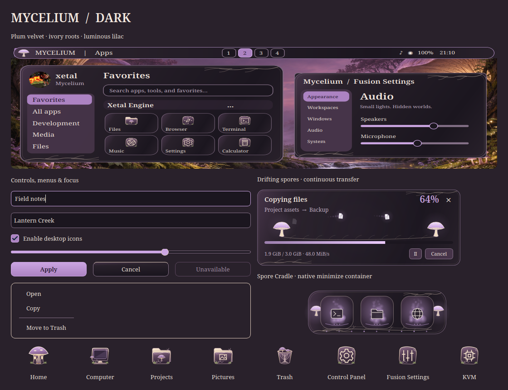

# Mycelium

An enchanted woodland desktop: plum velvet, lilac mushroom caps, warm ivory
roots and moss. Mycelium carries the concept through dark, light and
high-contrast palettes, with fine ornaments kept clear of text and controls.

The preview renders actual Qt controls, the gallery painter, icons, transfer
window and minimize artwork. Choose **Fusion Settings → Theme → Mycelium →
Apply preset** and select the components you want. **Icons** stays unchecked
by default; check it to include the original Mycelium icon pack.

## Included

- Plum surfaces, lilac selections, rounded controls, serif text and fine root
  borders across Settings, launcher, Files, application file pickers and Control
  Panel. File trees and preview panes retain their existing sizing behavior.
- A mushroom launcher badge, softly lit workspace buttons and root ornaments
  for Full, Partial and Centered taskbars.
- **Spore Cradle**, an independently selectable native minimize container with
  cap lanterns, ivory roots, luminous spores and individual window slots.
- File transfers between glowing mushrooms: documents drift like spores, fade
  fully at each endpoint and continue without a visible reset. Extraction
  reverses the flow, and archive operations have their own details.
- Matching notifications, control center, window controls, terminal, lock
  screen, compositor accents and optional greeter/GRUB editor palettes.
- **133 original themed icons**, including mossy folders, mushroom Home, a
  woven-root Trash, and distinct Control Panel, Fusion Settings and CPU/KVM icons.
- **Mycelium Spore** cursor artwork with an ivory pointer, lilac vein, animated
  mushroom busy cursor and all text, resize, drag/drop and unavailable shapes.
  The preset pairs it with the existing Sparkle trail.
- **Spore songs**, eight original soft wooden-bell cues. Existing volume,
  event switches and independent effect selections are preserved.

## Three wallpapers

| Scene | Artwork |
| --- | --- |
| Lantern Creek | [A stream beneath warm luminous caps](../wallpaper/mycelium/lantern-creek.png) |
| Spore Cathedral | [A vast woodland canopy of lilac mushrooms](../wallpaper/mycelium/spore-cathedral.png) |
| Mooncap Ridge | [Moonlit mushrooms above a misty valley](../wallpaper/mycelium/mooncap-ridge.png) |

All three original PNGs are 1672 × 941 pixels, without desktop controls or text
baked into the artwork. Exact generation prompts and provenance are recorded in
[prompts.json](../wallpaper/mycelium/prompts.json).

## Verification and activation

The theme, icon, cursor, transfer, minimize and sound suites passed. Qt 5/6,
GTK integration, both cursor formats, Cube and Minimize builds passed. Actual
controls, menus, Files, pickers and Control Panel were rendered in all three
palette modes; navigation and preview panes remained usable.

Transfer motion was captured over three complete slow cycles in both the
Settings preview and transfer renderer, with 25%, 100% and 250% speeds,
densities 1/3/7, copy/extraction and trails on/off. Frame sequences and loop
boundaries were inspected; automated checks cover both the overall loop and
every individual document wrap. A disposable Hyprland session passed all 16
native minimize designs and all ten cursor families, including window restore,
dock overflow, edges, reduced motion and idle suspension. These focused checks
do not replace every compositor stress test.

Adding the theme does not select it or change personal settings. After a local
update, log out and back into Hyprland once before applying the complete preset
so the session loads the new native cursor and minimize builds. Existing
compositor plugins are left running until the normal session restart.

See [AI_Theme_creation.md](../../../AI_Theme_creation.md) for the complete
integration checklist.
