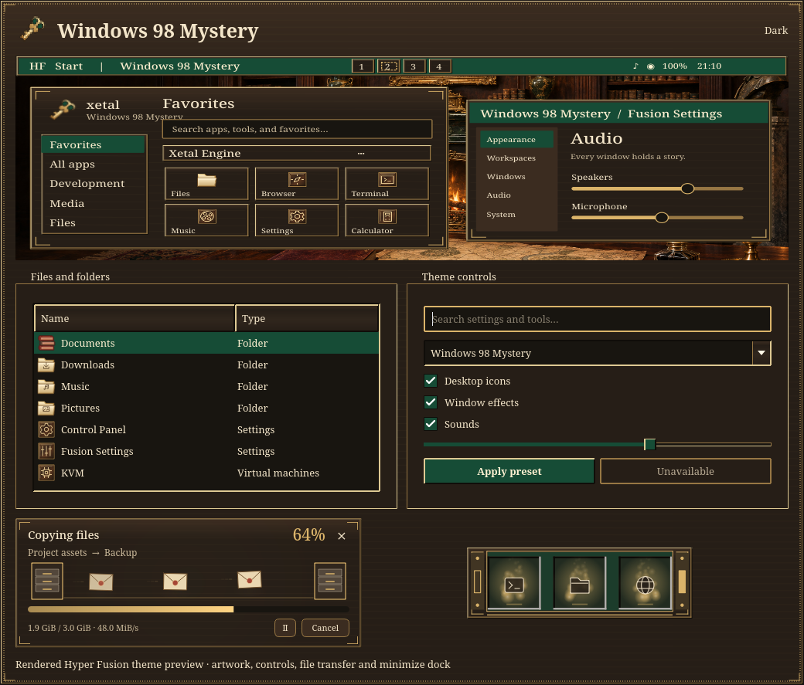

# Windows 98 Mystery

Walnut casework, emerald enamel, parchment text and engraved brass edges,
inspired by the supplied Victorian mystery desktop concept. Square beveled
controls and Noto Serif typography bring the classic desktop feel to Hyper
Fusion, with dark, light and high-contrast palettes.

Choose **Windows 98 Mystery** in **Fusion Settings → Theme → Presets**. Select
**Icons** to apply the matching pack; that component remains unchecked by
default. Components can also be selected individually. Installing the theme
preserves the active theme, wallpapers, monitor arrangement and preferences.

The collection includes:

- Emerald title bars, gold focus borders, square controls and walnut surfaces
  across Fusion Settings, the launcher, Fusion Files, Control Panel, dialogs
  and notifications. Full, Partial and Centered taskbars share the same style.
- 133 scalable system icon files including aliases: a brass Home key, leather
  books, parchment folders, emerald CRT, armillary globe and ornamental bin.
  Control Panel, Fusion Settings and KVM have distinct symbols.
- The **Mystery 98 Pocket Watch** cursor family in XCursor and Hyprcursor
  formats, with all text, resize and drag shapes and an animated watch.
- Wax-sealed letters travelling between wooden document trays during file
  transfers. Letters, trails and glow fade together before wrapping.
- The **Writing Desk** minimize dock, with emerald felt, brass handles and
  walnut side panels. Both the Qt preview and native shader implement it.
  Native style ID 22 is appended; existing IDs are unchanged.
- Eight original **The midnight study** sound cues: soft clockwork chimes and
  warm string overtones. The score and synthesis live in
  `tools/generate_sound_packs.py`; no Windows or film audio samples are used.

## Wallpapers

| Wallpaper | Scene |
| --- | --- |
| [Midnight Study](../wallpaper/mystery98/midnight-study.png) | Candlelit walnut library, emerald fireplace and a desk of clues |
| [Rain at the Manor](../wallpaper/mystery98/rain-at-the-manor.png) | Warm library windows, rain and an ornate garden gate |
| [The Secret Archive](../wallpaper/mystery98/secret-archive.png) | Moonlit shelves, a brass reading lamp and a concealed passage |

All three images are **1672 × 941**, with no painted desktop interface. They
were generated using the **built-in imagegen tool**, in new-image mode. Exact
prompts, dimensions and SHA-256 hashes are in
[prompts.json](../wallpaper/mystery98/prompts.json). These form the default
monitor set from physical left to right; saved personal choices take precedence.

## Validation and activation

The six theme, icon, cursor, transfer, minimize and sound suites ran 253 tests:
252 passed and one display-dependent test was skipped. Follow-up tests cover
the final preset, preview and taskbar refinements. Semantic text pairs meet
4.5:1 contrast in all three modes; taskbar and notification CSS parses.

Offscreen renders cover all three palettes, controls, menus, dialogs, and
paused, conflict, completion and error transfer states. A timer-driven matrix
exercised 216 production Settings-preview and transfer widgets across three
palettes, 25/100/250% speed, density 1/3/7, copying/extraction and trails off/on.
Every widget completed at least three loops and visited all 16 phase intervals.
The new scene also passes rendered cycle-boundary and individual-letter wrap
regressions. All eight sounds decode with quiet edges and ample headroom.

Qt 5/6 integrations, both cursor formats, Cube and Minimize build successfully.
The actual native dock shader compiles and renders through surfaceless EGL in
horizontal and vertical layouts and all three palettes. Interactive behavior
in the live compositor is not established by these offscreen checks.

Sources and assets are installed identically in the repo and live profile.
New native plugins use new build paths; loaded libraries are not overwritten
or hot-unloaded. **Sign out and back in once** to load the new cursor/dock
adapters, then open Fusion Settings to select the theme.
