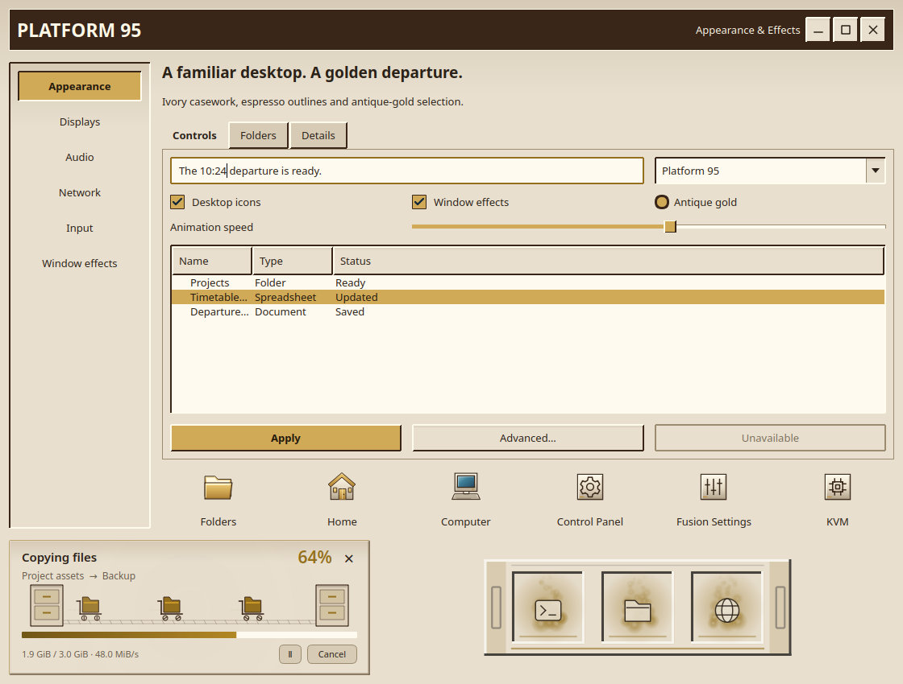

# Platform 95

Ivory casework, espresso headers and antique-gold accents inspired by the
railway-terminal desktop concept. Square bevels, inset fields and familiar
controls carry through the desktop. Light mode most closely matches the concept;
dark mode uses warm espresso, and high contrast uses black, ivory and pale gold.

This is a capture of real Qt controls and the production transfer/dock painters.
Choose **Fusion Settings → Theme → Presets → Platform 95** and select the
components to apply. Choose **Light** for the concept's ivory appearance. Builtin
presets retain the desktop's dark default; **Icons** stays unchecked until you
opt into the matching pack. Individual component choices remain independent.

Included are the launcher, Full/Partial/Centered taskbars, notifications, Files
and file pickers, Control Panel, terminal/lock palettes and greeter/GRUB editor
choices. **Parcel Shelf** supplies a native beveled minimize tray with brass
handles and inset slots. File transfers use little luggage carts carrying folders
between filing cabinets, fading each cart and its trail before the route wraps.

The pack includes **133 original icons**, with distinct gear, sliders and CPU
symbols for Control Panel, Fusion Settings and KVM. **Platform 95 Classic** has
an ivory pointer, a brass clock busy animation and all functional cursor shapes
and aliases in Hyprcursor and XCursor formats. Its preset uses the existing Soft
glow trail. **Golden departure** provides eight original synthesized desk-bell
cues, retaining the user's volume and event choices.

| Wallpaper | Scene |
| --- | --- |
| [Golden Concourse](../wallpaper/platform95/golden-concourse.png) | Sunlight through a grand iron-and-glass station hall |
| [Evening Platform](../wallpaper/platform95/evening-platform.png) | Warm lamps, a quiet canopy and rain at dusk |
| [Highland Crossing](../wallpaper/platform95/highland-crossing.png) | A steam train crossing a stone viaduct at sunrise |

All three original generated PNGs are **1672 × 941**. They contain no desktop
controls or baked-in text. Their exact prompts, provenance and hashes are in
[prompts.json](../wallpaper/platform95/prompts.json). Icon/cursor vectors and
sound synthesis are original repository artwork; native effects retain their
existing GPL license.

Verification covered all six theme/icon/cursor/transfer/minimize/sound suites,
GTK parsing of every taskbar variation and notification palette, rendered Qt
controls/menus/dialogs, and real native Files, picker and Control Panel windows
in dark, light and contrast modes. Native header controls were inspected in
normal, hover and disabled states. A test-fixture cleanup prevents a destroyed
LiveTheme object from leaking into later theme tests.

Native header glyphs now explicitly use HighlightedText over their highlight
hover surface. This keeps gold hover buttons readable in light and contrast
modes; stylesheet hover colors alone do not update custom-painted glyphs.

The Settings preview and transfer renderer were captured for 25.8 seconds with
25/100/250% speeds, densities 1/3/7, copy/extraction and trails on/off across all
three modes. Every card completed at least three loops; chronological frame
sequences and rendered boundary tests were inspected. Existing tests also cover
pause/resume, hidden timers, errors and completion. These use preview jobs and
do not copy personal files.

Disposable Hyprland checks passed all **17 dock designs** and **11 cursor
families**, including restore, hover, overflow, edges, reduced motion and idle
suspension. The Cube upgrade probe also passed sky rendering and replacement
checks; its temporary profile disabled default cap images it had not copied.
Qt integration sources and fonts did not change. Cursor, Cube, Minimize,
Files and Control Panel outputs were rebuilt where affected.

Installation preserves current selections. For an already running desktop,
log out and back into Hyprland once before applying the complete preset: the
repository's session lifecycle loads the updated native effects and refreshes
resident application catalogs at login. Installing this design does not install
a greeter, rewrite GRUB or alter another desktop's settings.

See [AI_Theme_creation.md](../../../AI_Theme_creation.md) for integration details.
