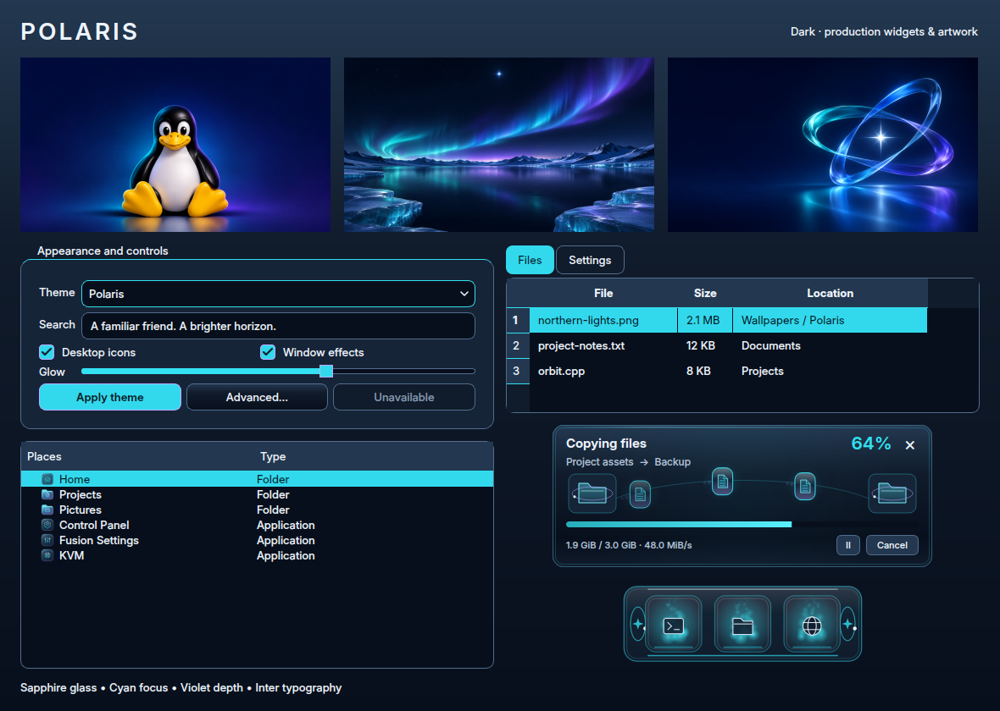

# Polaris

Midnight navy glass, luminous cyan focus and violet depth, inspired by the Tux
desktop concept. Rounded panels, fine inset rims, sapphire folders and Inter
typography give the desktop a familiar, polished appearance. Dark is the preset
default; light uses pale ice blue, and high contrast pairs black with bright cyan.

Choose **Fusion Settings → Theme → Presets → Polaris** and select the components
to apply. **Icons** stays unchecked by default; enable it to use the matching
original pack. Installing Polaris preserves the current theme, wallpapers and
personal settings. Existing applications may need reopening to load new styles.

The design covers the launcher, Full/Partial/Centered taskbars, notifications,
Fusion Files and file pickers, Control Panel, menus, dialogs, terminal and lock
palettes, task switcher and effect colors. Polaris also appears in the greeter
and GRUB editors; choosing it there does not install or change either service.

The icon pack provides distinct folders, devices, applications, file types and
actions, with aliases for desktop integrations. Control Panel uses a gear,
Fusion Settings uses sliders, and KVM uses a chip. **Polaris Starlight** supplies
all 20 cursor shapes, including a rotating orbital busy cursor, in Hyprcursor
and XCursor formats. Its preset uses the existing Soft glow pointer trail.
**Northern lights** supplies eight original, softly synthesized glass chimes.

File transfers carry glass document capsules along a polar arc between orbital
gateways. Each capsule, trail and glow fades before its route wraps. The
**Orbital Glass** minimize dock has an inset cyan rim, sapphire slots and paired
orbiting end lights. Both have independently selectable styles and preserve
existing animation, accessibility and behavior settings.

| Wallpaper | Composition |
| --- | --- |
| [Tux Starlight](../wallpaper/polaris/tux-starlight.png) | A friendly seated Tux with cyan and violet rim light against midnight navy |
| [Northern Lights](../wallpaper/polaris/northern-lights.png) | A cyan and violet aurora over a glacial lake beneath the north star |
| [Orbital Glass](../wallpaper/polaris/orbital-glass.png) | Three luminous glass ribbons circling a bright star |

All three generated PNGs are **1672 × 941**, without painted desktop interfaces.
They form the default three-monitor set and can also be selected individually.
Exact prompts, dimensions, provenance and hashes are in
[prompts.json](../wallpaper/polaris/prompts.json). The built-in imagegen tool
produced the wallpapers; icon/cursor vectors and sound synthesis are repository
artwork. Tux is the Linux mascot. Native effects retain their existing GPL license.

Validation includes theme, icon, cursor, sound, transfer and minimize unit suites;
GTK parsing of taskbar variants and notifications; and real Qt controls, menus,
dialogs, native Files and pickers in all three modes. Transfer inspection uses
three timer-driven loops in 36 production Settings-preview and transfer cards,
covering 25/100/250% speeds, densities 1/3/7, copy/extraction and trails on/off.
Rendered-frame regressions check each capsule's wrap and continued movement.

Qt 5/6 integrations, cursors, Cube and Minimize are rebuilt. A disposable
Hyprland session verifies all 20 dock materials and all 14 cursor families.
The broader dock check reaches the multi-monitor shared-boundary test before
timing out while revealing the first display's dock; that check uses Gilded
Hollow, not Polaris. This remains a validation limitation.

New native dock and cursor support loads through the normal Hyprland session
lifecycle. After installing into an already-running session, sign out and back
into Hyprland before applying those two new components. The theme gallery and
other components are available immediately in a newly opened Settings process.

See [AI_Theme_creation.md](../../../AI_Theme_creation.md) for the integration map.
