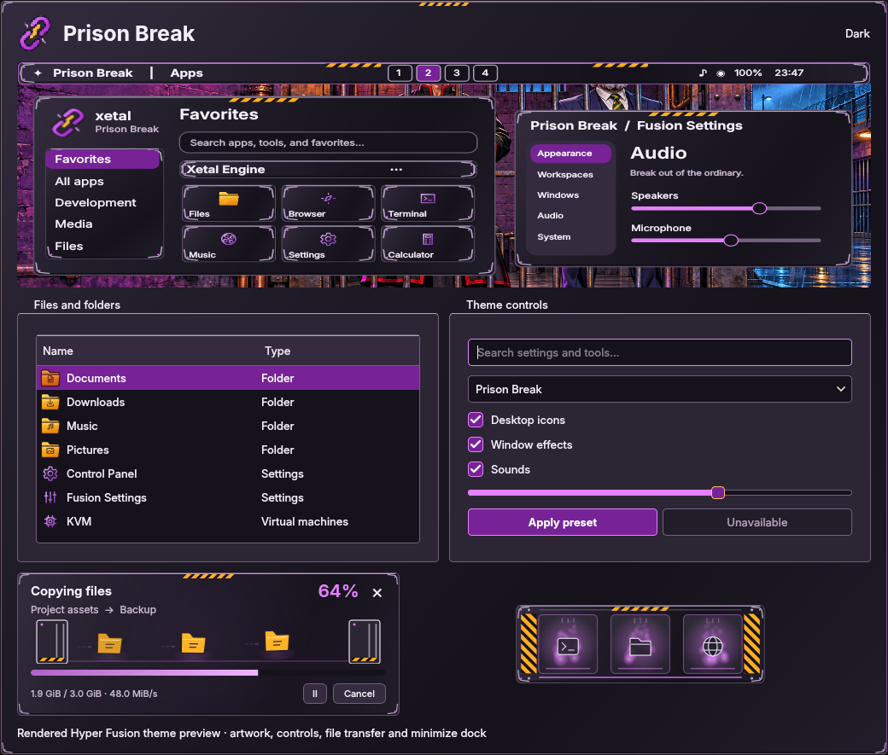

# Prison Break

Purple neon, graphite steel, orange folders and hazard stripes, inspired by the
supplied comic-book prison desktop concept. Bold Inter typography, inset metal
controls and violet focus edges carry the design through Hyper Fusion. Dark,
light and high-contrast palettes are included.

Choose **Prison Break** in **Fusion Settings → Theme → Presets**. Select **Icons**
for the matching pack; icons remain unchecked by default. Components can also
be selected individually. Installation preserves the active theme, wallpapers,
monitor arrangement and saved preferences, including the preceding Mystery 98
theme and its assets.

The collection includes:

- Riveted steel surfaces, violet controls and narrow orange hazard bands on
  painted edges. Decorations add no input surfaces or draggable overlays.
- Full, Partial and Centered taskbars; launcher surfaces; Fusion Files and file
  pickers; Control Panel; menus, dialogs and notifications.
- 133 scalable icon files including aliases: orange folders, an orange house,
  purple CRT, network nodes, silver bin and distinct equipment silhouettes.
  Control Panel, Fusion Settings and KVM retain different symbols.
- **Prison Break Escape Key** cursors in XCursor and Hyprcursor formats, with
  functional text, resize and drag shapes and an animated padlock busy cursor.
- Orange dossiers travelling through sliding gates during file transfers.
  Every dossier, trail and glow fades together at its wrap point; gate motion
  completes a whole periodic cycle.
- The **Cellblock Dock**, with violet steel, striped guards, rivets and inset
  slots, implemented in the Qt preview and native shader. Its ID is appended
  as 23; all previous native style IDs remain unchanged.
- Eight original **Midnight breakout** sound cues: soft synth pulses, metallic
  overtones and a warm bass echo. The score and synthesis are in
  `tools/generate_sound_packs.py`; no game, television or film samples are used.

## Wallpapers

| Wallpaper | Scene |
| --- | --- |
| [Cellblock Neon](../wallpaper/prisonbreak/cellblock-neon.png) | Two fictional comic characters behind bars, violet brick and amber cage lamps |
| [Midnight Yard](../wallpaper/prisonbreak/midnight-yard.png) | Rain, purple watchtowers and a partly open industrial gate |
| [The Service Passage](../wallpaper/prisonbreak/service-passage.png) | Copper pipes, neon light and a doorway into the rainy night |

The three images are **1672 × 941**, with no painted desktop UI. They were
created with the **built-in imagegen tool**, in new-image generation mode.
Exact prompts, dimensions and SHA-256 hashes are recorded in
[prompts.json](../wallpaper/prisonbreak/prompts.json). This is the default monitor
set in physical left-to-right order; saved personal wallpaper choices take
precedence.

## Validation and activation

The theme, icons, cursors, file transfers, minimize and sound suites ran 253
tests: 252 passed and one display-dependent test was skipped. Semantic text
pairs meet 4.5:1 contrast in all three palettes. Taskbar CSS parses across
palette/style/variant combinations, and notification CSS parses in every mode.

Offscreen renders cover all palettes, controls, menus, dialogs and running,
paused, conflict, completion and error transfer states. A timer-driven matrix
exercised 216 production Settings-preview and transfer widgets: three palettes,
25/100/250% speed, density 1/3/7, copying/extraction and trails off/on. Every
widget completed at least three loops and visited all 16 phase intervals.
Rendered cycle-boundary and individual-dossier wrap tests include the new scene.
All eight sounds decode with quiet edges and a worst decoded peak of −8.19 dBFS.

Qt 5/6 integrations, both cursor formats, Cube and Minimize build successfully.
The actual native dock shader compiles and renders through surfaceless EGL in
horizontal and vertical layouts and all three palettes. Offscreen checks do
not establish interactive behavior in the live compositor.

Source, assets and native outputs are installed in the repo and live profile.
Native plugins use new build paths; loaded plugins are not hot-unloaded.
**Sign out and back in once** to load the new cursor/dock adapters, then reopen
Fusion Settings to select Prison Break. No commit or push is included.
