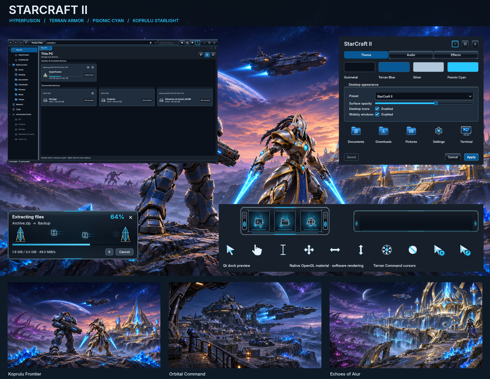
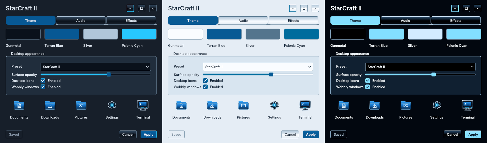

# StarCraft II

Terran gunmetal armor, cobalt enamel, silver bevels and psionic cyan lighting,
inspired by the supplied desktop concept. Protoss gold and Zerg violet carry
through the artwork. Includes dark, light and high-contrast palettes.

Choose **Fusion Settings → Theme → Presets → StarCraft II**. Select **Icons**
in the component chooser for the matching blue folders and command-deck
instruments; that optional component is unchecked by default.

The theme includes armored Start menu surfaces, coordinated application
controls, Fusion Files, Control Panel, notifications, three Waybar layouts,
and a **Command Deck** minimize dock with metal end caps and cyan reactors.
**Terran Command** cursors include an animated reactor spinner. File transfers
send glowing cargo between two Protoss-inspired pylons. **Koprulu comms**
provides eight original synthesized sound cues.

Three wallpapers are available in the wallpaper picker. The wallpaper
component assigns them to displays in the usual left-to-right order.

| Wallpaper | Scene |
| --- | --- |
| [Koprulu Frontier](../wallpaper/starcraft/koprulu-frontier.png) | A Terran marine and Protoss zealot overlook mineral fields, Zerg spires and a luminous Protoss city. |
| [Orbital Command](../wallpaper/starcraft/orbital-command.png) | A battlecruiser lifts above an armored Terran base, with engine plumes, gantries and a ringed planet. |
| [Echoes of Aiur](../wallpaper/starcraft/echoes-of-aiur.png) | Golden Protoss architecture spans a vast chasm above blue crystals and a violet Zerg frontier. |

These still illustrations were generated with the built-in imagegen tool at
1672 × 941. Exact prompts, dimensions and SHA-256 hashes are recorded in
[prompts.json](../wallpaper/starcraft/prompts.json). The wallpapers contain no
baked-in desktop windows or controls. Icons and cursor shapes are original
vectors. The sound pack uses the original score and synthesis in
[generate_sound_packs.py](../../../tools/generate_sound_packs.py), without game
recordings or soundtrack samples.

The overview assembles actual offscreen Fusion Files, production-stylesheet
Qt controls, transfer and dock renders over the wallpaper. It is a component
preview, not a screenshot of a running desktop session. Checks cover theme
transactions, palette contrast, icons, cursors, transfer wrap boundaries,
native dock IDs and sounds. Three-loop copy/extract sequences were rendered
at slow, normal and fast speeds in all three palettes. GTK accepted all nine
Waybar combinations and three notification palettes. The native dock shader
compiled and rendered both orientations and slots with software OpenGL;
Qt 5/6, Cube's cursor adapter and Minimize were rebuilt.

The nested Hyprland checks could not run in the sandbox: its compositor could
not bind its IPC socket or initialize the backend. Live compositor behavior
still needs a normal desktop session.

Reopen Fusion Settings to refresh the catalog. Log out and back into Hyprland
once to load the updated native dock and cursor adapters. Installing this
theme preserves the currently selected theme and personal settings.
