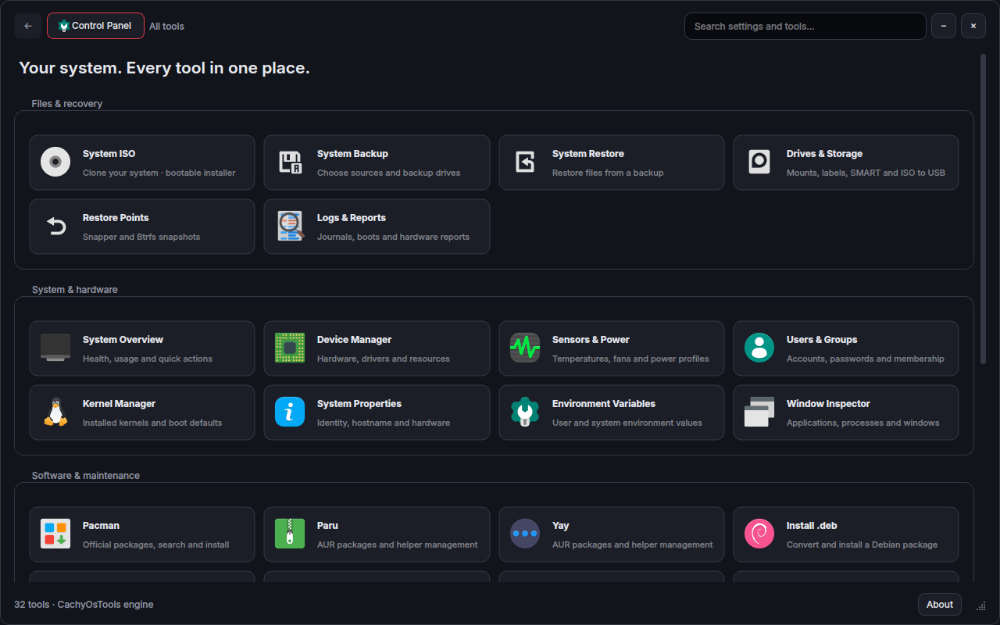
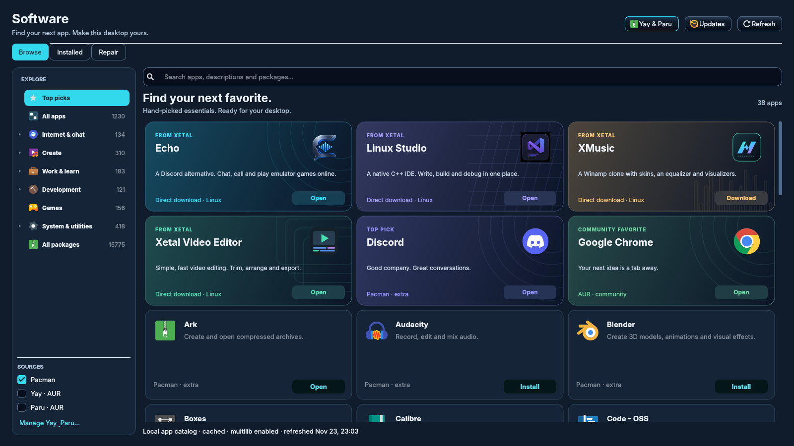
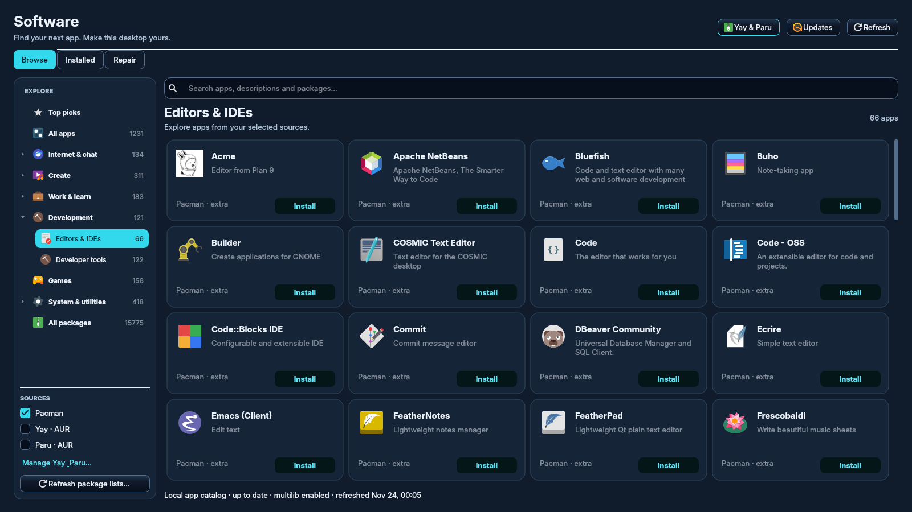
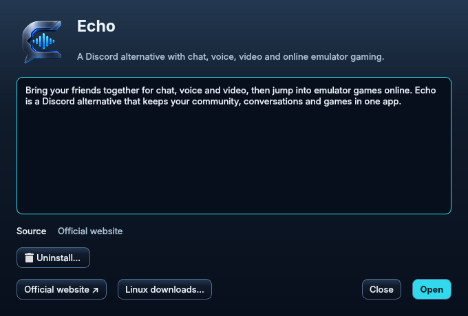
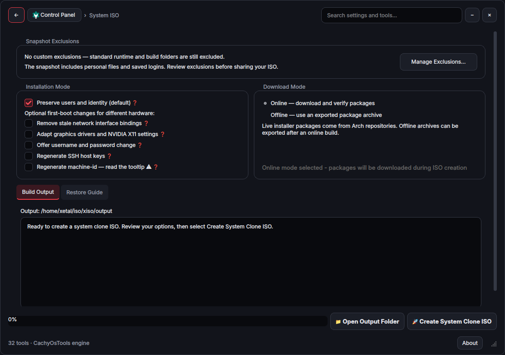
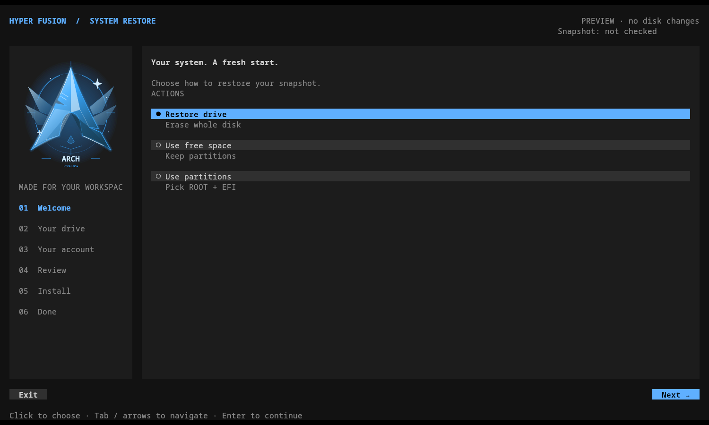

# Control Panel

Open **Apps → Control Panel**, immediately above Fusion Settings. It opens as a centered floating window. Drag its header to move it, use the bottom-right grip to resize it, and search by name or purpose. **Alt+Left** returns to all tools; **Ctrl+F** searches. Window size and preferences are saved separately from CachyOsTools.

The minus button hides the panel while its work continues. Open Control Panel from Apps again to return to the same instance and tool.

Click the star at the right of any tool tile to add a direct shortcut to **Apps → Favorites**. A filled star means it is saved; click again to remove the pin. Launching that favorite opens the specific page in the existing Control Panel window. Stars stay in sync with changes made in Apps, and saved favorites survive desktop updates.

The Start menu also searches Control Panel tools alongside installed apps and Fusion Settings destinations. Search a name or purpose, such as `grub`, `rdp` or `governor`, to open the corresponding page directly.

The native Qt/C++ interface uses a complete copy of the **CachyOsTools** engine. The original application is not replaced or modified. System operations, dialogs, scripts, translations and ISO resources are included in [`control_panel/backend`](../config/hypr/control_panel/backend). [`UPSTREAM.json`](../config/hypr/control_panel/UPSTREAM.json) records the original source revision and file hashes. The engine and integration use [GPLv3](../config/hypr/control_panel/LICENSE).



## Tools and feature coverage

| Control Panel entry | Included tools |
| --- | --- |
| Proton | Integrated XetalProton: a searchable app gallery, launch card and Task Manager shortcut, with environment management and Windows tools in Settings. Includes the 13-provider tool downloader, UMU, updates, Winetricks, compatibility options, command export and process logs. [Screenshots and feature showcase →](../README.md#windows-apps-with-our-custom-proton-manager) · [Guide →](../config/hypr/control_panel/proton/README.md) |
| System ISO | Full system clone, exclusions, online/offline packages, archive selection/verification, first-boot hardware/identity changes, output, restore guide, dependency checks and dummy installer preview |
| Ventoy USB | Bundled offline engine for creating and updating multiboot USB disks. USB identity and system-disk checks, exact-disk erase confirmation, MBR/GPT and Secure Boot options, progress logs and Open in Fusion Files. [Guide and source →](../config/hypr/control_panel/ventoy/README.md) |
| System Backup / System Restore | Source/destination drives, filesystem browsing, rsync backup and restore |
| Drives & Storage | Filters, mounts, labels, formatting, ownership/permissions, SMART health, benchmarking and ISO to USB |
| GRUB Boot Editor | Automatically loads the menu after authentication. Edit names, commands and ordering; choose a default, timeout or remembered selection; add other systems or register this Linux installation in UEFI. Includes appearance, backups and undo. [Guide →](GRUB-BOOT-EDITOR.md) |
| Restore Points | Snapper/Btrfs snapshot management |
| Logs & Reports | Plain-text hardware reports, decoded login history, journal filters, boot selection and live following |
| System Overview | Health, resource use, quick actions and language selection |
| Device Manager | Hardware categories, drivers and device operations |
| Sensors & Power | Temperatures, fans, power profiles and diagnostics |
| Users & Groups | Accounts, passwords, membership and administration |
| Kernel Manager | Installed kernels, install/remove and boot defaults |
| System Properties | Hardware, identity and hostname |
| Environment Variables | System environment editor and separate Hyprland login environment |
| Window Inspector | Window/process inspection, X11/Wayland backends and window actions |
| Default Apps | Browser, email, file manager, music, video, images, PDF, text, archives and office defaults; searchable individual file types and links; Undo |
| Software | App discovery with a category tree, featured banners, app icons/descriptions, cached Pacman catalog and optional AUR search. Installed and Repair tabs keep package maintenance in the same page. |
| Yay & Paru | Advanced helper search, installation and management; both helpers use the same AUR catalog. |
| Install .deb | Check Debian dependencies, convert supported applications, and install with pacman (experimental) |
| Package Updates | System upgrades, package checks and Arch news |
| System Cleaner | Curated cleanup plus a sudo disk visualizer with mounted-volume/folder picker, size tree, treemap, breadcrumbs and file actions |
| RAM Cleaner | Live memory readings, Normal/Aggressive manual cache cleanup and observed before/after results; keeps applications running |
| Network | Connections, Virtual networks, Diagnostics, Firewall and Shared folders; themed cards, expandable saved profiles and selection-aware actions |
| RDP | Outgoing RDP/VNC connections and incoming desktop sharing in two tabs. RDP keeps its native client, saved PCs, wallet credentials, folder/clipboard/audio options and session toolbar. VNC connections use TigerVNC; hosting uses hypr-rdp or WayVNC with monitor/address selection and live status. [Guide →](../config/hypr/control_panel/rdp/README.md) |
| Firewall | UFW/firewalld rules and configuration |
| Network Shares | Discovery, mounts, sharing and associated services |
| Shell & Apps Shortcuts | Alias add/edit/remove, shell configuration editor, terminal actions and Apps favorites |
| Services | System/user service controls, failed services, journals and boot analysis |
| Startup Applications | Choose Num Lock and Xetal Engine behavior at login; add/edit, enable/disable, remove and run login applications; manage user units |
| System Tweaks | Searchable cards, inline choices, current/saved values, permanent apply and restore; performance, memory/storage, security, network, system, desktop and Hyprland categories |
| System Configuration | Privileged editor and configuration catalog, extended with Hyprland and Kitty |
| Panel Preferences | Language, visible tool families, startup page, size memory, autosave, drive/package/editor defaults, ISO defaults and debug preview |
| Hyper Fusion Updates | The existing desktop updater, including Control Panel updates |

Software includes package repair and installed-package management. Shares, Firewall, Services and Startup Applications keep their dedicated entries. Yay and Paru share one helper-management page. KDE Plasma tweaks and the old KVM interface are omitted from this Hyprland panel; their upstream source remains in the engine archive.

The separate CachyOsTools Theme page is replaced by the **desktop master theme**. Raw, Modern, BreakPoint and Binary Knife, including Dark/Light/High contrast, apply to the panel and its dialogs. Appearance preferences link to Fusion Settings. Hyper Fusion's updater supersedes the original application's self-updater.

The backend targets **Arch Linux/CachyOS**. Package, kernel, boot and ISO tools retain their platform/dependency requirements; installing Hyper Fusion on another distribution does not translate these commands to another package manager. Existing confirmation and privilege prompts remain. Opening or searching the panel does not execute a system-changing operation.

## Software catalog



**Software → Browse** opens Top picks immediately. The first six banners are Echo,
Linux Studio, XMusic, Xetal Video Editor, Discord and Google Chrome, in that order.
The banners scroll with the app cards and adapt to the window width. Select a
category or expand it for browsers, chat, creative tools, development, games and
other apps. **All packages** also includes command-line tools and libraries.
Click a card for its description and source, or use its **Open**, **Install** or
**Download** button.

| Browse by category | App details |
| :---: | :---: |
| [](screenshots/software-development-polaris.png) | [](screenshots/software-echo-details-polaris.png) |

[Featured apps and full-size screenshots →](GALLERY.md#software-catalog)

**Pacman** is selected by default. **Yay · AUR** and **Paru · AUR** are optional,
remembered checkboxes; a missing helper links to its existing setup page. They
search the same AUR catalog, so selecting both does not duplicate results or
network requests. Yay is used when both are selected. Chrome is clearly marked
as an AUR app; its featured card can enable a helper before installation. Only
repositories enabled in the machine's Pacman configuration are shown, with their
normal priority. The ISO enables multilib, and the catalog reports that state.

The four Xetal apps use the host's published Linux releases, independently of
Pacman/AUR. **Install** checks the latest release, downloads privately and verifies
its byte count and SHA-256 before installation. `.run` files receive execute
permission and run automatically; Echo opens its own setup wizard. Linux Studio
uses the tarball, installs under `~/.local/opt/LinuxStudio`, and receives a menu
launcher. Progress and installation errors stay visible in Software.

Successful installations add their app launchers to **Favorites**. This also
applies to Pacman, Yay, Paru and converted `.deb` packages; libraries and hidden
helper launchers are skipped. Existing favorites and their arrangement are kept.
Fresh desktop installs include **XMusic**, pinned and registered as the default
player for the audio formats it supports. Its verified installer is bundled so
setup also works offline. Existing desktops keep their chosen music player.

AppImage and optional portable formats remain available as **Download only**.
These use a save dialog and do not execute the download. Cancelled or failed
downloads discard the partial file and preserve an existing download. **Open
folder** opens the destination in Fusion Files. The host publishes app updates.

Browsing and local search read Pacman databases and Arch AppStream metadata.
Icons are loaded locally, and a virtualized grid paints visible cards without
creating a widget for every package. An atomic disk cache reopens immediately;
changed repository data, installed packages, desktop launchers or bundled picks
invalidate it. **Refresh** rereads local metadata; **Updates** performs the existing
package-update workflow. Returning to a category after a minute also checks the
local cache. The first visit offers **Refresh lists**, which requests administrator
authentication and runs **`pacman -Sy` only**; it installs or upgrades no packages.
A successful refresh shows a green checkmark and **Your package list has been
refreshed successfully.** Command output stays available under **Show details**;
failures display the output and a **Retry** button. A successful refresh is
remembered. Missing/unreadable databases offer the same
repair, and **Refresh package lists…** in the sidebar can retry it at any time.
Ordinary catalog **Refresh** rereads local data without elevation.
AUR queries are debounced, bounded and cached for six hours; Refresh rechecks the
current query. Failed refreshes preserve the previous list and show the error.

Pacman installations retain a reviewed full `pacman -Syu` transaction. AUR
installation retains the helper's build-file review. **Installed** and **Repair**
keep removal, reinstall, cache/orphan cleanup and guarded repair tools. The
catalog refreshes installed state after a package transaction exits. Existing
`--section pacman`, `remove` and `repair` shortcuts continue to work.

Validated apps offer **Install with Pacman** and **Install with .deb installer**
in their details. AUR-only apps label the package route Yay/Paru instead.
The .deb route opens the existing installer with the matching app selected;
download its official Linux .deb, then choose it for the existing review and
conversion workflow. Compatibility notes describe the version actually tested.

Installed apps have **Uninstall…** in their details. Package-managed apps use the
actual installed package name, including .deb-converted aliases, and keep Pacman's
removal confirmation. Recognized per-user Xetal installer folders and launchers
can be moved to Trash. Custom development checkouts and arbitrary portable copies
require their own removal method; Software does not delete them automatically.

**Yay & Paru** shows **Install Yay** and **Install Paru** directly on the page.
**Yay is recommended for HyperFusion** and its install button is highlighted.
Either helper is sufficient; installed helpers show their status in the same
cards. **Manage helpers** retains reinstall, uninstall, install-both and cache
actions. Installation still opens the existing reviewed terminal setup.

## Hyprland integration

- Shell detection follows the terminal shell, including literal Kitty shell overrides, Zsh's `ZDOTDIR` and Fish's config directory. Supported aliases/abbreviations are parsed without executing shell configuration.
- Alias saves preserve surrounding configuration/functions and simple user-owned source files. External changes block stale saves. Private backups are kept in `control_panel/state/alias-backups`.
- **Add to Apps…** opens the existing shortcut editor, including command, directory, icon, terminal, keep-open and floating options. Saving creates a favorite in Apps.
- Terminal operations use the private Kitty profile. Control Panel runs as the ordinary desktop user; individual administrative tools request privileges when used.
- New login applications are saved in `control_panel/state/autostart` and run at the next Hyprland login. Shared desktop autostart files are not edited. Package entries require explicit opt-in; user systemd units remain separately identified.
- **Startup Applications → Desktop startup** includes **Turn on Num Lock when I log in**, enabled by default. It shares `input:numlock_by_default` in `control_center/input.conf` with the Input page's **Num Lock on at login** option. Changes use the existing full-configuration validation, backup and rollback path; the Num Lock key still works normally during the session.
- The same **Desktop startup** group controls whether the animated Xetal Engine dashboard appears at login. The dashboard also has a **Show this dashboard at login** checkbox linked to this setting; turning it off skips all four windows. **Super+D** still opens or hides it manually. The preference defaults to on and is stored in the update-preserved `control_panel/state/startup-screen.json`.
- User environment values are literal `NAME=value` lines in `control_panel/state/environment.env`, applied at the next Hyprland login. The explicit system pane still edits `/etc/environment` when requested.
- The panel, shortcut editor and startup helper are tied to the active compositor connection.

## Remote desktop: RDP and VNC

All remote desktop options are under **Control Panel → RDP**.

| Tab | Purpose |
| --- | --- |
| **Connect to a PC · RDP / VNC out** | Open a saved PC or create a connection. RDP is the default; VNC opens TigerVNC with its own encryption, clipboard, resizing, full-screen and view-only options. Existing RDP profiles and wallet credentials retain their behavior. |
| **Share this desktop · RDP / VNC in** | Share a monitor from this logged-in desktop. Choose RDP or authenticated TLS VNC, the monitor, listening address, port and a sharing password. One incoming protocol runs at a time. |

Hosting starts off, bound to the local computer, with automatic startup disabled.
For another PC, choose the LAN address and verify the certificate fingerprint.
Start requires a new password of 12–256 characters or a previously saved one.
The status shows starting, listening, active TCP connection counts or off, and
failed starts retain their error. Counts include authentication negotiation.
Polling preserves form edits and leaves buttons stable; the log pane removes
terminal color/control codes from both old and newly written output.

RDP includes keyboard/mouse control, clipboard and mirrored audio. VNC also
supports view-only sharing. Sharing stops at logout and does not expose a login
screen. No firewall ports are opened automatically. See the
[remote desktop guide](../config/hypr/control_panel/rdp/README.md) for connection,
credential and validation details.

## Network

The Network page groups related tools into five tabs:

- **Connections** puts adapters and nearby Wi-Fi together, with the computer
  name, local IPv4 address and DNS servers above them. Select an adapter for
  **IP & DNS…**, or a wireless network for **Connect**. Expand **Saved connections**
  to activate an existing profile or manage auto-connect and forgotten networks.
- **Virtual networks** groups physical bridges and libvirt networks. Create a
  bridge, update its hardware assignment, or start and stop VM networks here.
- **Diagnostics** gathers local/public addresses, listening ports, adapter
  traffic and the existing NetworkManager restart action.
- **Firewall** contains the existing rules and firewall controls. Loading rules
  remains an explicit action because it requires administrator authentication.
- **Shared folders** contains network discovery, mounts and folder sharing.
  The separate Control Panel shortcuts open these same tabs.

Secondary actions are under **More**. Controls that need a selection stay
disabled until a valid target is selected. Saved connections retain their UUID
when the list is refreshed or reordered; duplicate profile names do not change
which connection an action targets. Tables fit their content, and the two-column
layout becomes a single column in smaller windows. The adapter and Wi-Fi cards
share a height when side by side, with their action buttons aligned at the bottom.

Opening the page reads status and does not connect, disconnect or modify network
settings. Refresh reads only the visible area; **Scan** explicitly requests a new
Wi-Fi scan. Automatic/manual addressing is read from the active
[NetworkManager connection profile](https://networkmanager.dev/docs/api/latest/nm-settings-nmcli.html),
and VM network modes follow the [libvirt forwarding definition](https://libvirt.org/formatnetwork.html).
These replace the old display heuristics without changing connection actions.

## Persistent System Tweaks

Open **Control Panel → System Tweaks**. Choose a value on its card and click
**Save & apply**. Administrator authentication appears once per system operation;
the page reports success or the reason a change failed. Unavailable hardware
options are disabled. Search works across categories, and **About this setting**
explains each choice without opening another window.

- **Performance:** hardware-supported CPU governors, energy preferences, turbo
  boost, game memory mappings and the NMI watchdog. An enabled boot service
  restores CPU, transparent huge-page and disk scheduler choices without
  requiring cpupower. Active power managers that may override manual CPU choices
  are identified on the page.
- **Memory & storage:** zram0 capacity, swappiness, filesystem cache pressure,
  separate writeback thresholds, transparent huge pages, supported I/O schedulers,
  scheduled SSD TRIM and RAM-backed `/tmp`.
- **Security:** ptrace access, process visibility, crash dump collection and
  kernel log access. **Network** includes IPv6, available TCP congestion
  algorithms, Fast Open and buffer ceilings, plus the connection-profile editor
  for persistent DNS settings.
- **System:** parallel package downloads, pacman appearance, journal limits and
  separate inotify watch/instance limits. Boot options, firewall rules, startup
  configuration and service management link to their dedicated tools.
- **Desktop:** Fusion Files' saved hidden-file default. Existing per-folder view
  choices are preserved. **Hyprland** retains the log controls described below.

System settings are saved across reboots. Zram, `/tmp` and `/proc` mount changes
use **Save for reboot**; they do not tear down active swap or remount live
filesystems. Ptrace mode 3 is also scheduled for reboot because the kernel will
not allow it to be lowered during the same boot. Selecting another mode while
mode 3 is active therefore also requires reboot. Mode 0 permits normal same-user
debugging, subject to the kernel's remaining checks; it does not grant arbitrary
cross-user access. See the [kernel's Yama documentation](https://docs.kernel.org/admin-guide/LSM/Yama.html).

Each system change keeps a private previous-state backup. **Restore previous**
restores that setting's last backup, unless a configuration file has subsequently
changed. Errors trigger rollback and remain visible; a failed command is never
reported as a successful apply. Later configuration overrides are checked before
writing, including [sysctl.d precedence](https://www.freedesktop.org/software/systemd/man/latest/sysctl.d.html)
and systemd drop-ins. Zram follows the [generator's configuration rules](https://github.com/systemd/zram-generator/blob/main/man/zram-generator.conf.md).

CPU/THP/disk choices are recorded in `/etc/hyperfusion/system-tweaks.json` and
restored by `hyperfusion-system-tweaks.service`, which runs a root-owned helper
under `/usr/local/lib/hyperfusion`. It does not execute the user-writable desktop
profile at boot. Backups are under `/var/lib/hyperfusion-system-tweaks` with
administrator-only access. Simply opening this page changes no system settings.

## Hyprland log guard

**System Tweaks → Hyprland → Hyprland log guard** protects session runtime space by default. At login and once a minute, it checks Hyprland's log and an explicit list of Hyper Fusion session logs, including the cached Control Panel, Apps, Settings and Waybar logs. Files exceeding **64 MiB** are emptied in place, so their existing writers can continue logging and the space is released. Cleared log contents are discarded; save diagnostics elsewhere first when investigating a problem. The threshold is checked periodically, rather than imposing a hard filesystem quota.

**Protect session runtime space** takes effect during the current session and persists for future logins and desktop updates. **Check logs now** performs the same oversized-log cleanup immediately, including while automatic protection is paused. The page shows managed log usage and free runtime space. Only logs inside the current user's current Hyprland instance are eligible; symlinks, hardlinks, special files, other sessions and unrelated files are excluded. The helper follows the compositor's live IPC connection and exits at logout. No system service or administrator password is needed.

**Disable session logs to file** is a separate, initially unchecked preference. It applies at the **next Hyprland login**, and the panel shows when a change is pending. It sends Hyper Fusion session helper output to `/dev/null`, including cached UIs, Waybar, effects, startup windows and screenshot notifications, and requests `debug:disable_logs = true` from Hyprland. That compositor option is reapplied after configuration reloads. Unchecking restores normal logging on the following login; it does not force verbose compositor logging. Existing files are kept, running helpers are not restarted, and the cleanup checkbox is unchanged. Startup/driver diagnostics that bypass Hyprland's normal logging switch can still be bounded by the guard. Installer, update-job and application diagnostics outside the managed session logs remain available.

Preferences live in `control_panel/state/runtime-log-guard.json`; the last cleanup's time, filenames and reclaimed bytes are recorded alongside it. `scripts/session_logging.py` shares the file logging choice across helpers and records the policy for each login in that instance's `session-logging.json`. For a manual check from the session's terminal, run `python3 ~/.config/hypr/scripts/runtime-log-guard.py --once`. This is space protection, not a repair for a graphics driver error. Hyprland's [debugging documentation](https://wiki.hypr.land/crashes-and-bugs/) describes collecting diagnostics and warns that verbose logging can produce large files.

## Default Apps

**Fusion Settings → Default Apps** provides the same everyday app choices,
including the file manager used by Super+E and screenshot/recording **Show in
folder** actions. It shares the Control Panel backend, supports app search and
Undo, and links to the full file-type and protocol editor. Background helpers
resolve the Hyprland profile's app defaults even when started with older session
environment values. Fusion Files and Dolphin receive `--select` for reveal actions.
The Hyprland session starts a resident folder service so standard ShowItems and
ShowFolders calls, including Chrome's **Show in folder** portal requests, follow
this choice even when all Fusion Files windows are closed. The service exits at
logout and does not change KDE's service configuration.

Open **Software & maintenance → Default Apps**. The themed **Everyday apps**
cards show the current application for twelve categories. Choose a card, select
an installed application and click **Use app**. Recommended applications appear
first; **Show all installed apps** includes other choices. Cancelling leaves
defaults unchanged. **File types & links** lets you search extensions such as
`.png`, MIME types, protocols or application names and change individual types.

Choices apply throughout the current desktop account using standard MIME
associations. The browser card updates HTTP, HTTPS and HTML together; music,
video and image cards cover their registered formats. Existing application
preferences that explicitly override desktop defaults remain application
preferences. **Undo** restores the last change unless another program has since
changed those settings. Unrelated associations are preserved.

The file-manager choice is also used by Super+E, Apps → Files, desktop folder
actions and screenshot **Show in folder**. **My Computer** and the explicit
**Fusion Files** application continue to open Fusion Files. A fresh installation
uses Fusion Files as the folder default. The updater includes this page and
its helper without distributing the developer's application choices or history.

## RAM Cleaner

Open **Software & maintenance → RAM Cleaner**. **Normal** releases clean file cache; **Aggressive** also releases reclaimable filesystem metadata. Both finish pending disk writes first. Authentication is requested only after **Clean RAM**, and the panel stays responsive while it works. Cancelling authentication leaves memory alone. The tool never signals applications, deletes files, disables swap, compacts memory or changes persistent settings. Cleanup is manual, with no scheduled or login action.

Linux already reclaims caches when needed. **Available RAM** includes reclaimable memory, so reducing cache does not necessarily increase the memory available for a VM. Active application/VM memory is not reclaimable by this tool. Reading files may be slower while caches rebuild; this is an occasional troubleshooting tool, not a background performance booster. See the [kernel's cache reclamation documentation](https://docs.kernel.org/admin-guide/sysctl/vm.html#drop-caches).

The page reports file cache excluding shared/tmpfs memory, reclaimable metadata, swap usage and observed before/after changes. The numbers can move in either direction while other applications run. They are not a promised amount of memory freed. Only the short-lived helper runs as root, and it accepts two fixed modes writing to the single kernel cache-reclamation endpoint.

## Disk Visualizer

Open **System Cleaner → Disk Visualizer**, choose a mounted partition, then **Choose folder…** to browse its directory tree. **Scan with sudo** reads protected folders through a separate helper; the Qt interface runs as your normal desktop user. The original **Clean up** tab retains its cache-only cleanup rules.

The tree lists directories from largest to smallest and puts direct files in a separate **Files** group at the end of each directory. Expand that group to see its files, also largest first. Select a rectangle to inspect it, double-click a folder to zoom into its map, and use the clickable path buttons or **Alt+Up** to return. The splitter adjusts the space between tree and map.

**Space on disk** uses allocated blocks; **Apparent file size** is useful for inspecting sparse VM images. Hard links count once, symbolic links are never followed, and scans stay on the selected filesystem by default, including bind-mount boundaries. The optional cross-filesystem setting still skips virtual kernel filesystems. Unreadable or changing entries are reported. Shared/compressed filesystem blocks can make these totals differ from a partition's used-space figure.

Right-click a tree item or map tile to open its folder, copy its path, **Send to Trash**, or **Delete permanently…**. Removal requires confirmation of the selected path. Trash uses the desktop user's Trash and never falls back to permanent deletion when permission or filesystem support is missing. Permanent deletion checks the scanned item's identity and refuses scan roots, mount points and essential system folders. **Files** groups are navigational, not bulk-delete targets.

After a successful permanent deletion, the map and parent totals update from the existing scan immediately, including file counts and hard-link accounting. Your current map stays open, or moves to the surviving parent if you deleted the folder being viewed. Other folders are not rescanned; use **Scan with sudo** to include unrelated filesystem changes. Temporary entries that disappear during deletion, such as GPG sockets, are treated as already removed. Other failures or partial deletions trigger a fresh scan. Trash also rescans because the files may have moved elsewhere inside the scanned tree and still occupy space.

Scans are cancellable. A private, disposable SQLite index keeps the full file list out of GUI memory; tree rows load on demand and map detail is bounded. Closing Control Panel or ending its compositor session closes the helper's pipe, stops work and removes the temporary index.

## System ISO



At the default 1280 × 800 size, the ISO settings fit above a compact, internally scrolling output area, with build actions pinned below. The window remains constrained to the current monitor. On smaller screens, the page can scroll to keep every control accessible.

The live ISO opens a full graphical Hyper Fusion wizard with the transparent blue Arch emblem, drive cards, Back/Next controls, account setup and progress. Installation details remain visible throughout the restore and on the completion screen; no expansion button is needed. **Install ISO — Erase Full Disk** is the first option. Select a drive by its model and capacity; no device name or erase phrase needs to be typed. The final **Confirm install** button explicitly approves the displayed target. This is our own interface around the existing restore engine, inspired by the familiar Calamares flow.

The graphical interface uses Qt Widgets with [software rendering through LinuxFB/DRM](https://doc.qt.io/qt-6/embedded-linux.html#linuxfb). It does not require a desktop environment or accelerated OpenGL. If graphics cannot start, the console wizard opens automatically; choose **Use console installer** on the welcome page, run `/xetal.sh --text`, or add `xetal.text=1` to the live boot command line to request it directly. Its limited-color logo is drawn for console fonts, and GPM provides mouse support. A graphical failure after restoration starts never restarts or stops the restore worker.

Progress includes **Show installation details**, and failures expose the log automatically. `/var/log/xetal-installer.log` contains the restore details; `/var/log/xetal-installer-graphics.log` records graphical startup problems. Newly created partitions are mounted explicitly as ext4 and FAT32 to avoid failed ext2/ext3 detection probes.



**Preview installer…** opens the graphical wizard with sample drives and simulated progress. It does not build an ISO or touch disks. For boot testing, **Panel Preferences → ISO → Debug ISO Creator** enables the dummy ISO. The graphical release uses a new live-base cache, so its first dummy build downloads that base again. Existing ISO files must be rebuilt to include the new interface.

**Require a fresh account in the installer** controls the account behavior of the generated ISO:

- **Checked:** both graphical and console installers require a new username and a password entered twice. This page cannot be skipped. The selected source login and its password entry are replaced with a newly created administrator account. Its new password is used for both login and sudo; the source password is not inherited.
- **Unchecked:** the account page is skipped and existing accounts, passwords and sudo policy are preserved.

The new account inherits the snapshot’s desktop and files. Its numeric UID, file ownership and group memberships are retained; a matching home directory and private group move to the new name, and Hyper Fusion paths and display-manager autologin names are adjusted. This is an account replacement, not an empty-home installation. Other applications with hard-coded home paths may need adjustment afterward. Typed capital letters in login names become lowercase. A password is required, but there is no strength or complexity policy: even one character is accepted when both entries match. Passwords are masked and never written to command arguments or logs. First boot handles the selected hardware/identity adjustments without an account text prompt.

The builder, common helpers, installer, boot restoration and first-boot adjustments remain embedded Qt resources. `UPSTREAM.json` retains their original hashes and identifies the Hyper Fusion adaptations. The original CachyOsTools application is unchanged.

Read the retained [compatibility notes](../config/hypr/control_panel/backend/docs/ISO_COMPATIBILITY.md) and [validation guide](../config/hypr/control_panel/backend/docs/ISO_VALIDATION.md). The ISO remains a file-based snapshot with the original exclusions and restoration behavior. The interface retains its snapshot/target-disk confirmations. Closing Control Panel is blocked during an ISO build; Home and Minimize remain available.

The fresh account gets a password-protected administrator rule in the restored system, including overrides for inherited sudo rules that request the root or target account’s password. This also covers snapshots where sudo was granted directly to the old username instead of its group. The installer checks the complete policy with `visudo` before and after the account replacement. If a copied root-owned policy has a permission mismatch, such as `libvirt-hooks` restored as `0644`, it repairs only the files reported by `visudo` to the required read-only mode and validates again. Policy contents and ignored backups are preserved; symlinks, hardlinks and files writable by other users are not automatically repaired. A failed validation restores the prior modes and stops before account replacement. An invalid new administrator rule also restores the prior sudo files. Keeping the original account leaves its existing policy unchanged.

Integration validation covers the upstream ISO regression suite, graphical and console navigation, failure handling, resource provenance, isolated real account tools, sudo authorization and native navigation. This is not a new end-to-end physical-machine restore test. Test a generated recovery ISO in a VM before depending on it.

## Building and updating

`./x_hyperinstall.sh` builds the copied C++ application automatically. For development:

```bash
python3 config/hypr/control_panel/build.py
```

The executable lives in ignored `control_panel/.build`. Required components include CMake, Qt Widgets/Concurrent/Network/DBus/Linguist, XCB/XCB-RES, Wayland development files and Qt SVG readers. The Proton backend also needs a C++20 compiler, libcurl >= 7.85, libarchive and OpenSSL Crypto. Installer recipes include these dependencies. Updates build the executable before activation and preserve private Control Panel state and separate XetalProton storage.
