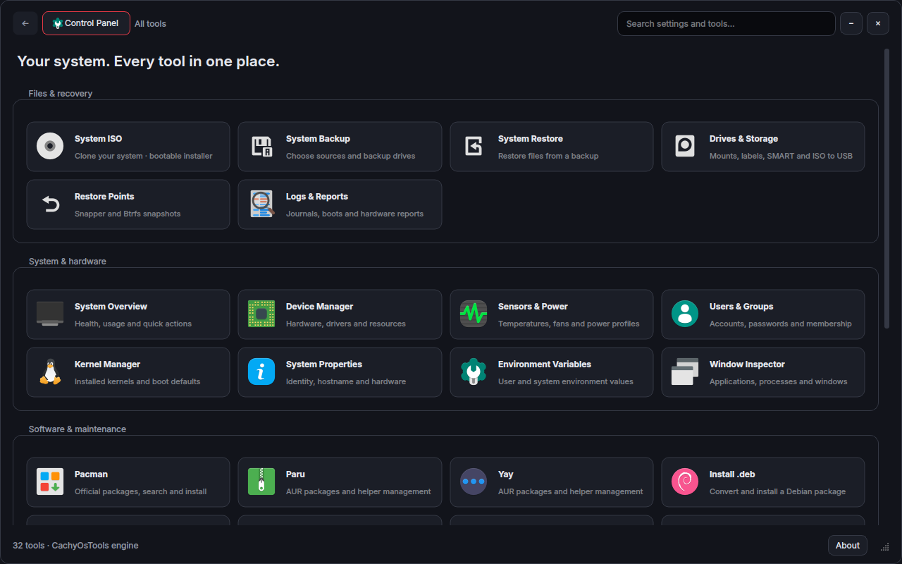
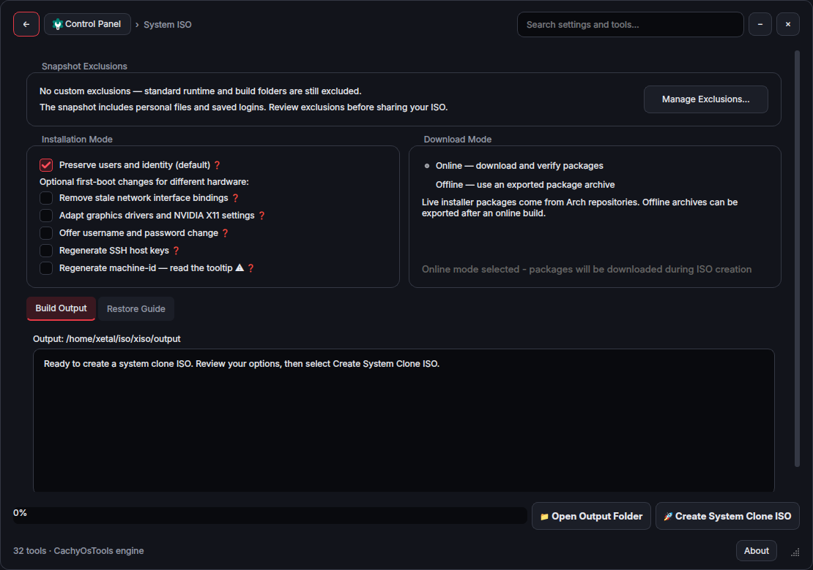
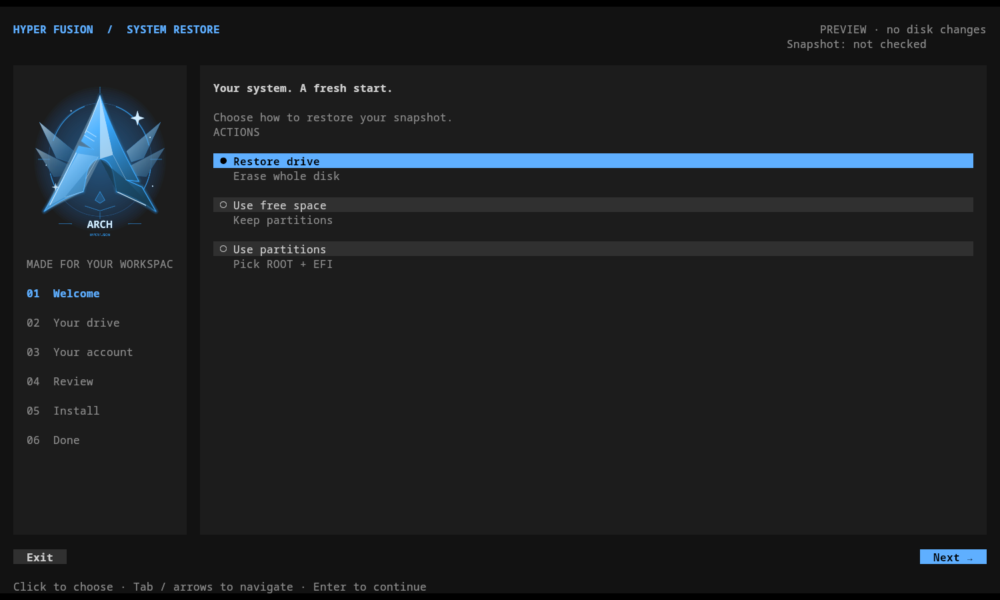

# Control Panel

Open **Apps → Control Panel**, immediately above Fusion Settings. It opens as a centered floating window. Drag its header to move it, use the bottom-right grip to resize it, and search by name or purpose. **Alt+Left** returns to all tools; **Ctrl+F** searches. Window size and preferences are saved separately from CachyOsTools.

The minus button hides the panel while its work continues. Open Control Panel from Apps again to return to the same instance and tool.

The native Qt/C++ interface uses a complete copy of the **CachyOsTools** engine. The original application is not replaced or modified. System operations, dialogs, scripts, translations and ISO resources are included in [`control_panel/backend`](../config/hypr/control_panel/backend). [`UPSTREAM.json`](../config/hypr/control_panel/UPSTREAM.json) records the original source revision and file hashes. The engine and integration use [GPLv3](../config/hypr/control_panel/LICENSE).



## Tools and feature coverage

| Control Panel entry | Included tools |
| --- | --- |
| System ISO | Full system clone, exclusions, online/offline packages, archive selection/verification, first-boot hardware/identity changes, output, restore guide, dependency checks and dummy installer preview |
| System Backup / System Restore | Source/destination drives, filesystem browsing, rsync backup and restore |
| Drives & Storage | Filters, mounts, labels, formatting, ownership/permissions, SMART health, benchmarking and ISO to USB |
| GRUB Boot Editor | Select a drive, automatically find Windows/Linux boot files, name and add an entry; rename, remove, backups and undo. [Guide →](GRUB-BOOT-EDITOR.md) |
| Restore Points | Snapper/Btrfs snapshot management |
| Logs & Reports | Plain-text hardware reports, decoded login history, journal filters, boot selection and live following |
| System Overview | Health, resource use, quick actions and language selection |
| Device Manager | Hardware categories, drivers and device operations |
| Sensors & Power | Temperatures, fans, power profiles and diagnostics |
| Users & Groups | Accounts, passwords, membership and administration |
| Kernel Manager | Installed kernels, install/remove and boot defaults |
| System Properties | Hardware, identity and hostname |
| Environment Variables | System environment editor and separate Hyprland login environment |
| Window Inspector | Window/process inspection, X11/Wayland backends and window actions |
| Default Apps | Browser, email, file manager, music, video, images, PDF, text, archives and office defaults; searchable individual file types and links; Undo |
| **Pacman / Paru / Yay** | Three adjacent entries: installed packages, repository/AUR searches, details, installation and helper management |
| Install .deb | Convert with debtap and install through pacman, with the original terminal review |
| Package Updates | System upgrades, package checks and Arch news |
| Package Repair | Mirrors, keyrings, locks, diagnostics and downgrades |
| Installed Software | Package removal, orphans and caches |
| System Cleaner | Curated cleanup plus a sudo disk visualizer with mounted-volume/folder picker, size tree, treemap, breadcrumbs and file actions |
| RAM Cleaner | Live memory readings, Normal/Aggressive manual cache cleanup and observed before/after results; keeps applications running |
| Network | Interfaces, Wi-Fi, connections, bridges, libvirt networks and ports |
| Firewall | UFW/firewalld rules and configuration |
| Network Shares | Discovery, mounts, sharing and associated services |
| Shell & Apps Shortcuts | Alias add/edit/remove, shell configuration editor, terminal actions and Apps favorites |
| Services | System/user service controls, failed services, journals and boot analysis |
| Startup Applications | Choose Num Lock and Xetal Engine behavior at login; add/edit, enable/disable, remove and run login applications; manage user units |
| System Tweaks | Hyprland tab with log protection and file logging controls; performance, security, network, storage, desktop and system settings |
| System Configuration | Privileged editor and configuration catalog, extended with Hyprland and Kitty |
| Panel Preferences | Language, visible tool families, startup page, size memory, autosave, drive/package/editor defaults, ISO defaults and debug preview |
| Hyper Fusion Updates | The existing desktop updater, including Control Panel updates |

Package Repair, Shares, Firewall, Services and Startup Applications each have a dedicated entry. Yay and Paru keep their own helper controls. KDE Plasma tweaks and the old KVM interface are omitted from this Hyprland panel; their upstream source remains in the engine archive.

The separate CachyOsTools Theme page is replaced by the **desktop master theme**. Raw, Modern, BreakPoint and Binary Knife, including Dark/Light/High contrast, apply to the panel and its dialogs. Appearance preferences link to Fusion Settings. Hyper Fusion's updater supersedes the original application's self-updater.

The backend targets **Arch Linux/CachyOS**. Package, kernel, boot and ISO tools retain their platform/dependency requirements; installing Hyper Fusion on another distribution does not translate these commands to another package manager. Existing confirmation and privilege prompts remain. Opening or searching the panel does not execute a system-changing operation.

## Hyprland integration

- Shell detection follows the terminal shell, including literal Kitty shell overrides, Zsh's `ZDOTDIR` and Fish's config directory. Supported aliases/abbreviations are parsed without executing shell configuration.
- Alias saves preserve surrounding configuration/functions and simple user-owned source files. External changes block stale saves. Private backups are kept in `control_panel/state/alias-backups`.
- **Add to Apps…** opens the existing shortcut editor, including command, directory, icon, terminal, keep-open and floating options. Saving creates a favorite in Apps.
- Terminal operations use the private Kitty profile. Control Panel runs as the ordinary desktop user; individual administrative tools request privileges when used.
- New login applications are saved in `control_panel/state/autostart` and run at the next Hyprland login. Shared desktop autostart files are not edited. Package entries require explicit opt-in; user systemd units remain separately identified.
- **Startup Applications → Desktop startup** includes **Turn on Num Lock when I log in**, enabled by default. It shares `input:numlock_by_default` in `control_center/input.conf` with the Input page's **Num Lock on at login** option. Changes use the existing full-configuration validation, backup and rollback path; the Num Lock key still works normally during the session.
- The same **Desktop startup** group controls whether the animated Xetal Engine dashboard appears at login. The dashboard also has a **Show this dashboard at login** checkbox linked to this setting; turning it off skips all four windows. **Super+D** still opens or hides it manually. The preference defaults to on and is stored in the update-preserved `control_panel/state/startup-screen.json`.
- User environment values are literal `NAME=value` lines in `control_panel/state/environment.env`, applied at the next Hyprland login. The explicit system pane still edits `/etc/environment` when requested.
- The panel, shortcut editor and startup helper are tied to the active compositor connection.

## Hyprland log guard

**System Tweaks → Hyprland → Hyprland log guard** protects session runtime space by default. At login and once a minute, it checks Hyprland's log and an explicit list of Hyper Fusion session logs, including the cached Control Panel, Apps, Settings and Waybar logs. Files exceeding **64 MiB** are emptied in place, so their existing writers can continue logging and the space is released. Cleared log contents are discarded; save diagnostics elsewhere first when investigating a problem. The threshold is checked periodically, rather than imposing a hard filesystem quota.

**Protect session runtime space** takes effect during the current session and persists for future logins and desktop updates. **Check logs now** performs the same oversized-log cleanup immediately, including while automatic protection is paused. The page shows managed log usage and free runtime space. Only logs inside the current user's current Hyprland instance are eligible; symlinks, hardlinks, special files, other sessions and unrelated files are excluded. The helper follows the compositor's live IPC connection and exits at logout. No system service or administrator password is needed.

**Disable session logs to file** is a separate, initially unchecked preference. It applies at the **next Hyprland login**, and the panel shows when a change is pending. It sends Hyper Fusion session helper output to `/dev/null`, including cached UIs, Waybar, effects, startup windows and screenshot notifications, and requests `debug:disable_logs = true` from Hyprland. That compositor option is reapplied after configuration reloads. Unchecking restores normal logging on the following login; it does not force verbose compositor logging. Existing files are kept, running helpers are not restarted, and the cleanup checkbox is unchanged. Startup/driver diagnostics that bypass Hyprland's normal logging switch can still be bounded by the guard. Installer, update-job and application diagnostics outside the managed session logs remain available.

Preferences live in `control_panel/state/runtime-log-guard.json`; the last cleanup's time, filenames and reclaimed bytes are recorded alongside it. `scripts/session_logging.py` shares the file logging choice across helpers and records the policy for each login in that instance's `session-logging.json`. For a manual check from the session's terminal, run `python3 ~/.config/hypr/scripts/runtime-log-guard.py --once`. This is space protection, not a repair for a graphics driver error. Hyprland's [debugging documentation](https://wiki.hypr.land/crashes-and-bugs/) describes collecting diagnostics and warns that verbose logging can produce large files.

## Default Apps

Open **Software & maintenance → Default Apps**. The themed **Everyday apps**
cards show the current application for twelve categories. Choose a card, select
an installed application and click **Use app**. Recommended applications appear
first; **Show all installed apps** includes other choices. Cancelling leaves
defaults unchanged. **File types & links** lets you search extensions such as
`.png`, MIME types, protocols or application names and change individual types.

Choices apply throughout the current desktop account using standard MIME
associations. The browser card updates HTTP, HTTPS and HTML together; music,
video and image cards cover their registered formats. Existing application
preferences that explicitly override desktop defaults remain application
preferences. **Undo** restores the last change unless another program has since
changed those settings. Unrelated associations are preserved.

The file-manager choice is also used by Super+E, Apps → Files, desktop folder
actions and screenshot **Show in folder**. **My Computer** and the explicit
**Fusion Files** application continue to open Fusion Files. A fresh installation
uses Fusion Files as the folder default. The updater includes this page and
its helper without distributing the developer's application choices or history.

## RAM Cleaner

Open **Software & maintenance → RAM Cleaner**. **Normal** releases clean file cache; **Aggressive** also releases reclaimable filesystem metadata. Both finish pending disk writes first. Authentication is requested only after **Clean RAM**, and the panel stays responsive while it works. Cancelling authentication leaves memory alone. The tool never signals applications, deletes files, disables swap, compacts memory or changes persistent settings. Cleanup is manual, with no scheduled or login action.

Linux already reclaims caches when needed. **Available RAM** includes reclaimable memory, so reducing cache does not necessarily increase the memory available for a VM. Active application/VM memory is not reclaimable by this tool. Reading files may be slower while caches rebuild; this is an occasional troubleshooting tool, not a background performance booster. See the [kernel's cache reclamation documentation](https://docs.kernel.org/admin-guide/sysctl/vm.html#drop-caches).

The page reports file cache excluding shared/tmpfs memory, reclaimable metadata, swap usage and observed before/after changes. The numbers can move in either direction while other applications run. They are not a promised amount of memory freed. Only the short-lived helper runs as root, and it accepts two fixed modes writing to the single kernel cache-reclamation endpoint.

## Disk Visualizer

Open **System Cleaner → Disk Visualizer**, choose a mounted partition, then **Choose folder…** to browse its directory tree. **Scan with sudo** reads protected folders through a separate helper; the Qt interface runs as your normal desktop user. The original **Clean up** tab retains its cache-only cleanup rules.

The tree lists directories from largest to smallest and puts direct files in a separate **Files** group at the end of each directory. Expand that group to see its files, also largest first. Select a rectangle to inspect it, double-click a folder to zoom into its map, and use the clickable path buttons or **Alt+Up** to return. The splitter adjusts the space between tree and map.

**Space on disk** uses allocated blocks; **Apparent file size** is useful for inspecting sparse VM images. Hard links count once, symbolic links are never followed, and scans stay on the selected filesystem by default, including bind-mount boundaries. The optional cross-filesystem setting still skips virtual kernel filesystems. Unreadable or changing entries are reported. Shared/compressed filesystem blocks can make these totals differ from a partition's used-space figure.

Right-click a tree item or map tile to open its folder, copy its path, **Send to Trash**, or **Delete permanently…**. Removal requires confirmation of the selected path. Trash uses the desktop user's Trash and never falls back to permanent deletion when permission or filesystem support is missing. Permanent deletion checks the scanned item's identity and refuses scan roots, mount points and essential system folders. **Files** groups are navigational, not bulk-delete targets.

After a successful permanent deletion, the map and parent totals update from the existing scan immediately, including file counts and hard-link accounting. Your current map stays open, or moves to the surviving parent if you deleted the folder being viewed. Other folders are not rescanned; use **Scan with sudo** to include unrelated filesystem changes. Temporary entries that disappear during deletion, such as GPG sockets, are treated as already removed. Other failures or partial deletions trigger a fresh scan. Trash also rescans because the files may have moved elsewhere inside the scanned tree and still occupy space.

Scans are cancellable. A private, disposable SQLite index keeps the full file list out of GUI memory; tree rows load on demand and map detail is bounded. Closing Control Panel or ending its compositor session closes the helper's pipe, stops work and removes the temporary index.

## System ISO



At the default 1280 × 800 size, the ISO settings fit above a compact, internally scrolling output area, with build actions pinned below. The window remains constrained to the current monitor. On smaller screens, the page can scroll to keep every control accessible.

The live ISO opens a full graphical Hyper Fusion wizard with the transparent blue Arch emblem, drive cards, Back/Next controls, account setup and progress. Installation details remain visible throughout the restore and on the completion screen; no expansion button is needed. **Install ISO — Erase Full Disk** is the first option. Select a drive by its model and capacity; no device name or erase phrase needs to be typed. The final **Confirm install** button explicitly approves the displayed target. This is our own interface around the existing restore engine, inspired by the familiar Calamares flow.

The graphical interface uses Qt Widgets with [software rendering through LinuxFB/DRM](https://doc.qt.io/qt-6/embedded-linux.html#linuxfb). It does not require a desktop environment or accelerated OpenGL. If graphics cannot start, the console wizard opens automatically; choose **Use console installer** on the welcome page, run `/xetal.sh --text`, or add `xetal.text=1` to the live boot command line to request it directly. Its limited-color logo is drawn for console fonts, and GPM provides mouse support. A graphical failure after restoration starts never restarts or stops the restore worker.

Progress includes **Show installation details**, and failures expose the log automatically. `/var/log/xetal-installer.log` contains the restore details; `/var/log/xetal-installer-graphics.log` records graphical startup problems. Newly created partitions are mounted explicitly as ext4 and FAT32 to avoid failed ext2/ext3 detection probes.



**Preview installer…** opens the graphical wizard with sample drives and simulated progress. It does not build an ISO or touch disks. For boot testing, **Panel Preferences → ISO → Debug ISO Creator** enables the dummy ISO. The graphical release uses a new live-base cache, so its first dummy build downloads that base again. Existing ISO files must be rebuilt to include the new interface.

**Require a fresh account in the installer** controls the account behavior of the generated ISO:

- **Checked:** both graphical and console installers require a new username and a password entered twice. This page cannot be skipped. The selected source login and its password entry are replaced with a newly created administrator account. Its new password is used for both login and sudo; the source password is not inherited.
- **Unchecked:** the account page is skipped and existing accounts, passwords and sudo policy are preserved.

The new account inherits the snapshot’s desktop and files. Its numeric UID, file ownership and group memberships are retained; a matching home directory and private group move to the new name, and Hyper Fusion paths and display-manager autologin names are adjusted. This is an account replacement, not an empty-home installation. Other applications with hard-coded home paths may need adjustment afterward. Typed capital letters in login names become lowercase. A password is required, but there is no strength or complexity policy: even one character is accepted when both entries match. Passwords are masked and never written to command arguments or logs. First boot handles the selected hardware/identity adjustments without an account text prompt.

The builder, common helpers, installer, boot restoration and first-boot adjustments remain embedded Qt resources. `UPSTREAM.json` retains their original hashes and identifies the Hyper Fusion adaptations. The original CachyOsTools application is unchanged.

Read the retained [compatibility notes](../config/hypr/control_panel/backend/docs/ISO_COMPATIBILITY.md) and [validation guide](../config/hypr/control_panel/backend/docs/ISO_VALIDATION.md). The ISO remains a file-based snapshot with the original exclusions and restoration behavior. The interface retains its snapshot/target-disk confirmations. Closing Control Panel is blocked during an ISO build; Home and Minimize remain available.

The fresh account gets a password-protected administrator rule in the restored system, including overrides for inherited sudo rules that request the root or target account’s password. This also covers snapshots where sudo was granted directly to the old username instead of its group. The installer checks the complete policy with `visudo` before and after the account replacement. If a copied root-owned policy has a permission mismatch, such as `libvirt-hooks` restored as `0644`, it repairs only the files reported by `visudo` to the required read-only mode and validates again. Policy contents and ignored backups are preserved; symlinks, hardlinks and files writable by other users are not automatically repaired. A failed validation restores the prior modes and stops before account replacement. An invalid new administrator rule also restores the prior sudo files. Keeping the original account leaves its existing policy unchanged.

Integration validation covers the upstream ISO regression suite, graphical and console navigation, failure handling, resource provenance, isolated real account tools, sudo authorization and native navigation. This is not a new end-to-end physical-machine restore test. Test a generated recovery ISO in a VM before depending on it.

## Building and updating

`./x_hyperinstall.sh` builds the copied C++ application automatically. For development:

```bash
python3 config/hypr/control_panel/build.py
```

The executable lives in ignored `control_panel/.build`. Required components include CMake, Qt Widgets/Network/DBus/Linguist, XCB/XCB-RES, Wayland development files and Qt SVG readers. Installer recipes include these dependencies. Updates build the executable before activation and preserve private Control Panel state.
