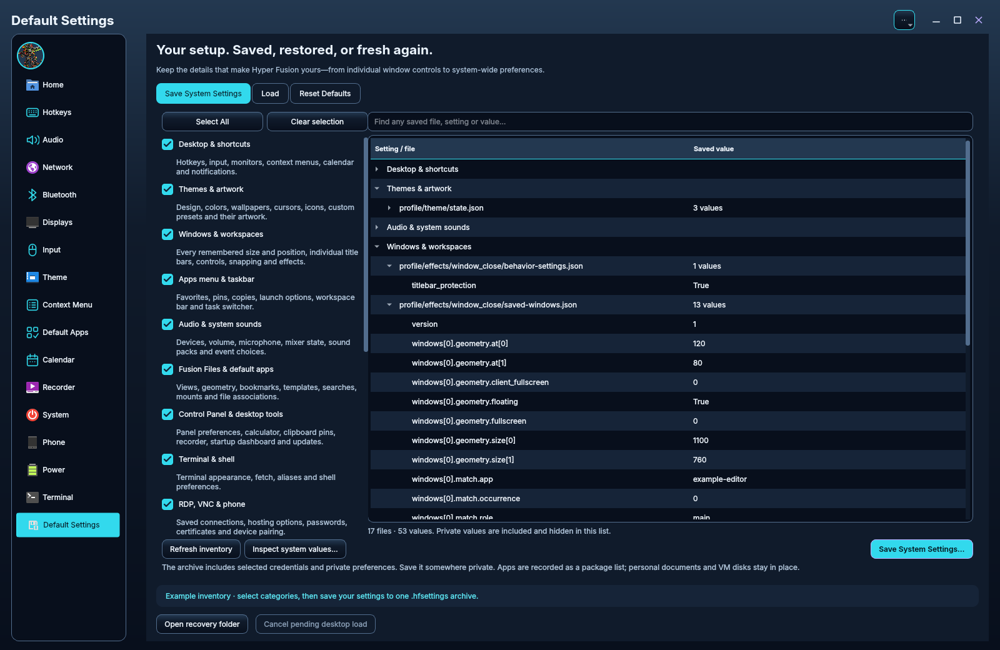
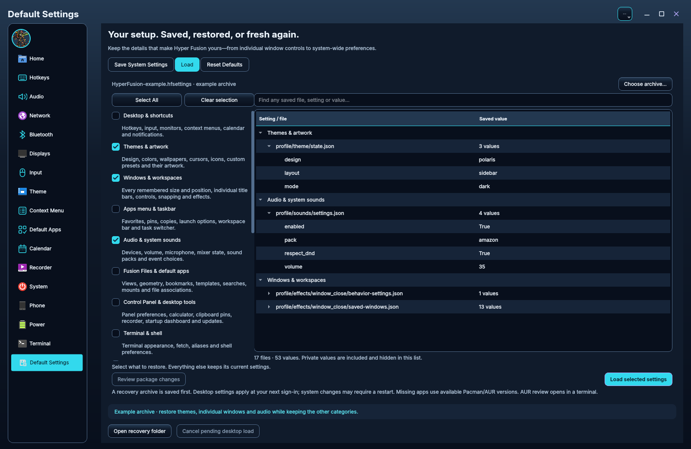
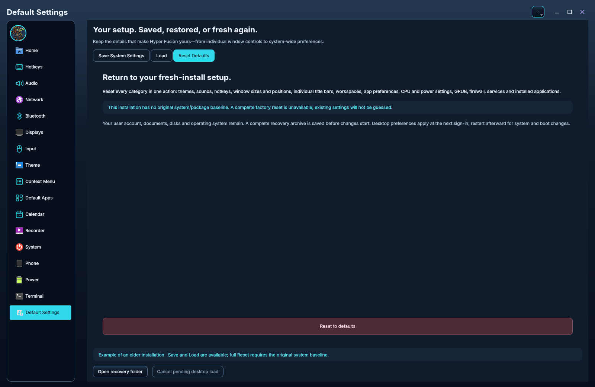

# Default Settings

**Fusion Settings → Default Settings** is the last item in the navigation sidebar.
It brings **Save System Settings**, **Load**, and **Reset Defaults** together.

[README showcase](../README.md#default-settings) · [Desktop gallery](GALLERY.md#default-settings)

The screenshots below show the actual native Qt interface in **Polaris**, captured
headlessly with example settings in an isolated account environment. No Load,
Reset, package installation or system changes were performed for these captures.
Click a picture to see it at full resolution.

## Save System Settings

**Choose what to keep.** Save and Load both have category checkboxes,
**Select All**, and **Clear selection**. Expand a file to inspect its values,
or search for a setting, filename or value. Private values are included in the
archive but hidden in the list.

[](screenshots/default-settings.png)

The real inventory reads the current account. **Refresh inventory** lists selected
desktop preferences; **Inspect system values** also reads administrator-protected
categories after authentication. **Save System Settings** reads every selected
category again and writes the archive to the location you choose.

### The 16 categories

| Category | Contents |
| --- | --- |
| Desktop & shortcuts | Hotkeys, input, displays, context menus, calendar, notifications and custom configuration includes |
| Themes & artwork | Theme, colors, wallpapers, cursors, icon packs, custom presets and referenced artwork |
| Windows & workspaces | Effects, snapping, title-bar protection, workspace layouts, app rules, individual KDE title bars and remembered geometry |
| Apps menu & taskbar | Favorites, shortcuts, pins, floating launch sizes, taskbar and task switcher |
| Audio & system sounds | Selected devices, channel volumes, mute, WirePlumber preferences, sound packs and event choices |
| Fusion Files & default apps | Views, window geometry, bookmarks, templates, saved searches, automount and file associations |
| Control Panel & desktop tools | Panel preferences, calculator, clipboard pins, recorder, startup dashboard and updater preferences |
| Terminal & shell | Terminal design, fetch, shell configuration and aliases |
| RDP, VNC & phone | Connections, hosting settings, passwords, certificates, KDE Connect and wallet files |
| KVM & Proton settings | Machine definitions, presets, last setup, tool paths and prefix configuration |
| Desktop power | Idle, lid, battery and monitor picture preferences |
| Other application preferences | Account configuration files, autostart, user services and desktop entries |
| System configuration & services | Editable system configuration, service enablement, hostname, mount declarations, CPU governor and other supported hardware policies |
| Network, firewall & shares | NetworkManager profiles, VPN/Wi-Fi credentials, firewall configuration, shares and Bluetooth pairing |
| GRUB boot settings | GRUB defaults, menu generators, themes, fonts and pictures |
| Installed applications | Pacman and foreign/AUR package names, versions, installation reasons and repository settings |

Archives have the `.hfsettings` extension. They are private files with permissions
`0600`, **not encrypted**. They can contain connection passwords, keys and personal
preferences. Keep them somewhere private and load archives you trust.

Application selections are package inventories, not copies of installed binaries.
Missing official packages use Pacman; foreign packages first use an available
matching cached package, then Yay or Paru. AUR review/build prompts open in a
terminal. Existing packages are not silently downgraded; version differences are
recorded. New dependencies required by available versions can remain. Unavailable
packages or dependency conflicts stop the operation and retain its recovery report.
Standalone downloaded applications are not converted into Pacman packages.

## Load

**Choose archive**, then check the categories you want to restore. Only categories
present in that archive are available. Unchecked categories retain their current
settings. When **Installed applications** is selected, **Review package changes**
lists planned installations, removals and version differences.

[](screenshots/default-settings-load.png)

*This example selects themes, individual windows and audio. The other categories
remain unchecked. The picture shows selection and inventory, without running a
restore.*

## Applying changes

Before Load or Reset changes anything, it saves a recovery archive under
`~/.local/state/hyperfusion-settings/recovery/`. Unselected categories keep their
current settings. A selected category also restores the absence of settings:
personal overrides absent from the archive are removed.

System operations request fresh administrator authentication, including when sudo
was recently used elsewhere. GRUB is regenerated and checked for this computer;
the archive does not replace its generated `grub.cfg` with another installation's
file. Mount declarations and sudo configuration are checked. System configuration
loads are restricted to the originating computer and architecture.

Package and system operations happen during Load. **Desktop preferences activate
at the next normal sign-in**, before Fusion's helpers and plugins start. Restart
afterward to activate system/boot changes. The operation never forces logout or
hot-swaps a native plugin. **Cancel pending desktop load** cancels only the queued
desktop portion; completed package/system changes require loading the recovery
archive to undo them.

Window IDs are not reused across sessions. Individual choices and geometry are
matched by application, window role, initial title and occurrence. Identical
siblings keep separate identities while they are open. Normal rectangles beneath
maximized windows are retained; restored positions are clamped to the available
work area. Apps changing their initial window identity may not match an older
per-window record. Application-wide rules still apply.

## Reset Defaults

**Reset to defaults** is one action covering every category, with an automatic
recovery archive first. Desktop defaults come from the same installer constants
and pristine profile used for a fresh installation. The first installation also
records the original system configuration and package set. Updates do not replace
that system baseline with personal settings.

**Older installations without an original system baseline cannot perform a
complete factory reset.** The page explains this and disables the full reset;
it never substitutes today's settings or guesses which applications to remove.
Save and selective Load remain available. Fresh foreground Setup records the
baseline; the ISO installer records it after its GRUB, account, driver and package
steps are complete. Existing finished ISOs are not modified by this feature.

[](screenshots/default-settings-reset.png)

*The missing-baseline state shown here is expected on older installations.
The updated installer records the baseline for future installations; opening this
page does not redefine personal settings as factory defaults.*

Settings recovery preserves the user accounts and their passwords, machine
identity, disk contents, personal documents and VM disks. It is not a disk-image
restore. The package planner refuses to remove required desktop/boot packages.

## Verification status

Recorded for the settings implementation in **0.0.0.320-alpha**, November 24, 2026.
Headless coverage does **not** establish that every setting has been restored and
verified in a complete installed desktop.

| Check | Evidence |
| --- | --- |
| Settings archives, UI and installer lifecycle | **35 passing tests** cover selection, validation, private-value display, queued activation, rollback, factory-baseline handling and related behavior. |
| Window memory and controls | **79 passing tests** across the window-memory and window-controls suites, including individual title bars, window identity, geometry and IPC failure handling. |
| Administrator helper | The real file capture/restore worker passed in a disposable user/mount namespace. Its service-reload command was stubbed; the host system was unchanged. |
| Current desktop inventory | A read-only snapshot of the running desktop passed archive and compositor-configuration validation. It was not loaded onto the host. |
| Still awaiting end-to-end verification | A complete factory reset and reboot on a fresh VM, actual Pacman/Yay installation and removal, a successful GRUB restore followed by boot, and hardware CPU-governor changes. |

Checks use temporary homes and system roots, an offscreen Qt window, and isolated
fixtures. The maintainer's desktop was never reset. The screenshots illustrate
the interface and are not evidence of a completed reset or package restore.

```sh
python3 -m unittest discover -s tests -p 'test_settings*.py' -v
python3 tests/check_settings_profiles_root.py
python3 -m unittest discover -s config/hypr/runtime/window_memory -p 'test_*.py'
python3 -m unittest discover -s config/hypr/effects/window_close -p 'test_*.py'
```

## Implementation

- `config/hypr/settings_profiles/catalog.py`: one ownership registry for inventory,
  export, import and reset, including every updater-declared preference.
- `archive.py`: bounded archive parsing, SHA-256 validation, registered destinations,
  symlink checks, file journals and rollback/recovery.
- `backend.py`, `system.py`, `packages.py`: private recovery, fresh authentication,
  package reconciliation, shared updater locks and queued desktop activation.
- `windows.py`, `audio.py`: live state and stable identity handling.
- `page.py`: native Qt page, background operations and searchable value inventory.
- `installer/settings_factory.py`: first-install baseline integration.
