# Hyper Fusion · Panel gallery

A tour of the real Xetal interface. Click any picture for its full resolution.
Panel captures use an isolated copy of the author's Hyprland profile. The full
Super+D scene was captured on the desktop over an empty temporary workspace,
then the original workspace was restored. Applications shown in
Favorites are installed separately. The file-progress cards use sample jobs;
their settings panel is captured from the installed interface without changing preferences.

[Back to the README](../README.md) · [Watch the desktop video](https://github.com/user-attachments/assets/8a20af5b-ec30-4bbb-ad7f-06d4e392a57d)

## Apps, in every style

### Xetal Raw

### Xetal Modern

### BreakPoint

## Menus and shortcuts

| Favorite context menu | Shortcut Properties |
| :---: | :---: |
|  |  |

### Desktop context menu

[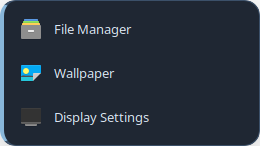](screenshots/desktop-context.png)

### Context Menu editor

### Taskbar Options

[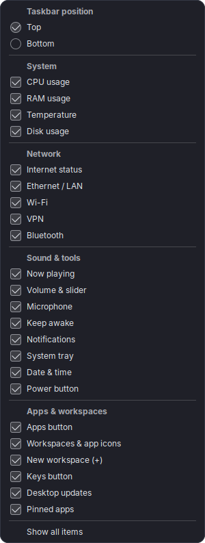](screenshots/taskbar-options.png)

## Fusion Settings

### Hotkeys

### Modern Home

### Audio

[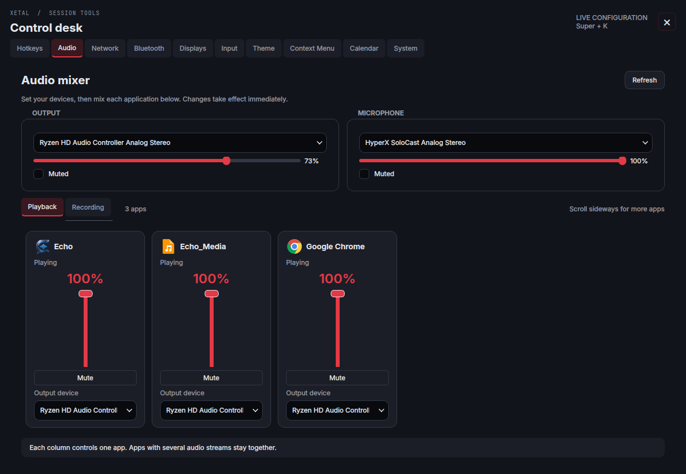](screenshots/audio.png)

### Network

[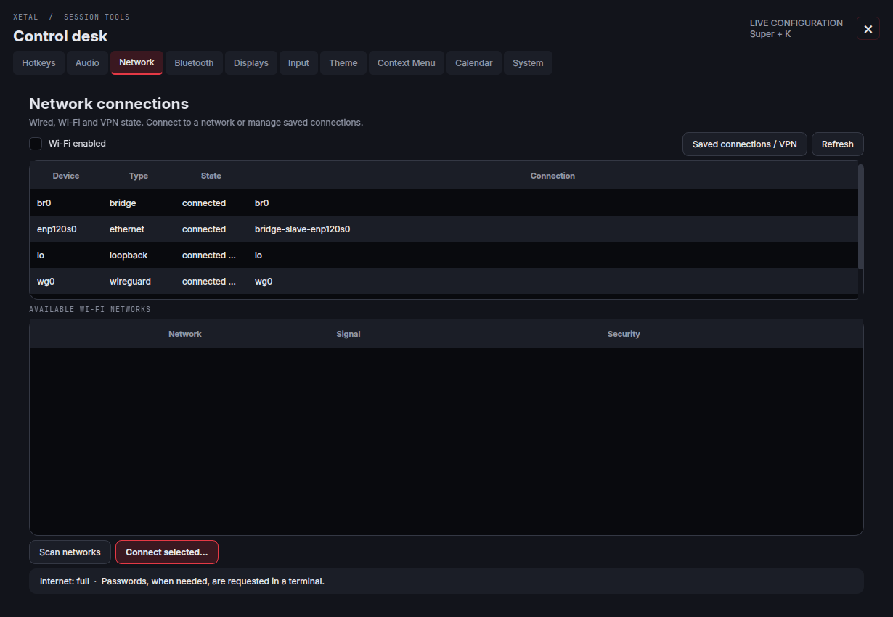](screenshots/network.png)

### Bluetooth

[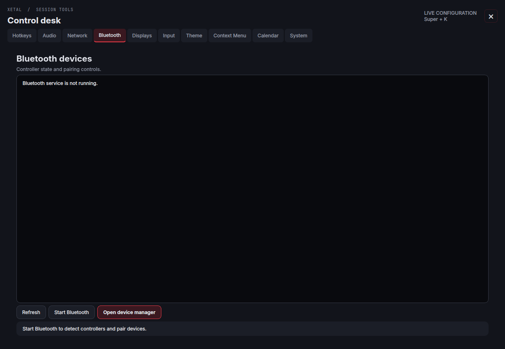](screenshots/bluetooth.png)

### Displays

[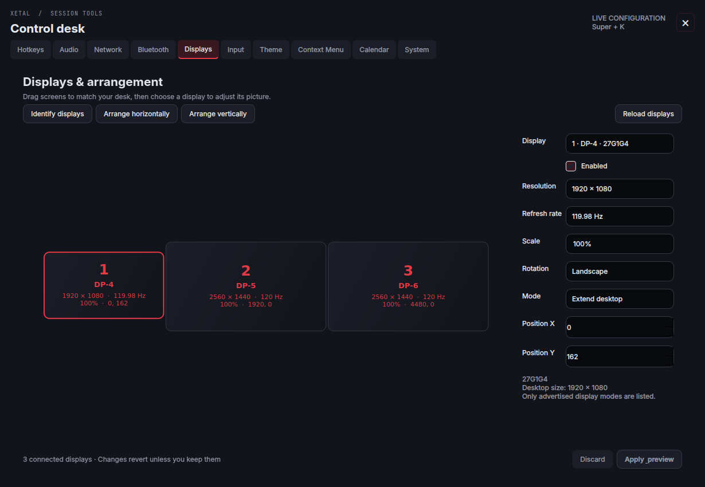](screenshots/displays.png)

### Input

[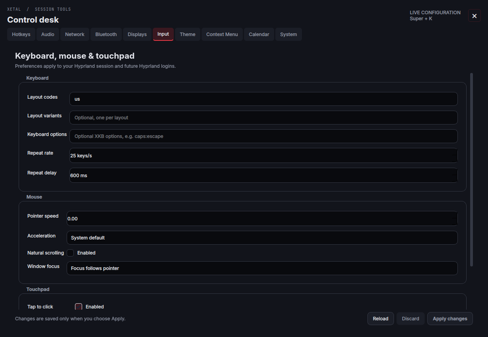](screenshots/input.png)

### Calendar

[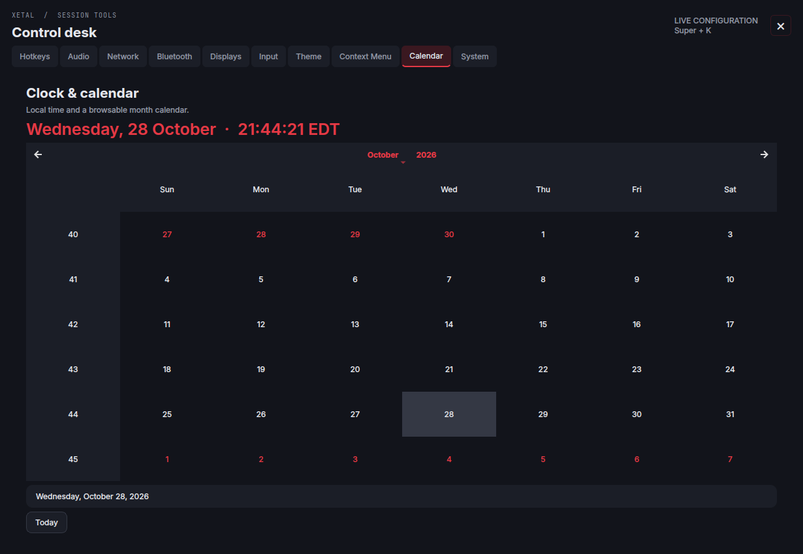](screenshots/calendar.png)

### System and session

[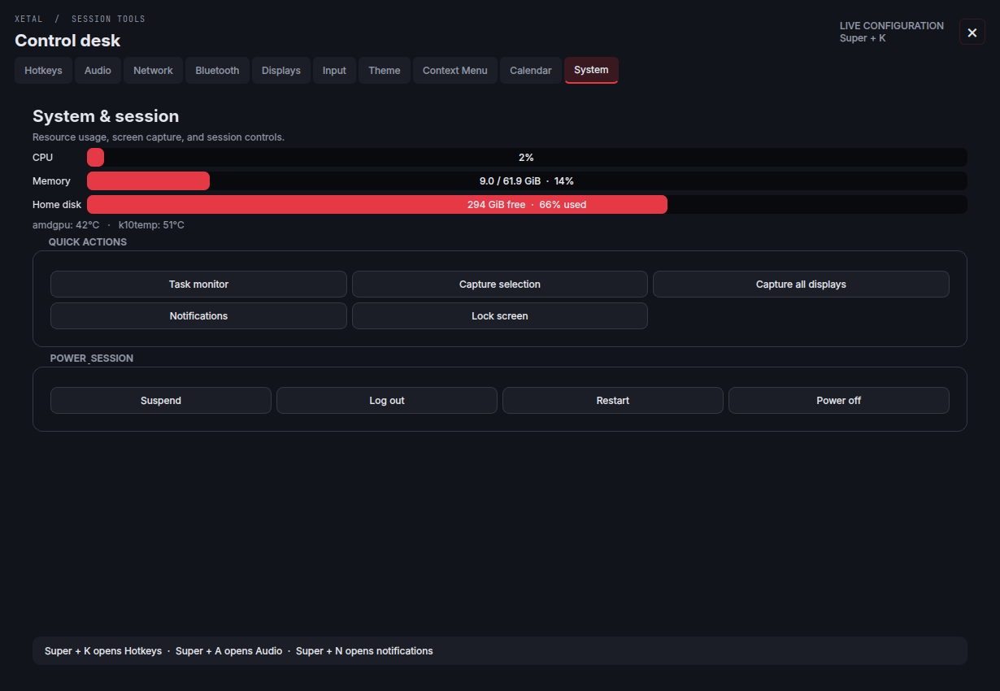](screenshots/system.png)

## Theme and appearance

### Design picker

### Menu backgrounds, surfaces and profile

### Wallpapers by monitor

[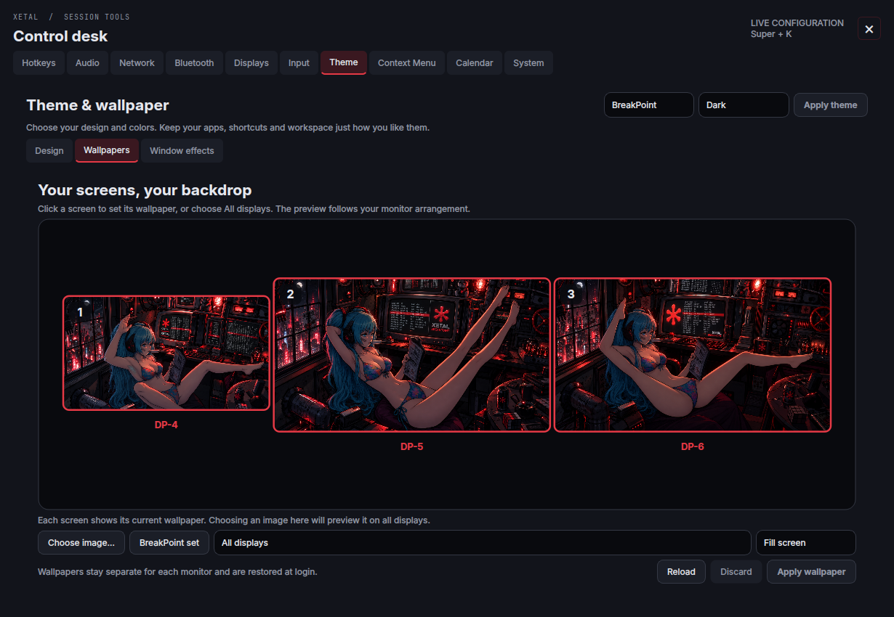](screenshots/wallpapers.png)

### Window appearance

[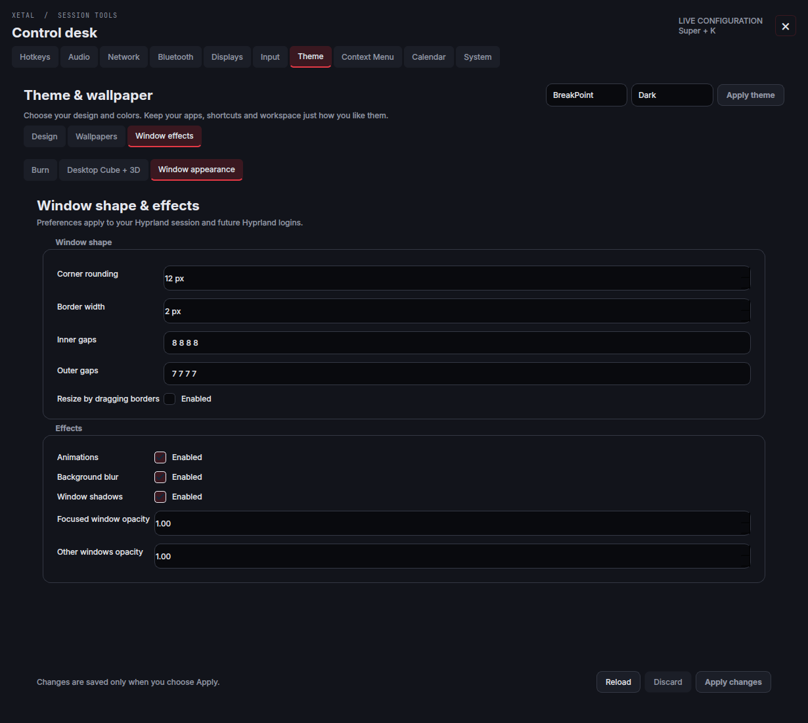](screenshots/window-appearance.png)

## Desktop effects

### Compiz Burn

### Desktop Cube + 3D Windows

## Floating tools

### Xetal Images

### File picker

### File-operation progress

Mix any transfer style with any desktop theme, or follow the desktop automatically.

| Xetal Raw | Xetal Modern | BreakPoint |
| :---: | :---: | :---: |
|  |  |  |

### MP3 / MP4 downloader

[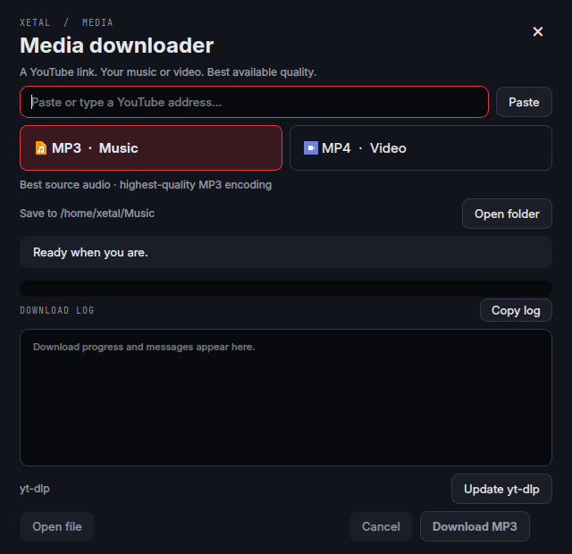](screenshots/downloader.png)

### Desktop updates

## Startup projects

[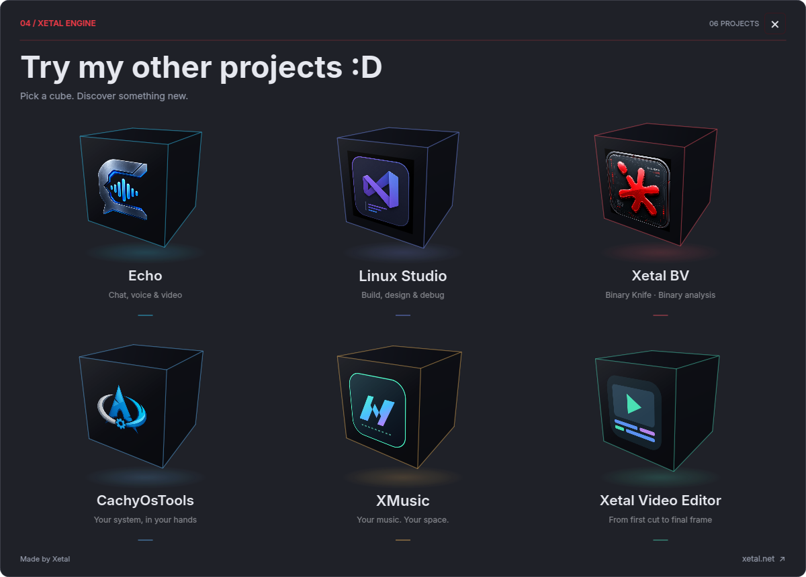](screenshots/projects.png)

## Wallpaper showcase

The requested `olly_anime.png`, copied unchanged from the author's artwork.

[Back to Hyper Fusion](../README.md)
