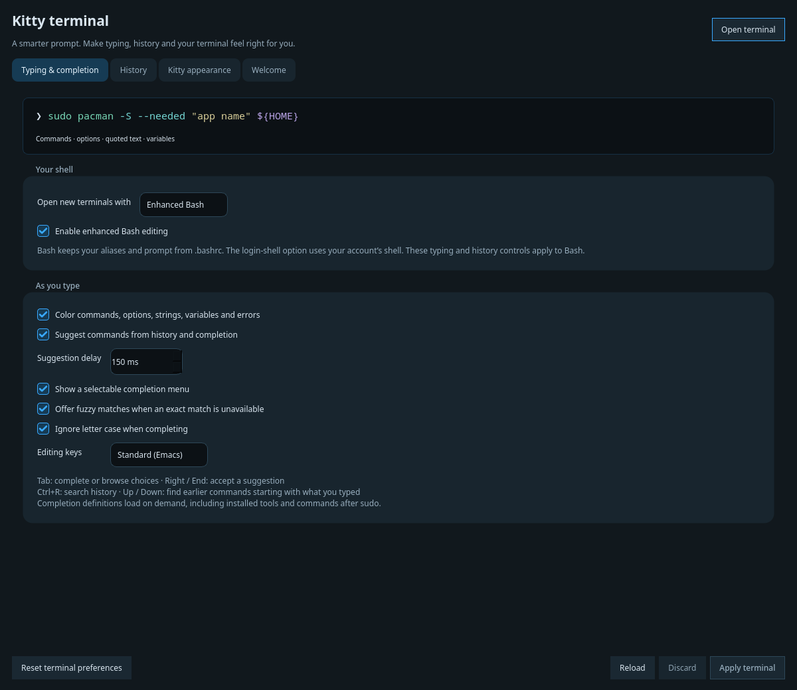
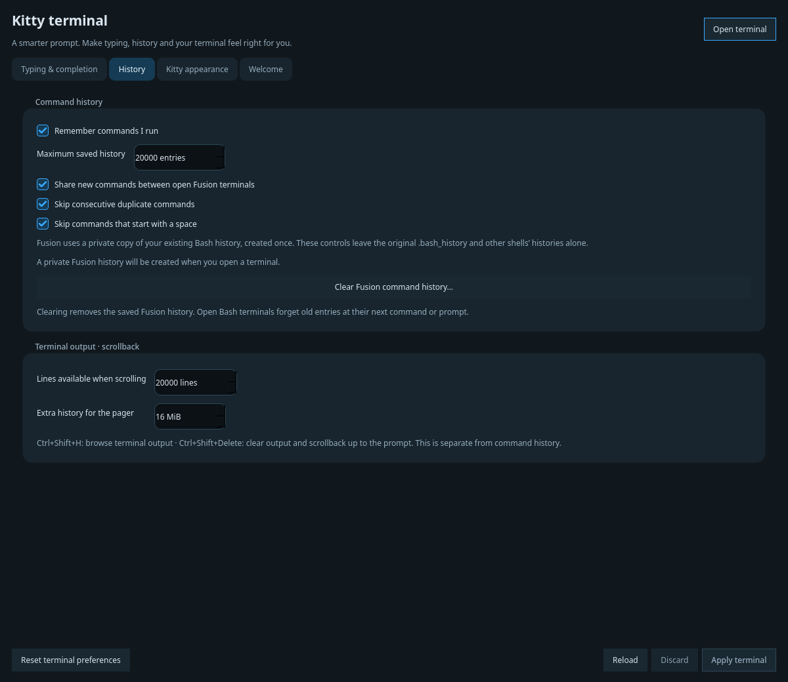

# Kitty terminal

Open **Fusion Settings → Terminal** for four tabs: **Typing & completion**,
**History**, **Kitty appearance**, and **Welcome**. You can also search for
`kitty`, `completion`, `history`, or `terminal` in the Apps menu.

[](screenshots/terminal-settings.png)

## A smarter Bash prompt

New Fusion terminals use **Enhanced Bash** by default. Commands, options,
quoted strings, variables and syntax errors get distinct colors as you type.
Inline suggestions draw on your command history and completion definitions.
Tab opens completion choices; installed tools can provide command-specific
options, including completion after `sudo`. Matching definitions load on demand.

Your Bash aliases and prompt are kept. The account's login shell is unchanged;
**My login shell** restores that shell for Fusion terminal windows. The enhanced
editing and history controls apply to Bash. Zsh and Fish continue to use their
own configuration. Command-only Kitty launches retain their requested command
and do not load the interactive editor.

| Keys | Action in the standard editing mode |
| --- | --- |
| **Tab** | Complete a command, option or path; browse available choices. |
| **Right / End** | Accept the suggested text when at the end of the command. |
| **Ctrl+R** | Search command history interactively. |
| **Up / Down** | Recall commands starting with the text already typed. |
| **Ctrl+Shift+H** | Open Kitty's output-history pager. |
| **Ctrl+Shift+Delete** | Clear output and scrollback up to the current prompt. |
| **Ctrl+Shift+F5** | Reload Kitty appearance after saving settings. |

Turn highlighting, suggestions, completion menus, fuzzy matching or
case-insensitive matching on or off independently. Suggestion delay and
standard/Vim editing keys are adjustable too.

## History you control

[](screenshots/terminal-history.png)

**Command history** remembers what you run. The default limit is **20,000
entries**. You can disable recording, change the limit, share new commands
between terminals, omit consecutive duplicates and skip commands beginning
with a space. Existing terminals adopt these preferences when reopened.

On first use, Fusion creates a private copy of the standard `.bash_history`
if it is a regular file no larger than 32 MiB. The original remains unchanged.
**Clear Fusion command history…** asks for confirmation and deletes the Fusion
copy. Open enhanced Bash sessions discard the old history at their next command
or prompt, while retaining commands entered after clearing. The old history
cannot be recreated by a closing terminal. This does not erase other shells'
history, saved screenshots or previously exported files.

**Scrollback** remembers command output separately. Its default is **20,000
lines**, with **16 MiB** of additional pager history. Change these independently
of command history; reopen a terminal for the new capacity to take full effect.

## Appearance and welcome

Kitty appearance controls the font, font size, padding, background opacity,
cursor shape/blinking/trail, scrollbar, tab style/position, remembered window
size, copy-on-selection, alert sounds and close confirmation. Terminal colors
and, by default, the font follow the desktop theme. The existing welcome logo,
custom image and system-information choices remain under **Welcome**.

**Apply terminal** saves typing, history and Kitty preferences. **Welcome** has
its own save button. **Reset terminal preferences** selects defaults for the
first three tabs without deleting history; Apply commits the change. Existing
Kitty windows can reload appearance; open a new terminal for all shell/history
changes. No administrator authentication is required.

These preferences are preserved by desktop updates and included in
**Default Settings → Terminal & shell** for Save, Load and Reset. Command
history and editor caches are private runtime data, not configuration exports.

## Implementation and verification

The profile bundles [ble.sh](https://github.com/akinomyoga/ble.sh) and
[bash-completion](https://github.com/scop/bash-completion). Versions, exact
source revisions, build steps and licenses are recorded in
[`terminal_fetch/vendor/manifest.json`](../config/hypr/terminal_fetch/vendor/manifest.json).
No shell enhancement is downloaded or installed at terminal startup.

- Preferences: `terminal_fetch/preferences.json`.
- Generated Kitty include: `terminal_fetch/kitty-settings.conf`.
- Private command history: `$XDG_STATE_HOME/hyperfusion/terminal/`, normally
  `~/.local/state/hyperfusion/terminal/`; directories are mode `0700`, history
  files `0600`. Clearing rotates the generation and removes the old directory.
- Editor caches: the user's XDG cache directory, never shipped with the profile.

The tests exercise real Bash PTYs for live colors, aliases, completion after
`sudo`, suggestions, prefix search, exit-status preservation, shared history,
clearing with two open sessions, history limits and disabled recording. Qt tests
cover editing, saving, discarding, resetting, clear confirmation and the existing
welcome. The screenshots above are unchanged captures of the actual Qt page in
an isolated example environment.

```bash
python3 -m unittest discover -s config/hypr/terminal_fetch -p 'test_*.py'
```
