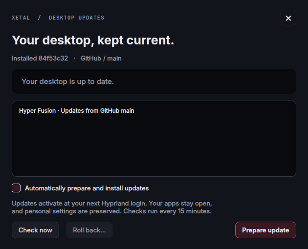

# Desktop updates

Hyper Fusion watches `XetalEngine/x_hyperland` on GitHub, branch **main**. Every new descendant commit on that branch is a desktop release. Publish tested changes there; use another branch for experiments.

## What users see

An animated **UPDATE** badge appears beside **Keys** when a newer commit is available. It stays completely hidden while the desktop is up to date or checking for updates, and remains visible while an update downloads or waits for the next login. Click it for installed/latest revisions, the commit message, a preparation log, **Check now**, **Prepare update**, automatic-update preferences and **Roll back**. Right-click the taskbar → Options can hide the module without disabling checks. To manage updates while the badge is hidden, run `~/.config/hypr/scripts/desktop-updates.sh`.



Automatic updates are enabled by default. One session helper checks roughly every 15 minutes, with a short startup delay. After showing the notice for at least 30 seconds, it downloads the advertised commit, merges the new defaults with personal settings, builds native components and validates the complete Hyprland configuration.

**Activation happens at the next Hyprland login, before the session helpers and native effects load.** No forced logout, app termination or compositor-plugin replacement occurs while you are working. The badge changes to **UPDATE READY** after preparation. Pausing automatic updates also postpones activation of an already prepared automatic update; a manually requested preparation remains explicit.

## Keeping personal settings

The installer records the delivered revision and defaults in `~/.config/hypr/.xetal-update.json`. That baseline distinguishes upstream changes from personal edits.

Git checkouts use their own commit. GitHub ZIP and tar downloads use `installer/source-revision.txt`, populated by Git's [`export-subst` archive attribute](https://git-scm.com/docs/gitattributes#Documentation/gitattributes.adoc-export-subst). Registration works offline and does not substitute the current GitHub head for an older download. If an old or incomplete archive has no revision, the installer stops before replacing the profile and asks for a fresh download. The update builder uses the same source identification and still rejects any revision that differs from the announced update.

- JSON preferences merge with new defaults; overlapping choices retain the user's value.
- Hotkeys and other text configuration use a three-way merge. Conflicting edits stop the update and identify the file.
- Monitor arrangements, selected wallpapers, generated theme colors, personal taskbar CSS and the private Dolphin profile are retained.
- Unknown user files stay in place. A removed upstream file is deleted only if it was unedited.
- The prepared plan records hashes. If settings change before login, activation stops and the update is prepared again.

The updater does not pull, reset, stash or rewrite a developer's clone. Its own exact-commit checkout lives in a private cache. A local build ahead of `main`, a rewritten branch or unrelated history does not trigger an automatic downgrade.

## Failure and recovery

Preparation works in a separate directory. Missing packages, merge conflicts, failed builds or invalid configuration leave the current desktop installed. Automatic updates never run `sudo` or change system packages; dependency problems are shown for the user to resolve.

Activation has a journal, per-file atomic writes and a backup of changed files. The next startup recovers an interrupted transaction. **Roll back** queues the previous completed version for next login and pauses automatic updates. It refuses to overwrite files edited since that update; inspect the message before resolving any difference.

The supported native Burn/Cube ABI is checked by their builders. On unsupported Hyprland versions the normal desktop remains installable and those optional effects remain unavailable.

## Files and session ownership

| Location | Purpose |
| --- | --- |
| `~/.config/hypr/updates/` | Checker, update UI and merge/transaction engine |
| `~/.config/hypr/.xetal-update.json` | Installed commit and delivered defaults |
| `~/.local/state/xetal-hyprland/updates/` | Settings, cached status, logs, prepared update and rollback backups |
| `~/.cache/xetal-hyprland/updates/` | Exact Git source downloads |

One daemon belongs to the running Hyprland instance; each taskbar reads its cached status. Compositor shutdown closes its socket and stops its owned network/build child processes, including detached compiler descendants. No persistent systemd service, global environment change or other desktop's settings are involved.

Public repositories use GitHub's conditional API requests, cached commit information and rate-limit backoff. Before public release, the private repository can use Git's existing credential helper; the updater never reads or stores tokens itself. Without repository access, checking reports the problem and leaves the desktop unchanged.

## Maintainer checks

```bash
(cd config/hypr/updates && QT_QPA_PLATFORM=offscreen python3 -m unittest discover -v)
python3 -m unittest discover -s tests -v
./tests/run-desktop-tests.sh
```

The updater tests cover merge conflicts, preference preservation, source integrity, interrupted writes, rollback, rate limits, commit ancestry, singleton ownership, logout cleanup and all three theme palettes. A disposable-profile integration run also built the native components, validated the complete config, activated a new revision and restored the previous revision.
